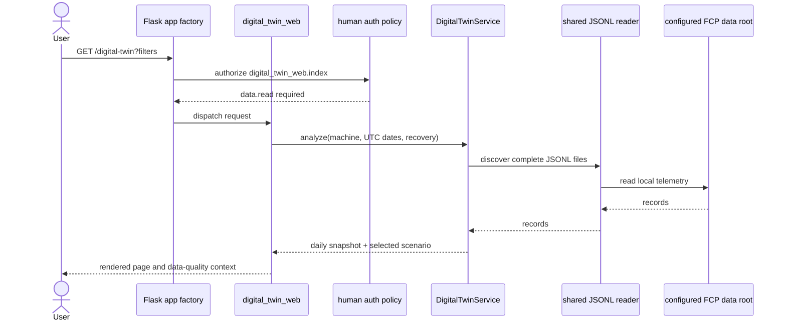

# Digital Twin What-If v1 — Design

Status: implemented

## Context

This design satisfies the requirements in
[`requirements.md`](requirements.md). The feature is a read-only historical
time model inside the existing FCP Flask workbench. It reuses the local JSONL
reader, current human authorization policy, and installed pandas/numpy
dependencies. It does not introduce a database schema, background worker, new
service, or machine connection.

## Architecture



### Components

| Component | Responsibility | Requirement trace |
| --- | --- | --- |
| `catalog/common/data_loading.py` shared reader | Discover complete JSONL files recursively and expose records | DT-01 |
| `catalog/flask_app/services/digital_twin_service.py` | Parse, classify, aggregate, cache, scope, and simulate telemetry | DT-01–DT-05, DT-08 |
| `catalog/flask_app/digital_twin_routes.py` | Parse GET filters, translate errors, call service, render page | DT-04–DT-06 |
| `catalog/flask_app/app.py` | Read `FCP_DATA_ROOT` configuration and register blueprint | DT-06–DT-07 |
| `catalog/flask_app/auth/policy.py` | Require existing `data.read` permission | DT-07 |
| `catalog/flask_app/templates/digital_twin.html`, `static/css/digital-twin.css` | Filters, metrics, state breakdown, assumptions, empty/error states | DT-04–DT-06 |
| `catalog/flask_app/templates/base.html` | Add the route to Monitor navigation | DT-06 |

## Data flow and model

1. Resolve the data root from Flask config `FCP_DATA_ROOT` (environment-backed
   by default); use `data/` when it is unset.
2. Discover complete JSONL inputs recursively via the shared data-loading
   helpers. The combined source limit is 2 GiB. Compute a source fingerprint
   from file path, modified time, and size.
3. Read machine identifier, timestamp, execution, spindle speed (`Srpm`) and
   load (`Sload`). Parse timestamps as UTC; drop invalid timestamps or blank
   machine identifiers.
4. Classify rows with recognized execution states first. Only missing or
   explicitly unavailable execution permits numeric signal fallback; an
   unrecognized execution state remains unclassified.
5. Sort by machine and timestamp. Attribute each adjacent interval to the
   starting record's state. Exclude non-positive intervals and intervals
   outside the inclusive 0.1–30 second analysis window. Track positive,
   usable, and long-gap counts separately.
6. Split usable intervals at UTC midnight and build process-local daily
   aggregates for state seconds, classified interval counts, and data quality.
7. For a request, filter the aggregates by selected machine and inclusive UTC
   date range. Default the dates to the selected machine's full recorded
   history. Default the machine to the machine with greatest modeled history.
8. Validate recovery as an integer 5-point step from 0 to 50. Return observed
   aggregates for every scope; return scenario shares only after 30 or more
   classified intervals.
9. Render results. Round for display only; retain full precision in the model.

For a sufficient scope:

```text
observed_time = active_time + non_active_time
recovered_time = non_active_time × recovery_percent / 100
simulated_active_time = active_time + recovered_time
simulated_active_share = simulated_active_time / observed_time
active_share_change_pp = (simulated_active_share - observed_active_share) × 100
```

The scenario preserves observed classified time and reallocates a portion of
non-active time. It does not extrapolate beyond that accounting identity.

## State and interval rules

- Active execution: `ACTIVE`, `EXECUTING`.
- Non-active execution: `STOPPED`, `PROGRAM_STOPPED`, `READY`, `INTERRUPTED`,
  `FEED_HOLD`, `FEEDHOLD`, `IDLE`, `HOLD`, `PAUSED`.
- Fallback applies only for missing/unavailable execution when at least one of
  `Srpm` or `Sload` is numeric. `Srpm > 100` or `Sload > 1` means active;
  otherwise non-active.
- Unknown execution values are unclassified, even when signals exist.
- Continuity is the count of positive adjacent intervals between 0.1 and 30
  seconds divided by all positive adjacent intervals.
- A long gap is excluded and reported; it is never presumed to be downtime.
- A scope with fewer than 30 classified intervals has no simulated share.

## Interfaces and failure handling

- Web interface: authenticated `GET /digital-twin`; filters are query
  parameters `machine_id`, `start_date`, `end_date`, and `recovery_percent`.
- Service interface: `DigitalTwinService.analyze(...)` returns machine
  choices, scope, observed totals, data quality, state breakdown, and scenario
  values in a dictionary.
- Invalid user filters return HTTP 400 with an explanatory validation message.
- A missing telemetry root returns a valid empty model. A source read failure
  or corpus larger than 2 GiB returns a data-unavailable page (HTTP 503).
- Snapshot data is process-local. A source inventory check is cached for 30
  seconds; a changed fingerprint rebuilds the in-memory summary.

## Access and operational constraints

- Route authorization is provided by the established human policy mapping for
  `digital_twin_web.index` to `data.read`.
- The route exposes GET only. The service does not mutate the source corpus,
  enqueue work, access a machine, or control a recorder.
- No new runtime dependencies or persistent storage are introduced.
- The analysis limit is 2 GiB of source files. The current implementation
  builds the source snapshot in process memory, so deployment sizing must be
  consistent with the host's available memory and actual corpus.

## Verification design

- Service tests exercise JSONL discovery, upload hiding, state precedence and
  fallback, interval bounds, UTC midnight splitting, filters, scenario math,
  minimum sample count, source-size failure, and input validation.
- Route tests exercise empty, populated, invalid, and unavailable states,
  Monitor navigation, GET-only behavior, and the `data.read` mapping.
- Existing-corpus evaluation checks data scope and the 0%, 10%, and 50%
  accounting identities. Results and limits are recorded in the evaluation
  report linked from `requirements.md`.

## Requirement traceability

| Requirement | Design elements |
| --- | --- |
| DT-01 | Shared reader, configured root, record parsing |
| DT-02 | State classification rules |
| DT-03 | Per-machine interval accounting, UTC daily aggregation, quality metrics |
| DT-04 | Bounded scenario math and minimum interval threshold |
| DT-05 | Request scoping and defaults |
| DT-06 | Blueprint, template, navigation, and page states |
| DT-07 | Human authorization mapping and read-only GET boundary |
| DT-08 | Existing-corpus verification plan |
