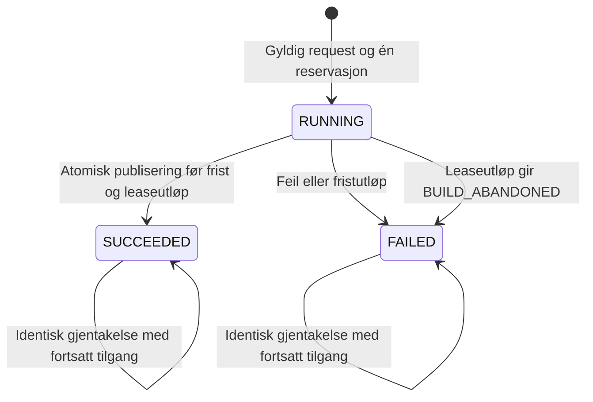

# Atferdskontrakt for første leveranse av prosesstvillingen

| Metadata | Verdi |
| --- | --- |
| Status | Bindende kontrakt for bestilt historikkimplementasjon; lokal kode og gjenstående kvalifisering er beskrevet i [implementasjonsstatus](../roadmap/v1_0_1_implementation.md), ikke erklært akseptert av dette dokumentet |
| Virkeområde | Historikkleveransen i [kravspesifikasjonen](production_process_digital_twin_requirements.md) |
| Samlet funksjon | [F01–F14 i kravspesifikasjonen](production_process_digital_twin_requirements.md#f01-hva-tvillingen-gjør-fra-start-til-slutt) beskriver beslutning, rapportert handling, resultat, oppfølging og sammenligning utover historikkleveransen |
| Formål | Én bestemt observerbar oppførsel for hver støttet operasjon, normaltilstand og feilklasse |
| Implementasjonsgrunnlag | Eksisterende funksjoner i kravspesifikasjonens E01–E09 skal gjenbrukes |
| Konfidensialitet | Kun kontraktfelt og konstruerte eksempler; ingen produksjonsdatoer, identiteter, verdier eller inventarer |

## B01. Bindende avgrensninger i dette forslaget

Ordene SKAL og tabellverdiene nedenfor angir den valgte oppførselen i
utkastet. Utvikleren skal ikke velge mellom alternative produktoppførsler.
Interne klassenavn, databaseindekser og gjenbruk av eksisterende kode kan
velges så lenge hele kontrakten oppfylles.

Dette dokumentet presiserer første leveranse. Ved motstrid med tidligere
foreslåtte detaljer i produktbeskrivelsen eller planen gjelder disse
presiseringene for denne leveransen. Definisjonen av digital tvilling og
kravene til konfidensialitet og legitim autoritet endres ikke.

| Tema | Valgt oppførsel |
| --- | --- |
| Faktisk motpart | Én avgrenset produksjonsprosess med én maskinbinding per definisjonsrevisjon; operatørkunnskap er egen kilde |
| Maskingrunnlag | Ett registrert inngangsgrunnlag og én datasett-revisjon per snapshot; én Device på én Agent-instans ved kanonisk input |
| Flere datasett/maskiner | Avvises i samme bestilling; separate snapshots kan åpnes hver for seg. Ingen union eller sammenligning i første leveranse |
| Historikkmodus | Bare `HISTORICAL`; andre moduser avvises |
| Klargjøring | Eksplisitt bestilling fryser kilderevisjon. GET oppretter ikke kilderevisjon eller snapshot |
| Definisjonsregistrering | Eksplisitte metadata-POST-er med `data.read` og `workflow.run`; ingen anonym bootstrap og ingen generell CRUD |
| Analyse | Eksplisitt POST med `data.read` og `analysis.run` |
| Prosesshendelser | Eksisterende menneskeregistreringer og relasjoner kan leses. Nye beslutninger, handlinger og resultater kan ikke registreres her |
| Segmentering | Eksisterende kanonisk/operasjonell semantikk beholdes. DT gjør ikke ny segmentering ved vanlig sidevisning |
| Legacy | Gjenbruk eksisterende dagbasert oppsummering; bare hele UTC-døgn; ingen kanonisk episodevisning |
| Nye numeriske modeller | Ingen baseline, avvik, prediksjon eller ny simulering |
| Ekstern kommunikasjon | Ingen ny nettverksforespørsel som følge av disse operasjonene; tilgjengelig lokalt grunnlag brukes eller forespørselen avvises |
| Bevaring | Ingen automatisk sletting av kilder, tidligere resultater, feil eller mislykkede byggartefakter |

Metadata-rutene og klargjøringsoperasjonen nedenfor lukker et hull i det
tidligere forslaget om «avgrensede applikasjonskommandoer» uten angitt
inngang. Dette er et eksplisitt forslag til produktatferd; det bestiller
ikke maskinoppsett, kildeaktivering, synkronisering eller nye grants.

## B02. Felles verdiregler og faste grenser

### B02.1 Representasjon

- Request er et UTF-8 JSON-objekt med `Content-Type: application/json`.
  Objekt, felt og enum er versjonert og skiller store/små bokstaver.
- Alle felt som er angitt som obligatoriske skal finnes. Et felt som ikke
  er oppført i sin kontrakt, dupliserte JSON-nøkler og ekstra queryparametere
  avvises. `null` er bare tillatt der tabellen uttrykkelig tillater det.
- Ukjent enumverdi gir `400 INVALID_REQUEST`. Kjente moduser `LIVE` og
  `REPLAY`, eller en kjent egenskap/visning som ikke støttes for valgt
  kilde, følger den spesifikke `422`-regelen. Tom datasettliste gir `400`;
  en liste med flere gyldige referanser følger flerdatasettregelen.
- Queryparametere kan forekomme én gang hver. `limit` skrives som
  desimale sifre uten fortegn, desimalpunkt eller ledende nuller. Verdi
  utenfor 1–500 gir `400 INVALID_REQUEST`, ikke automatisk justering.
- ID-er behandles som ugjennomsiktige strenger. Kildesti, URL, navn og
  klientens «actor» skal ikke brukes som ID eller som registeroppslag.
- Genererte objekt-ID-er har prefiks og 32 små heksadesimale tegn.
  Prefiks er `in_`, `ds_`, `tw_`, `sn_`, `cmd_`, `row_`, `rec_` eller `ev_`.
  Revisjoner er `rev_` etterfulgt av 64 små heksadesimale tegn.
  Eksisterende kilde-ID-er beholdes i beskyttet proveniens; de blir ikke
  offentlig objektidentitet ved å kopieres inn i URL.
- Tidsverdier i nye requests bruker UTC-formen
  `YYYY-MM-DDTHH:mm:ss.ffffffZ`, nøyaktig seks mikrosekundsiffer.
  Kalenderen skal være gyldig; skuddsekund og andre offset-former avvises.
  Sammenligning skjer som heltallsmikrosekunder, uten flyttallsavrunding.
- Strenger lagres uendret etter gyldig UTF-8-dekoding. Det foretas ingen
  automatisk trimming, navnesammenslåing eller Unicode-normalisering.
  Et obligatorisk tekstfelt med bare Unicode-whitespace avvises.
- Tall skal være endelige. Boolsk verdi godtas ikke som heltall.
  Manglende verdi representeres som `null` sammen med en navngitt årsak,
  aldri som NaN, tom streng eller oppdiktet nullmåling.
- Responser har alle oppførte felt. Ingen respons skal ekkoe et ugyldig
  feltinnhold, en filsti, en kilde-URL eller et internt unntak.

### B02.2 Grenser for kontraktversjon 1

Disse verdiene er konkrete produktforslag, ikke målinger eller grenser
utledet fra private data. Grensene kan senere endres med en navngitt
kontrakt-/policyrevisjon; de skal ikke endres lydløst per request.

| Parameter | Verdi og grenseatferd |
| --- | --- |
| Request-body | Maksimalt 65 536 byte før dekoding; større gir `413 REQUEST_TOO_LARGE` |
| Idempotensnøkkel | 16–128 ASCII-tegn fra bokstaver, sifre, bindestrek og understrek |
| Navn | 1–120 Unicode-tegn og maksimalt 480 UTF-8-byte |
| Beskrivende tekst | 1–4 096 UTF-8-byte per felt |
| Mål | 1–4 forskjellige målkoder fra B04 |
| Egenskaper | 1–4 forskjellige egenskapskoder fra B04 |
| Primærinput | Nøyaktig én; kanonisk input gjelder én Device/Agent-instans |
| Operatørinput | Ingen eller nøyaktig én lokalt lesbar samling |
| Snapshotvindu | `0 < end_at - start_at <= 2 678 400 000 000` mikrosekunder, tilsvarende 31 døgn |
| Kildefiler | Maksimalt 2 147 483 648 byte samlet i én klargjøring |
| Kildeposter | Maksimalt 2 000 000 observerte/inkluderte poster per klargjøring; én ekstra post gir grensefeil, ikke trunkering |
| Eget byggartefakt | Maksimalt 536 870 912 byte per klargjøring/snapshot/gjenoppbygging, inkludert staging |
| Plass før bygg | Minst 603 979 776 byte tilgjengelig på målvolumet, lik artefaktgrense pluss 64 MiB reserve |
| Ekstra byggminne | Maksimalt 536 870 912 byte økning fra prosessens målte RSS ved byggstart |
| Byggetid | Maksimalt 120 sekunder målt med monoton klokke fra reservert kommando til før publisering |
| Tung bygging | Maksimalt én aktiv klargjøring/snapshotbygging/gjenoppbygging per installasjon |
| Bygglease | 150 sekunder; utløp sperrer videre publisering fra den gamle byggingen |
| Sidegrense | Heltall 1–500; standard 100; ingen stille klamping |
| Evidensinnhold | Maksimalt 65 536 UTF-8-byte normalisert tekst per oppslag; større innhold gir `413 EVIDENCE_TOO_LARGE`, ikke umerket avkutting |
| Sideytelse | p95 under 2 sekunder for ferdigbygd episodeside etter oppskriften i B15 |

Ressurskontroller skal gjøres før publisering, minst hver 100 ms under
iterativt arbeid og før/etter et blokkerende lageroppslag. En operasjon som
ikke kan stoppes ved fristen, skal være sperret fra senere publisering.
Ingen grensefeil gir automatisk retry, opprydding eller ny bakgrunnsjobb.

## B03. Inngangsregister og eksplisitt klargjøring

### B03.1 Hva et inngangsgrunnlag er

`GET /inputs` leser bare eksisterende serverkonfigurerte kilder under
applikasjonens tillatte datarøtter. Kilderegister, Recorder-konfigurasjon,
eksisterende lageridentitet og lokal autoritativ operatør-/kunnskapslagring
gjenbrukes. DT skal ikke oppdage nye nettverkskilder eller ta en filsti fra
klienten. Filsymlinker som løser utenfor den tillatte roten er ikke gyldig input.

Hvert autorisert input beskrives med følgende felter:

| Felt | Verdi |
| --- | --- |
| `input_id` | Stabil ugjennomsiktig ID for den eksisterende registrerte kilden |
| `binding_revision` | Revisjon av eksisterende kilde-/Device-binding; ikke et bevis for at data er uendret |
| `kind` | `CANONICAL_DEVICE`, `LEGACY_JSONL` eller `OPERATOR_RECORDS` |
| `display_name` | Beskyttet visningstekst fra kildeinventaret; aldri en identitetsregel |
| `can_prepare` | `true` bare når gjeldende datatilgang og lokal lesekontrakt er tilgjengelig |
| `reason_codes` | Sortert liste etter B09; tom når `can_prepare=true` |

Listen utelater kilder brukeren ikke har rett til å vite om. En autorisert,
men teknisk utilgjengelig kilde kan vises med `can_prepare=false`. Mangler
hele det eksisterende registeret/lesekontrakten, returneres
`503 INPUT_REGISTRY_UNAVAILABLE`; en tom liste brukes bare når registeret
faktisk er lest og ingen synlige registreringer finnes.

En eksisterende autoritativ delt samling som krever nettverk, skjult cache-
skriving eller synkronisering, får `can_prepare=false` og
`LOCAL_REVISION_NOT_VERIFIABLE`. DT skal ikke lese en tilfeldig lokal fil som
erstatning for samlingens autoritative innhold.

### B03.2 Bestill klargjøring: `POST /dataset-revisions`

Alle feltene nedenfor kreves, også når operatørinput er `null`:

| Felt | Type og regel |
| --- | --- |
| `schema` | Streng, nøyaktig `fcp.process_twin.prepare.v1` |
| `input_id` | Synlig maskininput fra registeret |
| `expected_binding_revision` | Revisjonen som ble vist ved valget |
| `operator_input_id` | Synlig `OPERATOR_RECORDS`-input eller `null` |
| `expected_operator_binding_revision` | Revisjon når operatørinput er valgt, ellers `null` |
| `time_policy` | `SOURCE_UTC`, `ASSUME_UTC` eller `UNRESOLVED` |

`SOURCE_UTC` godtas bare når den faktiske kilderepresentasjonen og den
registrerte klokkebindingen dokumenterer UTC-normalisering. At en parser
kan lage et UTC-tidspunkt er ikke nok. `ASSUME_UTC` er en eksplisitt
menneskelig antakelse for naiv legacy-tid; den godtas bare for
`LEGACY_JSONL`. `UNRESOLVED` bevarer at tidspunkt ikke kan normaliseres.
Ingen tidsregel kan gjøre kildens målenøyaktighet faglig validert.

Etter B05-validering kjører klargjøringen følgende i denne rekkefølgen:

1. Lås valgt eksisterende kilde-/Device-binding mot den forventede revisjonen.
2. Les bare støttet schema gjennom lesebaner uten initialisering, migrering,
   opptak eller nettverkskall. Bruk konsistent SQLite-lesing der det gjelder.
3. Kontroller grenser, eksisterende kildeintegritet og kildeopprinnelse.
   Ukjent opprinnelse lagres som ukjent; den gis eget datasettomfang.
4. Bind kanoniske observasjoner for hele den valgte Agent-instansen før
   Device-filtrering. Bevar råbatchdigester og eksisterende segmenterings-
   input-/outputfingeravtrykk og policy. Godta ikke en annen Agent som reserve.
5. For legacy: bind sortert relativt filinventar, eksakte innholdsdigester og
   eksisterende parser-/klassifiseringspolicy. Identiske kopier av samme
   dokumenterte opptak refereres som én logisk kilde med bevarte kopireferanser.
   Uavklart overlapping gir `422 OVERLAP_UNRESOLVED`; første fil vinner ikke.
6. Når operatørinput er valgt: frys bare poster brukeren har tilgang til,
   deres faktiske innhold/revisjon og eksplisitte relasjoner. Ingen krysskobling
   utledes fra navn eller klokkeslett. Poster som ikke kan leses, skal ikke
   påvirke synlige antall eller bli tatt med i manifestet.
7. Kontroller at binding og de leste innholdsrevisjonene fortsatt svarer til
   det konsistente lesebildet. Uavklart blanding gir `409 SOURCE_CHANGED`.
8. Publiser ett uforanderlig datasett-revisjonsmanifest og nødvendige bevarte
   kilderepresentasjoner i DTs beskyttede lagring. Manifestet kopierer
   proveniens, aldri autorisasjon, grants, nøkler eller Federation-autoritet.

Suksess gir `201` med `dataset_id`, `dataset_revision_id`, begge inputbindinger,
`kind`, `time_policy`, `created_at`, `created_by`, tilgjengelige tidsgrenser
eller `null`, `source_references`, `operator_record_count` eller `null` når
ingen samling ble valgt, `integrity_status`, `reason_codes` og `command_id`.
Alle disse feltene kreves. Tall/metadata i dette svaret er konfidensielle.
Digestavvik gir `422 SOURCE_INTEGRITY_FAILED`. En kildeparser som avviser
selve innholdet gir `422 SOURCE_CONTENT_INVALID`. Eksisterende kildeposter
som allerede er forkastet av eiermodulens dokumenterte policy, skal ikke
tas inn igjen av DT; de opprinnelige forkastelsene bevares som kildegrunnlag.
`integrity_status` er `VERIFIED` når de bundne byte-/postrevisjonene er
kontrollert; en integritetsfeil publiseres ikke som en vellykket revisjon.
`origin_status` skal i tillegg være `KNOWN` eller `UNKNOWN`. Ukjent
opprinnelse er ikke en vellykket bekreftelse av felles historikk.
GET på revisjonen returnerer de samme feltene, men `source_references`
inneholder bare ugjennomsiktige evidensreferanser, ikke rå filinventar,
private filnavn eller kilde-URL-er. POST gir samme begrensede form.

Identisk innhold og binding med en ny bestillingsnøkkel gjenbruker den
eksisterende uforanderlige revisjonen, inkludert dens opprinnelige
`created_at`, `created_by` og `command_id`. Den nye bestillingen får egen
kommando-/auditpost og peker til samme revisjon. En kildepersons metadata
overskrives ikke fordi en annen bruker klargjør samme innhold.

Et gammelt manifest forblir gyldig som historisk revisjon når kilden vokser,
så lenge de eksakte bundne dataene fortsatt kan leses eller er bevart.
Uavklart erstatning av bundet innhold gir konflikt ved senere bygging.

## B04. Registrer tvillingen og bestill historikk

### B04.1 `POST /twins`

Kommandoen krever `data.read`, `workflow.run` og datatilgang til den klargjorte
revisjonen. Den oppretter bare definisjon/binding i eget lager.

| Felt | Obligatorisk verdi |
| --- | --- |
| `schema` | `fcp.process_twin.definition.v1` |
| `display_name` | Navn etter B02 |
| `counterpart_kind` | `PRODUCTION_PROCESS` |
| `counterpart_description` | Beskrivende tekst etter B02 |
| `process_boundary` | Beskrivende tekst etter B02 |
| `dataset_revision_id` | Eksisterende autorisert klargjort revisjon |
| `goals` | Ikke-tom liste uten duplikater fra `PROCESS_HISTORY`, `PROVENANCE`, `DATA_QUALITY`, `OPERATOR_CONTEXT` |
| `properties` | Ikke-tom liste uten duplikater fra `EXECUTION_HISTORY`, `OPERATIONAL_EPISODES`, `OPERATOR_RECORDS`, `EVIDENCE` |
| `role_profile` | Objekt med nøyaktig `observer=SYSTEM`, `analyst=SYSTEM_DESCRIPTIVE`, `decision_maker=HUMAN`, `executor=HUMAN` |
| `validity_scope` | Beskrivende tekst etter B02; en bruksavgrensning, ikke en valideringspåstand |

Maskinbinding og tillatte tjenester beregnes fra den valgte revisjonen og
disse kodene. For kanonisk input kreves hele settet med de fire oppførte
egenskapene; for legacy kreves nøyaktig settet uten `OPERATIONAL_EPISODES`.
Et annet sett av kjente koder gir `422 PROPERTY_NOT_SUPPORTED`.
UI viser denne faste egenskapsprofilen uten å kunne slå av kildevern eller
evidens. `allowed_services` er nøyaktig `history`, `operator_knowledge`
og `evidence`; målkodene er formålsbeskrivelser, ikke ekstra rettigheter.
Klienten kan ikke legge til ekstra maskiner eller tjenester.
`OPERATIONAL_EPISODES` med legacy-input avvises som
`422 PROPERTY_NOT_SUPPORTED`; øvrige egenskaper kan brukes med synlige mangler.
`OPERATOR_RECORDS` uten valgt operatørinput er lovlig: tjenesten skal da vise
at input ikke er valgt. Produktet skal ikke late som registreringer finnes.

Suksess gir `201` med `twin_id`, `definition_revision_id`,
`previous_revision_id=null`, alle normaliserte definisjonsfelt,
`input_binding`, `operator_binding` eller `null`, `allowed_services`,
`created_at`, `created_by` og `command_id`.

### B04.2 `POST /twins/{id}/revisions`

Request består av `expected_revision_id` og et `definition`-objekt med hele
formen over. Ingen PATCH/delfelter godtas. Dersom forventet revisjon ikke er
tvillingens siste registrerte revisjon, gis `409 DEFINITION_CHANGED`.
Suksess oppretter ny revisjon og peker på den gamle. Den gamle slettes ikke.
Samme innhold ved ny idempotensnøkkel gir `409 NO_DEFINITION_CHANGE`.
Eksisterende snapshots bytter aldri til den nye definisjonen automatisk.

### B04.3 `POST /twins/{id}/snapshots`

| Felt | Obligatorisk verdi |
| --- | --- |
| `schema` | `fcp.process_twin.snapshot_request.v1` |
| `definition_revision_id` | En eksisterende revisjon av den valgte tvillingen, ikke nødvendigvis den nyeste |
| `dataset_revision_ids` | Liste med nøyaktig én klargjort revisjon |
| `window` | Objekt med nøyaktig `start_at` og `end_at` etter B02 |
| `data_mode` | `HISTORICAL` |

Datasettets input-/Device-/operatørbinding skal være lik definisjonens.
En nyere dataversjon med samme binding er tillatt; annen binding gir
`422 BINDING_MISMATCH`. Flere datasett gir
`422 MULTI_DATASET_NOT_SUPPORTED`. Byggingen skal ikke bytte til siste
tilgjengelige revisjon hvis den bestilte ikke kan leses.

Kanonisk tidsvindu kan avgrenses til mikrosekund. Legacy krever at begge
grenser er UTC-midnatt; ellers `422 LEGACY_WINDOW_NOT_DAY_ALIGNED`.
`UNRESOLVED` kildetid gir et faktisk snapshot med
`UNRESOLVED_CONTEXT/SOURCE_TIME_UNRESOLVED`, ingen filtrert tidslinje og
ingen varighetsverdier. Det gjøres ingen skjult tidsantakelse.

## B05. Validering, feilprioritet og kommandoer

### B05.1 Felles kontrollrekkefølge

Første feil i følgende rekkefølge bestemmer svaret. En feilet kontroll skal
ikke undersøke et mer sensitivt objekt for å gi en mer detaljert feil.

| Trinn | Kontroll | Resultat ved feil |
| --- | --- | --- |
| 0 | Finn kjent rute og støttet metode | Ukjent rute: `404 ROUTE_NOT_FOUND`; kjent rute med feil metode: `405 METHOD_NOT_ALLOWED` og `Allow` |
| 0a | Sentral menneskelig autentisering er aktiv og tilgjengelig for DT | `503 AUTHENTICATION_UNAVAILABLE`; ingen utviklingsomgåelse |
| 1 | Gyldig, aktiv menneskelig sesjon | `401 AUTHENTICATION_REQUIRED` |
| 2 | Krevde sentrale rettigheter | `403 PERMISSION_REQUIRED`; ingen objektsøk |
| 3 | POST: gyldig eksisterende CSRF-token | `400 CSRF_INVALID` |
| 4 | POST: bodygrense, Content-Type, UTF-8 og JSON | Henholdsvis `413 REQUEST_TOO_LARGE`, `415 UNSUPPORTED_MEDIA_TYPE`, `400 INVALID_JSON` |
| 5 | Syntax/schema, ID-form, felter og idempotensnøkkel | `400 INVALID_REQUEST`; feltsti kan oppgis, feltverdi skal ikke oppgis |
| 6 | Objekter og bindinger innen brukerens eksisterende datatilgang | `404 OBJECT_NOT_FOUND`; samme svar for ukjent og ikke synlig objekt |
| 7 | Statisk tids-, egenskaps- og bindingssemantikk mot de refererte uforanderlige objektene | Spesifikk `422` fra kontrakten |
| 8 | Eksisterende idempotenspost for samme operasjon/aktør/nøkkel | B05.2; ikke reserver ny kommando |
| 9 | Eget kommandolager, ledig tung byggplass og nødvendig plass etter B02 | `503 STORE_UNAVAILABLE`, `409 BUILD_BUSY` eller `507 INSUFFICIENT_STORAGE` |
| 10 | Reserver kommando og utfør B03/B04/B06/B14 | Et lagret suksess- eller feilresultat etter B05.2 |

Sammenligning med en muterbar «siste revisjon», faktisk kildeåpning og
oppdatert kildebindingskontroll skjer ved utførelse i trinn 10 og før
commit. De skal ikke overstyre et identisk ferdig idempotensresultat i
trinn 8. Tilgangskontrollen i trinn 6 skal derimot alltid gjentas først.

Alle GET-operasjoner bruker trinn 0–2, syntaxkontroll og objekt-/datatilgang
før innhold leses. `HEAD` har samme tilgang/status/headers som GET uten body.
`OPTIONS` på kjent rute krever sign-in og rutens leserett, returnerer `204`
med `Allow`, og foretar ingen dataoperasjon. Kjente POST-ruter har ikke en
anonym OPTIONS-bane. Dette registreres i eksisterende sentral policy.

### B05.2 Idempotens og samtidighet

`Idempotency-Key` kreves på hver POST. Nøkkelrommet er
`(autentisert aktør, operasjonskode, nøkkel)`. Operasjonskoder er
`PREPARE_DATASET`, `CREATE_TWIN`, `REVISE_TWIN`, `BUILD_SNAPSHOT` og
`REBUILD_INDEX`. Mål-ID og alle validerte requestfelter inngår i bodydigest.
Objektnøkler og kodelister sorteres i digest; tekst og tidsverdier bevares.
Dupliserte kodelisteverdier avvises før digestberegning.

| Eksisterende kommandostatus | Identisk request | Annen request med samme nøkkel |
| --- | --- | --- |
| Ingen | Fortsett til reservasjon | Ikke relevant |
| `RUNNING`, lease gyldig | `409 COMMAND_RUNNING`, `Retry-After: 1`; ingen ny bygging | `409 IDEMPOTENCY_CONFLICT` |
| `SUCCEEDED` | Samme opprinnelige HTTP-status, resultat og `Location` etter ny tilgangskontroll | `409 IDEMPOTENCY_CONFLICT` |
| `FAILED` | Samme lagrede HTTP-status og feil; ingen retry | `409 IDEMPOTENCY_CONFLICT` |
| `RUNNING`, lease utløpt | Behandles som `FAILED` med `503 BUILD_ABANDONED`; gammel publisering er sperret | `409 IDEMPOTENCY_CONFLICT` |

Syntaks-/tilgangsfeil før reservasjon forbruker ikke nøkkelen. Feil etter
reservasjon lagres som endelig resultat og forbruker nøkkelen. En ny
kjøring etter en slik feil krever brukerens nye eksplisitte bestilling med
ny nøkkel. Det er ikke en automatisk rerun.

To samtidige identiske requests skal maksimalt reservere én kommando.
Andre tunge kommandoer får `409 BUILD_BUSY` uten reservasjon. En metadata-
registrering kan kjøre mens en tung analyse kjører, men må fortsatt ha
revisjonskontroll ved publisering.

`GET /commands/{id}` leser bare egne kommandoer etter gjeldende kildetilgang.
`GET /commands/by-key` finner egen kommando med headeren `Idempotency-Key`
og query `operation`; ukjent nøkkel gir `404 OBJECT_NOT_FOUND`.
Et vellykket oppslag gir `200` med `command_id`, `operation`, `status`,
`created_at`, `finished_at` eller `null`, `result_location` eller `null`,
`original_http_status` eller `null` og `error` eller `null`.
Dette lar klienten avklare brutt forbindelse uten å bestille ny analyse.
Et gjentatt ferdig resultat bevarer opprinnelig `data`/`error`, HTTP-status
og `Location`. `meta.request_id`, `meta.evaluated_at` og aktuell teknisk
tilgjengelighet gjelder den nye forespørselen; disse er ikke historisk innhold.

En terminal kommando bytter aldri til RUNNING. Ny bestilling er et nytt
kommandoforløp; gammel feil eller suksess bevares.

## B06. Snapshotets innhold og publisering

### B06.1 Byggerekkefølge

1. Les nøyaktig definisjons- og datasett-revisjon fra bestillingen.
2. Kontroller aktuell rett til alle bidragende kilder og menneskeposter.
   Autorisasjon kopieres ikke fra manifestet.
3. Les konsistent eksisterende kanonisk/operasjonelt grunnlag eller bevart
   eksakt revisjon. Sammenlign Agent, policy og faktisk inputfingeravtrykk
   med den valgte operasjonelle projeksjonen. Et tilfeldig likt maksimalt
   sekvenstall er ikke tilstrekkelig.
4. Ved ikke samsvar: `409 PROJECTION_REVISION_MISMATCH`; ingen snapshot.
   Det skal ikke startes ny Recorder-/segmenteringsjobb for å få samsvar.
5. Bygg visningsobjekter etter B07–B09; lagre originalreferanser og bare det
   innholdet som kreves for historisk gjengivelse og kontrollerbar evidens.
6. Kontroller grenser, lease, forventede definisjons-/bindingsreferanser,
   kildekonsistens og aktuell tilgang på nytt før publisering.
7. Publiser snapshotmanifest, fullstendig lesemodell og suksess-audit gjennom
   én synlig commitgrense. Ikke krev at ulike eksisterende kildedatabaser
   kan skrives som én transaksjon; de skal ikke skrives.

Hvis klientforbindelsen brytes, er kommandooppslaget fasit for om det ble
publisert. En snapshot som ble publisert før bruddet skal ikke bygges igjen
av samme nøkkel. Hvis lease/fristen er passert før commit, skal ingen senere
respons eller gammel prosess kunne publisere resultatet.

### B06.2 Obligatorisk snapshotrespons

`POST`-suksess og `GET /snapshots/{id}` bruker samme `data`-form:

| Felt | Innhold |
| --- | --- |
| `snapshot_id`, `twin_id`, `definition_revision_id` | Eksakte referanser |
| `dataset_revision_ids` | Én revisjon, som i request |
| `data_mode` | `HISTORICAL` |
| `source_kind`, `time_policy` | Fra det klargjorte datasettet |
| `window` | Eksakte start-/sluttverdier fra request |
| `captured_at`, `created_by`, `command_id` | Serverbundet registreringsgrunnlag |
| `first_observed_at`, `last_observed_at` | Kjent normalisert tid eller `null`; aldri satt lik `captured_at` som reserve |
| `content_revision` | Digest av logisk innhold, policyer og kilde-/notatrevisjoner |
| `services` | Alle tjenester i B09, hver med status og årsaker |
| `summary` | Felt og nullregler i B07 |
| `counts` | Totalt antall per støttet visning; `null` for en ustøttet/ikke vurderbar visning |
| `available_views` | Tillatte visningskoder fra B07 |
| `model_validity` | `NOT_ASSESSED` i denne leveransen; ingen import av en generell «validert»-påstand |

Vurderingstid for hvor gammel historikken er returneres i responsens
`meta.evaluated_at`, ikke som omskrevet historisk innhold. Ingen request
skriver «sist åpnet» inn i snapshotet.
`counts` har nøyaktig nøklene `episodes`, `execution`, `gaps`, `operator`,
`legacy_daily`, `unplaced_primary_records` og `unplaced_operator_records`.
Hver verdi er et kjent ikke-negativt heltall eller `null` når den ikke er
vurderbar/støttet. Ingen operatørinput gir `operator=null` og
`unplaced_operator_records=null`; et faktisk vurdert tomt utvalg gir `0`.
Første/siste observasjonstid gjelder primærinputets faktisk plasserte
observasjoner innen `[a,b)`, etter Device-filter. Evidens brukt til å
dokumentere en grense eller kontinuitet fra utenfor vinduet endrer ikke
disse feltene. Begge kan være `null` selv om et kildeunderbygd intervall
dekker vinduet uten en punktobservasjon inni.

### B06.3 Eksakt digestgrunnlag

Gjenbruk eksisterende `canonical_sha256`-serialisering: JSON med sorterte
objektnøkler, UTF-8, `ensure_ascii=False` og skilletegn komma/kolon uten
ekstra mellomrom. NaN/uendelig avvises før serialisering.

Snapshotets logiske digestgrunnlag har disse feltene: `contract_version`,
`source_bindings`, `source_content_digests`, `definition_content`,
`window_us`, `time_policy`, `transformation_versions`, `rows_by_view`,
`links`, `operator_source_revisions`, `services` og `summary_integer_values`.
Hver liste følger den fastsatte rekkefølgen i kontrakten. Referanser til
rader/relasjoner i dette grunnlaget bruker stabile kilde-/innholdsreferanser,
ikke tilfeldige nye objekt-ID-er. Definisjonsinnhold uten registreringsmetadata
inngår. Forfatter og faktisk hendelsestid i en kilderegistrering inngår som
kildeinnhold. Byggetid, request-ID, ny server-ID, lease, indeksplassering og
aktuell ferskhetsvurdering inngår ikke. `active_share` beregnes fra de to
heltallene og inngår ikke som et separat avrundet flyttall i digesten.

Dette fastsetter hva «samme logiske resultat» betyr ved gjentatt bygging
og gjenoppbygging. Lik kildefilstørrelse eller likt filtidspunkt er ikke en
erstatning for dette innholdsgrunnlaget.

## B07. Utvalg, rekkefølge og beregninger

### B07.1 Tidsutvalg og klipping

- Intervallet er halvåpent `[a,b)`. En punkthendelse med tid `a` inkluderes;
  en med tid `b` utelates. Ingen avrunding til sekund eller døgn for kanonisk input.
- Et segment med `[s,e)` tas med når `max(a,s) < min(b,e)`.
  Segment med `s=e` behandles som punkthendelse. Segment uten kjent slutt
  forlenges ikke; eksisterende kjent observasjonsgrense brukes bare når
  kildekontrakten faktisk gir den.
- Originale grenser, klassifikasjon og `partial_start`/`partial_end`
  beholdes. Egen `visible_start_at`, `visible_end_at`,
  `clipped_start` og `clipped_end` beskriver vindusklipping.
- Det skal ikke settes nye segmentgrenser eller «bekreftede deler» fordi
  vinduet starter midt i en eksisterende episode.
- Kontekst fra før vinduet kan bare brukes når eksisterende tidslinje
  dokumenterer kontinuiteten inn i vinduet. Brudd bryter arving.
- Varigheter for den synlige delen beregnes fra eksisterende tidslinjes
  tilstandsintervaller og deres skjæring med vinduet. En delvis episode skal
  ikke få proporsjonalt skalert totalvarighet uten slikt intervallgrunnlag.
- Ukjent klokke gir ingen tidsfiltrerte poster. Poster med ufortolkbar tid
  telles separat som `unplaced_count` hvis opprinnelse/sekvens er kjent;
  de plasseres ikke ved tidspunkt null eller dagens tid.

### B07.2 Visninger og rader

`GET /snapshots/{id}/timeline` har bare `view`, `limit` og `cursor`.

| `view` | Innhold og fast rekkefølge |
| --- | --- |
| `episodes` | Kanoniske episoder; stigende original `start_sequence`, deretter original segmentfingeravtrykk |
| `execution` | Eksisterende kanoniske tilstandsintervaller; stigende startsekvens, deretter sluttsekvens og rad-ID |
| `gaps` | Opprinnelige Agent-sekvenshull og tidsregresjoner; stigende sekvensposisjon, deretter årsakskode og rad-ID |
| `operator` | Bare eksplisitt relaterte poster og ulenkede poster i det valgte inputet; kjente `occurred_at` stigende, ellers kjente `recorded_at`, ellers sist, med post-ID som tiebreaker |
| `legacy_daily` | Eksisterende døgnoppsummeringer; stigende UTC-døgn |

Standard er `episodes` for kanonisk input og `legacy_daily` for legacy.
Ustøttet visning gir `422 VIEW_NOT_SUPPORTED`; API-et bytter ikke visning
automatisk. Ukjent visningskode gir `400 INVALID_REQUEST`.

Hver rad har `row_id`, `row_kind`, `source_ref`, `claim_class`,
`original_start_at`, `original_end_at`, `visible_start_at`, `visible_end_at`,
`clipped_start`, `clipped_end`, `classification` eller `null`,
`context`, `reason_codes`, `evidence_refs` og `metrics`.
Tid som ikke gjelder radtypen er `null`. `context` bevarer verdier sammen
med kilde-/ukjentstatus; ingen nødvendig verdi erstattes av tom streng.
`metrics` er `null` for gap/punktposter uten målbart intervall.
`row_kind` er henholdsvis `EPISODE`, `EXECUTION_SPAN`, `DISCONTINUITY`,
`OPERATOR_RECORD` og `LEGACY_DAY` for de fem visningene. `metrics` bruker
de samme varighetsnavnene og nullreglene som `summary`, men bare for raden.
`context` har `values` og `pending_roles`. `values` viderefører eksisterende
ContextValue-felt `role`, `value`, `available`, `sequence`, `observed_at`,
`observed_at_us`, `data_item_id`; `pending_roles` bevarer uavklart semantikk.
Synlige kildekoder og klassifikasjoner fra eksisterende lag gjengis
uendret med kildeversjon; de brukes ikke som nye DT-autorisasjonsregler.

Episodeoppslag returnerer samme rad og i tillegg original run-/cycle-referanse,
originale grensebegrunnelser og relasjonsreferanser. Episode som finnes i
kilden, men ikke inngår i snapshotet, gir `404 OBJECT_NOT_FOUND`.

### B07.3 Varighet og totalsummer

`summary` har følgende faste felt, alle heltallsmikrosekunder eller `null`:

| Felt | Regel |
| --- | --- |
| `requested_duration_us` | `b-a`, også ved tomt eller uavklart datagrunnlag |
| `covered_duration_us` | Unionen av kildeunderbygde tilstandsintervaller innen vinduet; ukjent tilstand inne i en kjent dekningsperiode inngår |
| `uncovered_duration_us` | `requested_duration_us-covered_duration_us`; `null` når tidsgrunnlaget er uavklart |
| `active_us`, `program_stopped_us`, `feed_hold_us`, `other_execution_us`, `unknown_state_us` | Eksisterende klassifiserte intervallers skjæring, uten dobbeltelling |
| `active_share` | `active_us/covered_duration_us` bare når begge er kjente og dekning er positiv, ellers `null`; aldri prosent av ønsket vindu uten merking |

Ved kjent klokke og ingen dekningsintervaller er `covered_duration_us=0`,
`uncovered_duration_us=requested_duration_us`, tilstandsvarigheter og
`active_share=null`. Ved uavklart klokke er alle felt unntatt ønsket varighet
`null`. Ved positiv dekning summerer tilstandsvarighetene nøyaktig til dekning;
tilstand som faktisk er målt til null varighet kan da være `0`.
Summelikheten gjelder den kanoniske tidslinjens kjente klassifikasjon.
For legacy beholdes eksplisitt manglende metrikker etter B07.4; det skal
ikke konstrueres en restkategori for å få en slik sum til å se komplett ut.

Summer beregnes én gang over den eksisterende maskintidslinjen. Run-, cycle-
og episodevarigheter summeres ikke sammen til et nytt maskintotal, siden
objektene overlapper hierarkisk. Tilbakegående klokke som hindrer konsistent
varighet gir `null` for berørte metrikker og `DURATION_UNRESOLVED`; ingen
negativ verdi eller absoluttverdikorrigering.

`counts` og `total` er antall rader i hele den konkrete snapshotvisningen,
ikke et produksjonstall. `ACTIVE`, en episode og en tellerovergang er ikke
et antall kvalitetsgodkjente deler.

### B07.4 Legacy-presisering

Eksisterende JSONL-parser, `_Snapshot`, dagoppsummering og grensepolicy skal
gjenbrukes. Halvåpent `[start_midnight,end_midnight)` oversettes til dagens
inklusive datofilter med sluttdato lik `end_midnight - ett døgn`.
Ingen ny underdøgnsanalyse eller kanonisk episodegenerator skal opprettes.

Eksisterende ugyldige/lange legacy-intervaller beholder sine kvalitetsutfall.
Legacy-varighetsfeltene i `summary` tas bare fra eksisterende faktisk
klassifisert observasjonstid. Der tjenesten ikke leverer en metrikk, er
den `null` med `METRIC_NOT_PROVIDED`; den gjenskapes ikke fra et kakediagram
eller en antatt samplingsfrekvens. Dagens aritmetiske scenario vises fortsatt
bare på eksisterende DT-side i denne leveransen.
Eksisterende sekundverdier konverteres til heltallsmikrosekunder ved
`Decimal(str(verdi)) * 1_000_000`, avrundet til nærmeste heltall med half-even.
Dette er en enhetskonvertering, ikke økt målepresisjon; original verdi,
enhet og kvalitet beholdes som kildegrunnlag.

## B08. Operatørkunnskap og evidens

### B08.1 Eksisterende poster

Bare poster fra valgt, lokalt autoritativ operatørinput kan inngå.
Forfatter-/aktørreferanser vises bare når de inngår i brukerens datatilgang.

En post blir del av snapshotets operatørvisning når minst én av disse
betingelsene er oppfylt, i denne rekkefølgen:

1. Den har en eksisterende eksplisitt relasjon til et segment som inngår i
   snapshotet. Alle slike relasjoner beholdes, selv om postens tid er ukjent.
2. Den mangler slik relasjon, men har en eksisterende, verifisert maskinbinding
   lik definisjonens og kjent hendelsestid innen `[a,b)`. Posten vises da som
   `UNLINKED`; plassering i samme tidsvindu er ingen bekreftet relasjon.
3. Ellers inngår den ikke i tidslinjen. Snapshotmetadata skal oppgi antall
   autoriserte uplacerbare poster som `unplaced_operator_records`, uten å vise dem som
   hendelser i vinduet.

Kjent `recorded_at` alene brukes ikke som hendelsestid ved utvalg. Naiv tid
uten bekreftet operatørklokke er ukjent. Navnelikhet, fritekstens
`trace_target`, programnavn og et «worked»-felt skaper ikke en ny kanonisk
relasjon eller målt effekt. Kildens eksisterende innhold beholdes som
`HUMAN_REPORTED`, med egen kildestatus.

Hver post har `record_id`, `source_revision`, `occurred_at` eller `null`,
`recorded_at` eller `null`, `time_status`, `author_ref` eller `null`,
`source_status`, `fields`, `field_states`, `link_status`, `link_refs`
og `evidence_refs`. `time_status` er `KNOWN`, `ASSUMED` eller `UNRESOLVED`.
`fields` har nøyaktig `observation`, `trigger`, `context`, `hypothesis`,
`goal`, `decision`, `rationale`, `expected_outcome`, `outcome`, `notes`,
`review_status`, `worked` og `action_type`. Hver verdi er kildens streng
eller `null` når feltet mangler. `field_states` har samme nøkler og verdiene
`PRESENT`, `SOURCE_EMPTY` eller `MISSING`; en faktisk tom kildestreng beholdes
som tom streng med `SOURCE_EMPTY`, ikke som et oppdiktet resultat.
Øvrig originalinnhold kan bare åpnes som autorisert evidens.
`link_status` gjelder dette snapshotet og er `CONFIRMED`, `PROPOSED`,
`REJECTED`, `UNRESOLVED` eller `UNLINKED`. Ingen ny beslutning, handling
eller utfall lages ved denne visningsprojeksjonen.

En eksplisitt `ASSUMED`- eller `UNRESOLVED`-status i posten oppgraderes aldri
av samlingens UTC-binding. `ASSUMED` kan beholde den oppgitte normaliserte
tiden som metadata, men gir ingen sikker tidslinjeposisjon eller tidsbasert
utvalg. `UNRESOLVED` gir `occurred_at=null`. Begge kan inngå via en eksisterende
eksplisitt relasjon etter regel 1; registreringstid brukes bare til sortering.

### B08.2 Relasjoner

`GET /snapshots/{id}/links` returnerer eksisterende relasjoner med
`link_id`, `source_object_ref`, `target_object_ref`, begge revisjoner,
`relation_kind`, `status`, `origin` og `evidence_refs`.
Bare relasjoner med begge endepunkter innen snapshotets autoriserte
objektsett inngår. Kildestatusene `PROPOSED`, `CONFIRMED` og `REJECTED`
beholdes. Ukjent kildebetydning vises som `UNRESOLVED` med begrunnelse,
ikke som bekreftet. Første leveranse har ingen POST-rute for disse postene.

### B08.3 Evidensoppslag

`GET /snapshots/{id}/evidence/{id}` følger denne beslutningen:

1. Kontroller snapshot og alle dets bidragende datatilganger på nytt.
   Ukjent eller mistet tilgang gir `404 OBJECT_NOT_FOUND` uten kildeoppslag.
2. Kontroller at evidens-ID-en finnes i akkurat dette snapshotet.
3. Les bevart eksakt kildeinnhold hvis det finnes med matchende digest.
   Ellers les original eksakt revisjon gjennom den eksisterende lesekontrakten.
4. Ingen matchende revisjon gir `200` med
   `state=SOURCE_UNAVAILABLE`, `content=null` og årsak. En nåværende
   notattekst eller tilfeldig kopi brukes aldri som reserve.
5. Tjenesten teknisk utilgjengelig gir `503 SOURCE_STORE_UNAVAILABLE`.
   For stor evidens gir `413 EVIDENCE_TOO_LARGE`.
6. Matchende innhold gir `200` med `state=AVAILABLE`, `evidence_id`,
   `source_revision`, `locator`, `claim_class`, `content`, `content_digest`
   og `reason_codes=[]`. Innhold er normalisert tekst, aldri en automatisk
   nedlasting eller kjørbar fil. Rå kildefilsti returneres ikke.

Bevart innhold gir aldri egen autoritet. Kan aktuell datatilgang ikke
kontrolleres uten nettverk, gis `503 AUTHORIZATION_UNAVAILABLE` og ingen data.

## B09. Tjenestestatus og årsaker

Snapshotet returnerer alltid status for `history`, `operator_knowledge`,
`evidence`, `feedback`, `comparison` og `simulation`. Hver status har
`state`, `reason_codes` og `counts_available`.
`counts_available` er true bare når utvalget for denne tjenesten faktisk er
vurdert og antallet er kjent, også når det kjente antallet er null.
Uavklart tidsutvalg, ikke valgt input og NOT_IN_RELEASE gir false og
tilhørende antallsfelt `null`.

Første treff nedenfor bestemmer `history.state`:

| Prioritet | Betingelse | Tilstand/primærårsak |
| --- | --- | --- |
| 1 | Inputtid er `UNRESOLVED` | `UNRESOLVED_CONTEXT / SOURCE_TIME_UNRESOLVED` |
| 2 | Eksisterende nødvendig semantisk rolle er uavklart/blokkert | `UNRESOLVED_CONTEXT / SEMANTIC_ROLE_UNRESOLVED` |
| 3 | Ingen plasserbar observasjon/dekning i vinduet | `INSUFFICIENT_DATA / EMPTY_WINDOW` |
| 4 | Sekvensbrudd, regresjon, delvis dekning, delvis kildegrense, uavklart nødvendig kontekst eller eksplisitt UTC-antakelse | `PARTIAL` med alle aktuelle årsaker |
| 5 | Ingen av de foregående | `AVAILABLE`, tom årsaksliste |

Prioritet 3 betyr at både antallet plasserte primærposter og positiv
kildeunderbygd intervalldekning er null. Finnes det primærposter, men ingen
beregnbar intervalldekning, brukes prioritet 4 med `METRIC_NOT_PROVIDED`.
Et gap eller en uplacerbar menneskepost alene gjør ikke maskinhistorien
tilgjengelig.

Teknisk kildesvikt før bygging og revisjonsmismatch er kommandofeil, ikke en
grønn snapshot med tomme data. Mistet tilgang etter publisering er en
tilgangsfeil og skal ikke forvandle skjulte verdier til synlige nuller.

| Tjeneste | Beslutningsregel |
| --- | --- |
| `operator_knowledge` | Ikke valgt input: `INSUFFICIENT_DATA/OPERATOR_SOURCE_NOT_SELECTED`; valgt, men ingen synlige poster i utvalget: `INSUFFICIENT_DATA/NO_VISIBLE_OPERATOR_RECORDS`; minst én ulenket/usikker post: `PARTIAL/UNLINKED_RECORDS` og/eller `RECORD_TIME_UNRESOLVED`; ellers `AVAILABLE` |
| `evidence` | Ingen påstander å etterprøve: `INSUFFICIENT_DATA/NO_EVIDENCE_IN_SCOPE`; noen referanser uten tilgjengelig eksakt innhold: `PARTIAL/SOURCE_UNAVAILABLE`; ellers `AVAILABLE` |
| `feedback`, `comparison`, `simulation` | Alltid `UNAVAILABLE/NOT_IN_RELEASE`; ingen kjøps-, aktiverings-, trenings- eller utførelsesknapp |

Flere årsaker bevares. Første årsak følger tabellens prioritet; øvrige
sorteres leksikografisk etter kode. Følgende nye kvalitetskoder er definert:
`SOURCE_TIME_UNRESOLVED`, `SEMANTIC_ROLE_UNRESOLVED`, `EMPTY_WINDOW`,
`UTC_ASSUMED`, `SEQUENCE_GAP`, `TIMESTAMP_REGRESSION`, `PARTIAL_COVERAGE`,
`PARTIAL_SOURCE_BOUNDARY`, `CONTEXT_UNRESOLVED`, `DURATION_UNRESOLVED`,
`METRIC_NOT_PROVIDED`, `OPERATOR_SOURCE_NOT_SELECTED`,
`NO_VISIBLE_OPERATOR_RECORDS`, `UNLINKED_RECORDS`, `RECORD_TIME_UNRESOLVED`,
`NO_EVIDENCE_IN_SCOPE`, `SOURCE_UNAVAILABLE` og `NOT_IN_RELEASE`.
Originale segmenteringsbegrunnelser returneres i eget kildefelt og får ikke
ny betydning ved navnelikhet med en DT-kode.
Statusene i snapshotets `services` er den fryste vurderingen av
datagrunnlaget ved bygging. En senere teknisk svikt omskriver ikke denne
vurderingen eller innholdsdigesten. Den aktuelle forespørselens tekniske
tilgjengelighet returneres separat i `meta` etter B10.2 og har forrang
for om UI faktisk kan vise innhold nå. Et evidensoppslag vurderer alltid
den aktuelle kildetilgjengeligheten etter B08.3.

## B10. API, svar og sideinndeling

### B10.1 Fullstendig rutekart

Prefiks er `/api/process-twins/v1`. Ruter som ikke står her, finnes ikke i
første leveranse. Den faste ruten `/commands/by-key` har forrang foran ID-ruten.

| Metode/rute | Rettigheter utover aktuell objekttilgang | Suksess |
| --- | --- | --- |
| GET `/inputs` | `data.read` | `200` inputliste |
| POST `/dataset-revisions` | `data.read`, `analysis.run` | `201` datasett-revisjon |
| GET `/dataset-revisions/{revision}` | `data.read` | `200` revisjonsmetadata uten rå filinventar |
| POST `/twins` | `data.read`, `workflow.run` | `201` definisjon |
| POST `/twins/{id}/revisions` | `data.read`, `workflow.run` | `201` ny definisjonsrevisjon |
| GET `/twins` | `data.read` | `200` definisjonsliste |
| GET `/twins/{id}/revisions/{revision}` | `data.read` | `200` eksakt definisjon |
| GET `/twins/{id}/snapshots` | `data.read` | `200` autoriserte snapshots |
| POST `/twins/{id}/snapshots` | `data.read`, `analysis.run` | `201` snapshot |
| GET `/snapshots/{id}` | `data.read` | `200` B06.2 |
| GET `/snapshots/{id}/timeline` | `data.read` | `200` B07-liste |
| GET `/snapshots/{id}/episodes/{episode}` | `data.read` | `200` episodedetalj |
| GET `/snapshots/{id}/records/{record}` | `data.read` | `200` B08.1-post |
| GET `/snapshots/{id}/links` | `data.read` | `200` B08.2-liste |
| GET `/snapshots/{id}/evidence/{evidence}` | `data.read` | `200` B08.3 |
| POST `/snapshots/{id}/rebuild-index` | `data.read`, `analysis.run` | `200` samme snapshotreferanse og ny, konsistent indeksstatus |
| GET `/commands/{id}` | `data.read`, samme kommandorett som ved bestilling | `200` egen kommando |
| GET `/commands/by-key` | `data.read`, samme kommandorett som ved bestilling | `200` egen kommando |

Gjenoppbyggingens body er nøyaktig `schema=fcp.process_twin.rebuild.v1`
og `expected_content_revision`. Andre verdier gir konflikt.

### B10.2 Responskonvolutt

Suksess har nøyaktig `schema`, `data` og `meta`. `schema` er
`fcp.process_twin.response.v1`; `meta` har `request_id`, `evaluated_at`
og `contract_version=1`. `data` følger operasjonens feltkontrakt.
`meta` har i tillegg `technical_state` og `technical_reason_codes`.
Tilstandene er `AVAILABLE` for en utført operasjon, `PARTIAL` ved lesbart
snapshotmanifest uten indeks eller ved kjent evidensmangel,
`UNAVAILABLE` ved teknisk tjeneste-/byggsvikt og `NOT_EVALUATED` ved
tidlig routing-, syntaks- eller tilgangsavvisning. Årsakslisten er tom ved
AVAILABLE; ellers brukes den aktuelle navngitte feilen/mangelen.

Alle `201`-svar har `Location` til det opprettede objektet: revisjons-GET
for klargjøring og definisjon, snapshot-GET for historikk. Vellykket
gjenoppbygging gir `200` med `Location` til samme snapshot, ingen ny historie.

Feil har nøyaktig `schema`, `error` og `meta`. `error` har `code`,
`message`, `field` eller `null`, `command_id` eller `null` og
`retry_mode`. `message` er fast norsk tekst for koden; den inneholder
ingen kildeverdi. `retry_mode` er `CORRECT_REQUEST`, `REAUTHENTICATE`,
`WAIT_FOR_COMMAND`, `NEW_EXPLICIT_REQUEST` eller `NONE`.

Alle `4xx`-valideringsfeil har `CORRECT_REQUEST`, unntatt `401` og
rettighetsfeil som har `REAUTHENTICATE`, og `COMMAND_RUNNING/BUILD_BUSY`
som har `WAIT_FOR_COMMAND`. En lagret byggfeil har
`NEW_EXPLICIT_REQUEST`. Uventet intern feil gir
`500 INTERNAL_ERROR`, ingen internt feildetalj og ingen automatisk retry.

### B10.3 Lister og cursor

Alle lister har `items`, `total`, `limit`, `has_more`, `next_cursor` og
`snapshot_id` eller `null` for lister uten snapshot, samt `view` eller
`null` for lister uten en tidslinjevisning. `availability` er tjenestens
`state`, `reason_codes` og `counts_available` etter B09. `total` gjelder hele
det autoriserte, frosne utvalget. Tomt, faktisk lest utvalg gir `items=[]`,
`total=0`, `has_more=false`, `next_cursor=null`.
Ved uavklart tids-/semantikkutvalg er `items=[]`, `total=null`,
`has_more=false` og `next_cursor=null`, sammen med den uavklarte
tilgjengelighetsstatusen. Dette skal ikke vises som en bekreftet tom historie.

`next_cursor` er ikke-null akkurat når flere rader finnes. Den er
ugjennomsiktig og integritetsbeskyttet, og bindes til utvalg/revisjon,
visning, sidegrense og siste returnerte rad. Den må ikke inneholde
dekodbar tid, navn, kildeidentitet eller fritekst. Eksisterende cursor-
mekanisme kan gjenbrukes bare når disse reglene er oppfylt.

Manipulert cursor, endret `limit`, annen visning eller annen snapshot gir
`400 INVALID_CURSOR`. Signeringsnøkkel som er endret, gir samme feil og
brukeren tilbys første side av samme snapshot. Cursor gir ingen tilgang;
hver side kontrolleres på nytt. Ingen rad hoppes over eller gjentas innen
samme utvalg, og GET skal ikke skrive cursor- eller analyseobjekter.

Definisjonsliste sorteres på stabil `twin_id`, revisjonsliste på
revisjonsrekkefølge, snapshotliste på registreringstid og deretter
`snapshot_id`. Listens første side bindes til eksisterende registerversjon
i cursoren; endret register før neste side gir `409 LIST_CHANGED`, ikke en
blandet liste. Tidslinje- og relasjonslister er allerede snapshotbundne.

## B11. Brukerflyt, handlinger og eksakte meldinger

Websiden er `/process-twin`. Sign-in og visuell navigasjon gjenbrukes.
Valg og fritekst lagres ikke i URL eller nettleserens lokale lagring.
Bare ugjennomsiktige objekt-ID-er kan brukes ved intern navigering.
Websiden godtar bare valgfri queryparameter `snapshot` med gyldig
snapshot-ID. Ugyldig/ekstra parameter gir en lesbar `400` uten data.
Ved kjent autorisert ID åpnes samme snapshot; ved ukjent/utilgjengelig
ID vises «Innholdet er ikke tilgjengelig for deg.» uten tidligere innhold.

| Tilstand | Hva vises | Tillatte brukerhandlinger |
| --- | --- | --- |
| Ikke innlogget | Eksisterende sign-in-flyt | Logg inn; ingen kilde-/tvillingdata |
| Ingen leserett | «Du har ikke tilgang til prosesstvillingen.» | Tilbake til eksisterende navigasjon |
| Ingen tvillinger | «Ingen prosesstvilling er registrert for datagrunnlag du har tilgang til.» | Se kildestatus; «Registrer tvilling» bare med `workflow.run` |
| Ingen klargjort revisjon | «Datagrunnlaget må klargjøres før en tvilling kan registreres.» | «Klargjør grunnlag» bare med `analysis.run` |
| Klargjøring | Valgt eksisterende kilde, eventuell operatørsamling og eksplisitt tidspolicy; UTC-antakelse forklares før innsending | Bekreft eller avbryt før POST; ingen automatisk kildeaktivering |
| Registrering | Feltene i B04 med valgt revisjon synlig | «Registrer tvilling» eller avbryt; ikke skriv til kildeinventaret |
| Definisjon uten snapshot | Definisjon, kilde-/datatilstand; «Ingen historisk snapshot er opprettet.» | Velg vindu og «Opprett historisk snapshot» med analyserett |
| Bygg pågår | «Historisk snapshot bygges. Datagrunnlaget endres ikke.» | Vent; avklar egen kommandostatus. Ingen ny automatisk POST |
| Bygg ferdig | Snapshot-ID/revisjon, historisk modus, vindu, tjenestestatuser og standardvisning | Bla, velg støttet visning, åpne episode/post/evidens eller bestill nytt snapshot eksplisitt |
| Endre definisjon | Hele siste definisjon i skjema, med forventet revisjon bundet til skjemaet | «Registrer ny revisjon» med workflow.run, eller avbryt; eksisterende snapshots beholdes |
| Tomt tidsutvalg | «Ingen plasserbare observasjoner finnes i dette tidsvinduet.» | Behold snapshot eller velg nytt vindu; ingen normaldriftspåstand |
| Ukjent kildetid | «Kildetiden er uavklart. Historikk og varighet kan ikke plasseres i det valgte tidsvinduet.» | Les kilde-/policygrunnlag; ingen automatisk tidssoneendring |
| Ingen operatørinput valgt | «Operatørgrunnlag er ikke valgt for dette snapshotet.» | Les maskinhistorie; ny klargjøring kreves for å legge til kilde |
| Ingen synlige operatørposter | «Ingen tilgjengelige operatørregistreringer inngår i utvalget.» | Les maskinhistorie; ingen påstand om at ingen personer handlet |
| Ulenket post | «Registreringen har ingen bekreftet kobling til en episode.» | Les post/evidens; ingen «bekreft»-knapp i første leveranse |
| Evidens mangler | «Den eksakte kilderevisjonen er ikke tilgjengelig.» | Behold kontekst; ingen visning av dagens tekst som erstatning |
| Mistet tilgang | «Innholdet er ikke tilgjengelig for deg.» | Tøm berørt visning umiddelbart og gå tilbake; ingen gamle verdier beholdes i UI |
| Indeks mangler | «Visningsgrunnlaget mangler. Historikken er bevart.» | «Gjenoppbygg visning» bare med analyserett; GET starter ikke jobben |
| Brutt forbindelse | «Resultatet kunne ikke bekreftes. Kontroller bestillingsstatus før du sender på nytt.» | «Kontroller status» bruker egen nøkkel; ingen automatisk ny analyse |

POST sendes én gang per brukerhandling. Klienten lager en tilfeldig nøkkel,
beholder den i minnet under handlingen og bruker samme nøkkel ved eksplisitt
statusavklaring. Knappen deaktiveres mens request pågår. Kommandostatus kan
leses hvert andre sekund i maksimalt 150 sekunder; deretter kreves nytt
klikk på «Kontroller status». Dette er lesing, ingen analyse- eller kildejobb.

Ny bestilling får ny nøkkel. Ved `409 COMMAND_RUNNING` fortsetter bare
statuslesing. Ved `409 SOURCE_CHANGED` eller annen terminal feil skal
brukeren se feilen og velge ny klargjøring/bestilling eksplisitt.
Felter skal ikke byttes til nyere revisjon i bakgrunnen.

Alle primærhandlinger og evidensoppslag kan brukes med tastatur.
Fokus flyttes til feiloversikten etter avvisning og til snapshotoverskriften
etter suksess. Status, kildeklasse og uavklart grunnlag uttrykkes med tekst,
ikke bare farge. Ingen ny beslutnings-/utførelsesknapp vises.

## B12. Tilgang, tilbakekalling og konfidensialitet

Alle operasjoner krever aktiv menneskelig sesjon, også dersom generelt
utviklingsoppsett har deaktivert auth for eldre sider. DT skal da avvise
med `503 AUTHENTICATION_UNAVAILABLE`; det opprettes ingen lokal omgåelse.
Eksisterende `current_user`, rettighetspolicy og Flask-WTF-CSRF gjenbrukes.
De nye POST-endepunktene registreres eksplisitt for CSRF, ettersom dagens
globale CSRF-oppsett ikke automatisk beskytter alle nye blueprints.

Alle bidragende kilder/poster i snapshotet må fortsatt være tilgjengelige
for brukeren. Hvis én slik datatilgang mistes, avvises hele det berørte
snapshotet i første leveranse. Ingen delvis redigert visning eller cache
skal røpe det som nå er skjult. Ny analyse av et annet omfang krever ny
eksplisitt bestilling. Tilgang avledes ikke fra snapshotforfatter eller rolle
alene, og tilbaketrekking skal gjelde også en idempotent gjentakelse.

| Flate | Tillatt innhold |
| --- | --- |
| Autorisert UI/API-body | Nødvendige reelle verdier, tid og proveniens innen datatilgangen |
| URL | Kun faste rutekoder, ugjennomsiktige ID-er, `view`, `limit`, `cursor` og kommandokode; ingen feltverdi fra produksjonen |
| Allmenn logg | Tilfeldig `request_id`, rutemal, HTTP-status, teknisk feilkode og varighet; ingen querystring, objekt-ID, brukernavn, body eller kildeverdi |
| Privat audit | Kommando, aktør, berørte objektrevisjoner, resultat og kildehenvisninger; samme datatilgang/beskyttelse som primærgrunnlaget |
| Test, dokument, PR, ekstern søk/AI, demo | Håndskrevne syntetiske verdier og plassholdere |

Alle DT-responser, inkludert feil, har `Cache-Control: no-store` og
`Referrer-Policy: no-referrer`. Ingen ny tredjepartsressurs lastes.
Fritekst HTML-escapes i eksisterende malmotor; den blir ikke kode,
modellinstruksjon, URL-mål eller verktøykommando. Eksport, delingslenke og
automatisk skjermdump finnes ikke i denne leveransen.

## B13. Fullstendig feilkatalog for denne kontrakten

Koder som ikke nedenfor er angitt for en operasjon, skal ikke brukes som
uspesifiserte forretningsutfall. Ukjent implementasjonsunntak blir
`500 INTERNAL_ERROR` og bevares i beskyttet feildiagnostikk.

| HTTP | Koder | Fast norsk melding |
| --- | --- | --- |
| 400 | `INVALID_REQUEST`, `INVALID_JSON` | «Forespørselen har ugyldig format.» |
| 400 | `CSRF_INVALID` | «Skjemaets sikkerhetskontroll er utløpt eller ugyldig. Last siden på nytt.» |
| 400 | `INVALID_CURSOR` | «Sidepekeren er ugyldig. Åpne første side igjen.» |
| 401 | `AUTHENTICATION_REQUIRED` | «Logg inn for å fortsette.» |
| 403 | `PERMISSION_REQUIRED` | «Du har ikke rettighet til denne handlingen.» |
| 404 | `OBJECT_NOT_FOUND`, `ROUTE_NOT_FOUND` | «Innholdet er ikke tilgjengelig.» |
| 405 | `METHOD_NOT_ALLOWED` | «Denne handlingen støttes ikke på adressen.» |
| 409 | `COMMAND_RUNNING`, `BUILD_BUSY` | «En bygging pågår. Kontroller status før du sender på nytt.» |
| 409 | `IDEMPOTENCY_CONFLICT` | «Bestillingsnøkkelen er allerede brukt med annet innhold.» |
| 409 | `DEFINITION_CHANGED`, `SOURCE_CHANGED`, `LIST_CHANGED` | «Grunnlaget er endret. Last inn valget på nytt før en ny bestilling.» |
| 409 | `NO_DEFINITION_CHANGE` | «Definisjonen inneholder ingen endring.» |
| 409 | `PROJECTION_REVISION_MISMATCH`, `REBUILD_DIFFERENT_RESULT` | «Revisjonene samsvarer ikke. Resultatet ble ikke publisert.» |
| 413 | `REQUEST_TOO_LARGE`, `EVIDENCE_TOO_LARGE` | «Innholdet overskrider tillatt størrelse.» |
| 415 | `UNSUPPORTED_MEDIA_TYPE` | «Forespørselen må være JSON.» |
| 422 | `INVALID_TIME_WINDOW`, `LEGACY_WINDOW_NOT_DAY_ALIGNED` | «Tidsvinduet oppfyller ikke reglene for denne kilden.» |
| 422 | `DATA_MODE_NOT_SUPPORTED`, `MULTI_DATASET_NOT_SUPPORTED`, `PROPERTY_NOT_SUPPORTED`, `VIEW_NOT_SUPPORTED`, `BINDING_MISMATCH` | «Valget støttes ikke av denne leveransen eller kildebindingen.» |
| 422 | `INPUT_LIMIT_EXCEEDED`, `RECORD_LIMIT_EXCEEDED`, `ARTIFACT_LIMIT_EXCEEDED`, `MEMORY_LIMIT_EXCEEDED` | «Bestillingen overskrider ressursgrensen og ble ikke publisert.» |
| 422 | `OVERLAP_UNRESOLVED`, `INPUT_SCHEMA_UNSUPPORTED`, `TIME_POLICY_NOT_SUPPORTED` | «Kildegrunnlaget oppfyller ikke kontrakten.» |
| 422 | `SOURCE_INTEGRITY_FAILED`, `SOURCE_CONTENT_INVALID` | «Kildeinnholdet kunne ikke verifiseres eller leses. Resultatet ble ikke publisert.» |
| 500 | `INTERNAL_ERROR` | «En intern feil oppstod. Resultatet må avklares gjennom bestillingsstatus.» |
| 503 | `AUTHENTICATION_UNAVAILABLE`, `AUTHORIZATION_UNAVAILABLE`, `INPUT_REGISTRY_UNAVAILABLE`, `STORE_UNAVAILABLE`, `SOURCE_STORE_UNAVAILABLE`, `SOURCE_UNAVAILABLE`, `SOURCE_BINDING_UNAVAILABLE` | «En nødvendig tjeneste eller kilde er utilgjengelig. Ingen reservekilde er brukt.» |
| 503 | `VIEW_INDEX_UNAVAILABLE` | «Visningsgrunnlaget mangler. Historikken er bevart.» |
| 503 | `BUILD_ABANDONED` | «Byggingen ble avbrutt og kan ikke publiseres. En ny kjøring krever en ny bestilling.» |
| 503 | `CLOCK_UNSAFE` | «Bygging kan ikke utføres mens fristgrunnlaget er uavklart.» |
| 504 | `BUILD_DEADLINE_EXCEEDED` | «Byggingen overskred tidsgrensen og ble ikke publisert.» |
| 507 | `INSUFFICIENT_STORAGE` | «Det er ikke tilstrekkelig lagringsplass. Ingen eksisterende data er slettet.» |

`UNRESOLVED_CONTEXT`, `PARTIAL`, `INSUFFICIENT_DATA` og
`SOURCE_UNAVAILABLE` i et evidensobjekt er faglige/innholdsmessige
tilstander, ikke HTTP-suksesspåstander om komplett og validert analyse.

## B14. Feil, avbrudd og gjenoppbygging

| Hendelse | Bestemt oppførsel |
| --- | --- |
| Appens DT-lager finnes ikke | `503 STORE_UNAVAILABLE`; GET oppretter eller migrerer ikke lageret. Oppsett følger vanlig eksplisitt produktinstallasjon |
| Ustøttet kildeschema | `422 INPUT_SCHEMA_UNSUPPORTED`; ingen migrering av kilden |
| Kilde fjernet før eller under bygg | Lagret `503 SOURCE_UNAVAILABLE`; ingen snapshot; samme nøkkel returnerer samme feil |
| Kilden vokser med nye observasjoner uten å endre den bundne revisjonen | Den bestilte, verifiserbare revisjonen brukes; de nye observasjonene inngår ikke |
| Bundet kildeinnhold er erstattet og ingen eksakt bevart revisjon finnes | `409 SOURCE_CHANGED`; ingen overgang til ny kilde |
| Prosessen krasjer etter reservasjon | Kommando er `RUNNING` frem til leaseutløp, deretter effektivt `FAILED/BUILD_ABANDONED`; GET rapporterer uten å skrive, neste eksplisitte POST kan registrere avslutningen |
| Gammel prosess våkner etter leaseutløp | Commit avvises; den kan ikke publisere eller overskrive et terminalt kommandoutfall |
| Systemets frist-/leasegrunnlag ikke kan vurderes trygt | Ingen overtakelse eller publisering; `503 CLOCK_UNSAFE`; gamle data bevares |
| Full disk før bygg | `507 INSUFFICIENT_STORAGE` uten reservasjon og uten sletting |
| Full disk under bygg | Ingen snapshotcommit. Returner `507`; hvis feilen ikke kan journalføres, avklares kommando som avbrutt etter leaseutløp, aldri som suksess |
| Visningsindeks mangler etter publisering | Snapshotmanifest/status kan leses. Tidslinje gir `503 VIEW_INDEX_UNAVAILABLE`; ingen gjenoppbygging fra GET |
| Eksplisitt gjenoppbygging | Bruk samme snapshot, bevarte eksakte kilder og policy. Krev identisk innholdsdigest før atomisk erstatning av indeks. Avvik gir `409 REBUILD_DIFFERENT_RESULT` |
| Gjenoppbygging uten nødvendig eksakt kilde | `503 SOURCE_UNAVAILABLE`; snapshotmanifest/feilbevis bevares |
| Tilbakeføring til eldre produkt | Kilder og egne primærmanifest bevares; ingen nedgradering av ukjent DT-schema eller automatisk aktivering/restart av andre komponenter |

Ingen brukerforespørsel sletter staging eller tidligere feilbevis for å
skaffe plass. Eventuell senere retention/opprydding krever egen produktkontrakt.

## B15. Konkrete akseptvektorer

Testtid er konstruert: `T(n)` betyr UTC-epoken pluss `n` mikrosekunder,
formatert etter B02. Ingen testverdi kommer fra produksjonsmateriale.
Testalias A/B angir forskjellige syntetiske objekter med gyldig ID-form.
I hver rad er alle ikke nevnte forhåndsvilkår gyldige. Testen skal kontrollere
HTTP, feilkode/status, sideeffekt og kildeinnhold; «feiler som forventet» er
ikke et tilstrekkelig testresultat.

| ID | Gitt / når | Nøyaktig forventet resultat |
| --- | --- | --- |
| BV-01 | Anonym sender syntaktisk ugyldig snapshotrequest | `401 AUTHENTICATION_REQUIRED`; ingen objektsøk, kommando eller kildeåpning |
| BV-02 | Leser uten analyserett sender samme request | `403 PERMISSION_REQUIRED`; body brukes ikke til kildeoppslag |
| BV-03 | Analysebruker uten gyldig CSRF sender gyldig body | `400 CSRF_INVALID`; ingen reservasjon |
| BV-04 | Autorisert request er 65 537 byte | `413 REQUEST_TOO_LARGE`; nøkkelen er ikke brukt |
| BV-05 | JSON har to like feltnøkler eller et ekstra `actor`-felt | `400 INVALID_REQUEST` for ukjent felt; duplisert JSON-nøkkel gir `400 INVALID_JSON`; ingen sideeffekt |
| BV-06 | Ett påkrevd felt fjernes, ett av gangen | `400 INVALID_REQUEST` med feltsti, uten feltverdi |
| BV-07 | Ukjent og utilgjengelig objekt-ID prøves separat | Samme `404 OBJECT_NOT_FOUND`-form; ingen kildeverdi |
| BV-08 | `start_at=T(10)`, `end_at=T(10)` | `422 INVALID_TIME_WINDOW`; ingen reservasjon |
| BV-09 | Vindu er nøyaktig 31 døgn, deretter én mikrosekund større | Første godtas for videre kontroll; andre gir `422 INVALID_TIME_WINDOW` |
| BV-10 | Bestillingen har to datasett-revisjoner | `422 MULTI_DATASET_NOT_SUPPORTED`; ingen sammenslåing |
| BV-11 | Bestill `LIVE` eller `REPLAY` | `422 DATA_MODE_NOT_SUPPORTED`; ingen jobb/opptak starter |
| BV-12 | Legacyvindu har ikke begge grenser ved UTC-midnatt | `422 LEGACY_WINDOW_NOT_DAY_ALIGNED` |
| BV-13 | Gyldig request med uavklart kildetid | `201`; `history=UNRESOLVED_CONTEXT`, primærårsak `SOURCE_TIME_UNRESOLVED`; ingen tidslinjerader; alle målte varigheter `null` |
| BV-14 | Punktobservasjoner finnes ved T(10), T(19), T(20); vindu er [T(10),T(20)) | Bare de to første inngår; endepunktet T(20) utelates |
| BV-15 | Episode [T(8 000 000),T(23 000 000)); vindu [T(10 000 000),T(20 000 000)) | Originalgrenser beholdes; synlige grenser er 10 000 000 og 20 000 000; begge `clipped` er true |
| BV-16 | I BV-15 er ACTIVE [8,12)s og [17,23)s, FEED_HOLD [12,15)s, UNKNOWN [15,17)s | Synlig dekning 10 000 000 us; active 5 000 000; feed hold 3 000 000; unknown 2 000 000; active_share=0.5 |
| BV-17 | Kjent klokke, ingen intervaller i et vindu på 10 us | `covered_duration_us=0`, `uncovered_duration_us=10`, tilstandsvarigheter og active_share er `null`; `INSUFFICIENT_DATA/EMPTY_WINDOW` |
| BV-18 | Run, cycle og episode dekker samme 10 us | Maskintotal er 10 us, ikke 30 us |
| BV-19 | To Devices deler én Agent; sekvensgapet ligger før Device-filteret | Gapet bevares og Device-kontekst blandes ikke |
| BV-20 | Samme source/instans/sekvens i datasett A og B | Ulike opprinnelsesreferanser; ingen identitetskollisjon eller automatisk union |
| BV-21 | To dokumenterte byteidentiske kopier av samme opptak, deretter en uavklart overlapp | Kopiene gir ett logisk grunnlag; uavklart overlapp gir `422 OVERLAP_UNRESOLVED` |
| BV-22 | Projeksjonens inputfingeravtrykk svarer ikke til bundet kanonisk revisjon | `409 PROJECTION_REVISION_MISMATCH`; ingen ny segmentering eller snapshot |
| BV-23 | Nye data appendes, men bundet historisk revisjon kan fortsatt leses eksakt | Bestilt revisjon brukes; nye data er fraværende i snapshotet |
| BV-24 | Bundet innhold erstattes, uten bevart eksakt revisjon | `409 SOURCE_CHANGED`; ingen nyere kilde brukes |
| BV-25 | To samtidige identiske POST-er med samme nøkkel | Én reservasjon; den andre får `409 COMMAND_RUNNING` eller det ferdige samme resultatet; aldri to snapshots |
| BV-26 | Samme nøkkel etter suksess; deretter samme nøkkel med endret vindu | Identisk bestilling gir samme opprinnelige `201`, snapshot-ID og `Location`; endret gir `409 IDEMPOTENCY_CONFLICT` |
| BV-27 | Bygg feiler etter reservasjon; samme nøkkel prøves igjen | Samme lagrede feil, ingen ny bygging |
| BV-28 | En annen tung kommando kjører med gyldig lease | `409 BUILD_BUSY`; den nye nøkkelen reserveres ikke |
| BV-29 | Byggfrist passeres eller prosessen forsøker commit etter leaseutløp | Frist gir `504 BUILD_DEADLINE_EXCEEDED`; utløpt prosess kan ikke publisere; uavklart krasj blir `503 BUILD_ABANDONED` |
| BV-30 | Tilgang til én bidragende menneskepost tilbakekalles etter første side | Neste side, evidens og idempotent replay gir `404 OBJECT_NOT_FOUND`; intet gammelt innhold utleveres |
| BV-31 | Ingen operatørinput ble valgt | `operator_knowledge=INSUFFICIENT_DATA/OPERATOR_SOURCE_NOT_SELECTED`, record_count=null; ingen påstand om antall faktiske menneskehandlinger |
| BV-32 | Operatørpost har bare recorded_at i vinduet, ingen occurred_at/bekreftet relasjon | Ingen tidslinjeplassering; posten teller bare som uplacerbar innen autorisert grunnlag |
| BV-33 | Én eksisterende post er eksplisitt relatert til to inkluderte episoder | Begge relasjoner bevares; posten er én post, ikke to handlinger |
| BV-34 | Godkjent støttekort og menneskelig «bedre»-tekst | Ingen ny utført handling eller numerisk kvalitetsgevinst |
| BV-35 | Eksakt notatrevisjon mangler, dagens tekst er annerledes | `200` evidensobjekt med `SOURCE_UNAVAILABLE`, `content=null`; dagens tekst vises ikke som gammel evidens |
| BV-36 | 1 001 episoder, limit=500 | Sidene har 500, 500, 1 rad; total=1 001 på alle; has_more=true,true,false; siste cursor=null |
| BV-37 | Cursor gjenbrukes med annen limit, visning eller snapshot | `400 INVALID_CURSOR`; ingen delvis liste |
| BV-38 | Modell er ikke faglig vurdert og maskinhistorie kan leses | History kan være AVAILABLE; model_validity=NOT_ASSESSED; comparison/simulation er UNAVAILABLE/NOT_IN_RELEASE |
| BV-39 | Hele det autoriserte inputregisteret leses og er tomt, deretter er registeret teknisk utilgjengelig | Første gir `200 items=[]`; andre gir `503 INPUT_REGISTRY_UNAVAILABLE` |
| BV-40 | Visningsindeks mangler; vanlig GET og deretter eksplisitt rebuild | GET gir `503 VIEW_INDEX_UNAVAILABLE` uten skriving; rebuild publiserer bare ved identisk innholdsdigest |
| BV-41 | Gjenoppbygging ville gi annen logisk historie | `409 REBUILD_DIFFERENT_RESULT`; gammelt manifest og feilgrunnlag bevares |
| BV-42 | Ledig plass er én byte under kravet i B02 | `507 INSUFFICIENT_STORAGE`; ingen reservasjon, sletting eller kildeendring |
| BV-43 | Nytt definisjonsforslag mot gammel expected_revision | `409 DEFINITION_CHANGED`; tidligere definisjoner/snapshots er uendret |
| BV-44 | Syntetisk hemmelig markør og kjørbar HTML finnes i et notat | Bare autorisert body/UI kan inneholde markøren; tekst escapes; URL, allmenn logg og eksterne kall inneholder den ikke |
| BV-45 | Etterfølgende feil i flere kontroller samtidig | Første treff i B05.1 bestemmer eneste returnerte kode; senere sensitiv kontroll utføres ikke |
| BV-46 | Definisjonsrevisjon ble opprettet med nøkkel K, og en nyere revisjon finnes når identisk K gjentas | Samme opprinnelige `201` og revisjon returneres; DEFINITION_CHANGED skal ikke overstyre et ferdig identisk resultat |
| BV-47 | Bare målt null ACTIVE i en ellers dekket FEED_HOLD-periode | active_us=0 og active_share=0; dette er forskjellig fra `null` ved manglende dekning |
| BV-48 | Nye rader kommer til definisjonsregisteret mellom to listesider | `409 LIST_CHANGED`; en uendret snapshot-tidslinje fortsetter å være lesbar |
| BV-49 | Indeks tapes etter publisering av en snapshot med historisk AVAILABLE-status | Manifest-GET beholder original services/content_revision og gir meta.technical_state=PARTIAL med VIEW_INDEX_UNAVAILABLE; tidslinje-GET gir 503; ingen automatisk rebuild |

### B15.1 Ytelsesoppskrift og pilot

Ytelsesprofilen er syntetisk: én Device, én Agent-instans, 100 000 kanoniske
observasjoner, 10 000 episoder og 100 menneskeposter. Den skal være konsistent
med eksisterende modeller og ha egen lagret innholdsdigest i testresultatet.
Ingen produksjonsprofil kopieres. Byggutfall og ressursbruk rapporteres separat.

Kjør 10 oppvarmingsrequests og deretter 100 sekvensielle requests mot samme
ferdigbygde episodeside med limit=100, aktiv autentisering og kildeomfangs-
kontroll. Mål serverens start-til-ferdig-serialisering med monoton klokke.
Sorter de 100 latensene; p95 er den 95. stigende verdien og skal være under
2 sekunder. Referanseprofil er 4 logiske CPU-er, 8 GiB prosess-/miljøminne og
lokal SSD, uten andre aktive bygginger. Dette er testkrav, ingen forespørsel
om brukerens RAM eller påstand om en nåværende maskin.

Privat pilot følger kravspesifikasjonens AP-01. Første pilot velger ett
kanonisk forløp og minst én ekte menneskeregistrering før resultatvurdering.
Alle inkluderte faktapåstander/slutninger skal ha eksakt evidens eller
eksplisitt avståelse. Ukjent kobling vises som ukjent. Det er historikkaksept,
ikke bevis for årsakseffekt, prediksjon eller en full tilbakemeldingssløyfe.

## B16. Kobling til krav og kontroll av tolkningsrom

| Kravområde | Bindende detalj i denne leveransen |
| --- | --- |
| DT-REU-* | B01, B03 og eksisterende E01–E09: gjenbruk før minste dokumenterte integrasjon |
| DT-SCP-*, DT-DEF-* | B01, B04 og B11 |
| DT-DAT-* | B02, B03, B06–B08 |
| DT-SNP-* | B04–B07, B14 |
| DT-HIS-* | B07–B09 |
| DT-SEC-* | B05, B08, B10, B12 |
| DT-PRV-* | B02, B10–B13 |
| DT-API-* | B03–B05, B10 og B13 |
| DT-UX-* | B07–B09 og B11 |
| DT-NFR-* | B02, B06, B10, B14–B15 |
| DT-ACC-* | B15 og BV-01–BV-49, i tillegg til privat AP-01 |

For første leveranse skal hvert API ha en kontrakttest for gyldig request,
hver ugyldig feltklasse, hver navngitt feilgren, gjentatt request og
tilgangsendring. Tilstandstabellene og vektorene er forventet atferd;
en implementasjon skal ikke velge en annen status, reservekilde,
retryregel eller nullregel fordi det er enklere internt.

Senere D3–D7-funksjoner er ikke åpne implementasjonspunkter i denne
leveransen: deres ruter finnes ikke, deres tjenester viser NOT_IN_RELEASE,
og de følger F04–F13s bestemte tilstander, felt, kommandoer og rutekatalog
når deres fase bestilles. Fasegrensen betyr ikke fritt valg av oppførsel.
Den maskinlesbare saksmodellen gjelder disse senere saksfunksjonene;
den aktiverer ingen ny rute i den første historikkleveransen.
