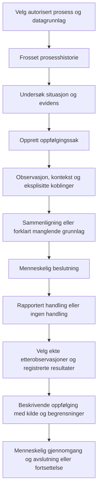

# Kravspesifikasjon: digital tvilling av produksjonsprosessen

| Metadata | Verdi |
| --- | --- |
| Dokumentstatus | Kravutkast til gjennomgang; ingen implementasjons- eller akseptpåstand |
| Motpart | Produksjonsprosessen med maskin og operatør |
| Godkjent grunnlag | Definisjon og valg av faktisk motpart; øvrige krav er forslag |
| Samlet funksjonell oppførsel | F01–F14 i dette dokumentet beskriver hele den menneskemedierte prosesstvillingen, også det som leveres etter historikk |
| Første leveranse | Historikk- og evidensgrunnlag, avgrenset i dette dokumentet |
| Detaljert oppførsel | [Atferdskontrakt B01–B16](production_process_digital_twin_behavior.md): innganger, tilstandsoverganger, felt, rekkefølge, feil og konkrete testvektorer |
| Formell saksmodell | [Maskinlesbar beslutnings- og tilstandsmodell](production_process_digital_twin_state_model.json); spesifikasjon, ikke produktimplementasjon |
| Plan | [Releaseplan med arbeidsnavn v1.0.1](../roadmap/v1_0_1_plan.md); endelig versjonsnummer fastsettes separat |
| Produktbeskrivelse | [Utviklerspesifikasjon og samlet målbilde](production_process_digital_twin.md) |
| Kildegrunnlag | [Forsknings- og løsningsvurdering](production_process_digital_twin_research.md) og lesende gjennomgang av eksisterende kode |
| Hovedpremiss | Gjenbruk eksisterende funksjoner, datakontrakter, lagre, brukerflater, autorisasjon og tester |
| Konfidensialitet | Reelle produksjonsdata og metadata inngår ikke i dokumentet; også datoer, identiteter, volum og avledede resultater er beskyttet |

## 1. Formål og godkjent definisjon

Kravspesifikasjonen beskriver **hva produktet skal gjøre, hvilke begrensninger
det skal overholde, og hvordan oppfyllelse skal etterprøves**. Planen beskriver
rekkefølge og arbeidspakker. Produktbeskrivelsen forklarer domenet og mulige
tekniske løsninger. Foreslåtte filnavn eller datatyper er ikke i seg selv en
bestilling av parallelle implementasjoner.

Atferdskontrakten presiserer første leveranse med faste valg. Den erstatter
tidligere åpne alternativer om registreringsinngang, ressursgrenser,
nullregler og feilhåndtering. Kontrakten er et gjennomgåelig produktforslag;
en utvikler skal ikke velge en annen observerbar oppførsel uten revidert krav.

Les først F01–F14 for hva tvillingen gjør fra registrert prosessituasjon til
oppfølging. Kravtabellene angir sporbarhet. B01–B16 angir historikkleveransens
tekniske grense. At en funksjon leveres i en senere fase, innebærer ikke at
utvikleren skal finne opp dens produktoppførsel når fasen begynner.

Den godkjente definisjonen er:

> En digital tvilling er en formålsbestemt digital representasjon av en identifiserbar faktisk motpart — eksempelvis et objekt, system, en tjeneste eller en prosess. Tvillingen oppdateres med observasjoner fra motparten og bruker modeller til å beskrive, analysere, simulere eller forutsi utvalgte egenskaper og oppførsel. Den leverer tjenester som støtter definerte, etterprøvbare mål, og inngår i en tilbakemeldingssløyfe der resultatene kan påvirke motparten og effekten vurderes gjennom nye observasjoner.

Motparten trenger ikke være et fysisk objekt. Her representeres en sammensatt
produksjonsprosess; maskin og operatør inngår bare med egenskaper som er
relevante for formålet og kan begrunnes med data.

Første leveranse gir etterprøvbar historie. Den komplette tvillingen omfatter
senere oppfølging fra menneskelig beslutning og rapportert handling til nye
observasjoner og resultatvurdering. Historikkleveransen skal ikke omtales som
om hele denne sløyfen allerede er levert.

## F01. Hva tvillingen gjør fra start til slutt

Tvillingen skal la et menneske undersøke en konkret produksjonssituasjon,
forstå dokumenterte forskjeller, registrere sin beslutning og rapporterte
handling, og undersøke hva som er observert etterpå. Hvert ledd skal kunne
leses alene og som del av samme prosessforløp.

Det samlede brukerforløpet er:

1. Brukeren velger prosess, maskin og et eksisterende datagrunnlag. Produktet
   viser hva bindingen bygger på og hvilken tid/kontekst som er kjent.
2. Brukeren åpner et frosset historisk forløp. Tvillingen viser eksisterende
   maskintilstander, forløp, sykluser, episoder og dokumenterte databrudd.
3. Brukeren velger hva som skal undersøkes og åpner en oppfølgingssak.
   Dette oppretter en saksreferanse til forløpet, ikke en maskinhendelse.
4. Brukeren leser eller registrerer en observasjon. Tvillingen skiller
   maskinmåling, menneskelig utsagn, hypotese og beregning i presentasjonen.
5. Brukeren kan be om en sammenligning. Tvillingen beregner bare erklærte
   egenskaper, kontrollerer sammenlignbarheten og viser resultat eller en
   presis mangelliste. En forskjell blir ikke automatisk en feil eller årsak.
6. Mennesket velger tiltak, videre observasjon eller ingen handling.
   Tvillingen registrerer valget og begrunnelsen. Den utfører ikke valget.
7. Mennesket rapporterer utført, ikke utført eller ukjent handling og kan
   registrere målinger/vurderinger. Tvillingen skal ikke gjette et slikt ledd.
8. Når nye autoriserte observasjoner faktisk finnes, velger brukeren et
   ettergrunnlag. Tvillingen undersøker før/etter, målinger og kontekst og
   produserer en ny, uforanderlig oppfølging med eksplisitte begrensninger.
9. Brukeren gjennomgår resultatet og avslutter eller fortsetter saken.
   Avslutning er et menneskelig arbeidsflytvalg, ikke bevis for forbedring.
10. Saken og dens kildegrunnlag kan gjenfinnes senere. Den oppretter ikke
    automatisk en godkjent strategi, et treningsgrunnlag eller en ny modell.



For hvert spørsmål skal produktet gi følgende svarform:

| Brukerens spørsmål | Produktets svar |
| --- | --- |
| Hva skjedde? | Kildeunderbygde tilstander/hendelser, deres rekkefølge, kontekst og brudd |
| Hva gjorde operatøren? | Eksisterende rapporterte handlinger med status og kilde; ellers «Ingen handling er registrert i dette grunnlaget.» |
| Hvorfor skjedde det? | Registrerte hypoteser og deres grunnlag. Uten evaluert årsaksmodell vises «Årsak er ikke fastslått.» |
| Er dette annerledes? | Konkret forskjell mot et navngitt, kontrollert grunnlag, eller årsak til at sammenligning ikke kan kvalifiseres |
| Hva bør gjøres? | Bare relevant, tilgjengelig og legitimt gjenbrukbar støtte fra eksisterende kunnskapsflyt; ellers «Ingen kvalifisert anbefaling er tilgjengelig.» |
| Ble det bedre etter tiltaket? | Registrert/målt før/etter-forskjell og vurdering mot uttrykkelige mål; årsakssammenheng forblir separat |
| Hva vet vi ikke? | En navngitt liste over manglende identitet, tid, kontekst, utførelse, måling eller modellgyldighet |

## F02. Reaksjon på nye data og endringer

Et allerede åpnet snapshot byttes aldri lydløst. Nye kildedata og endrede
menneskeposter behandles som nye revisjoner. Ingen ny controller eller
maskin-/Recorder-aktivering er nødvendig for denne oppførselen.

| Hendelse | Synlig reaksjon | Registrering og videre handling |
| --- | --- | --- |
| Nye maskinobservasjoner finnes i eksisterende datatilførsel | Ved neste eksplisitte kilde-/statusoppslag vises «Nyere datagrunnlag er tilgjengelig.» | Gammelt snapshot og saken er uendret. Brukeren velger selv ny klargjøring og nytt snapshot |
| Nye data ankommer mens en historisk side er åpen | Ingen omskriving av den åpne siden | Eksisterende snapshot beholdes; ingen automatisk saksevaluering |
| En brukt operatørpost korrigeres i sin eierflyt | Tidligere visning beholder eksakt brukt revisjon; ny revisjon kan vises ved eksplisitt nytt grunnlag | Dagens tekst erstatter ikke gammel evidens |
| Et nytt etter-snapshot velges i en sak | Det valgte grunnlaget vises som ettergrunnlag med kilde/revisjon | Sakens fakta får ny revisjon; tidligere oppfølging blir historisk/utdatert |
| En måling eller kontekstverdi mangler | Feltet vises med navngitt ukjentgrunnlag | Ingen standardverdi, ingen stille imputering og ingen automatisk godkjenning |
| Det finnes sekvenshull eller klokketilbakegang | Bruddet vises der eiermodellen plasserer det | Arvet kontekst og beregninger over bruddet følger eksisterende diskontinuitetsregler |
| Datatilgang mistes | Den berørte visningen tømmes og «Innholdet er ikke tilgjengelig for deg.» vises | Ingen reanalyse, eksport eller visning fra gammel klientcache |
| En ny definisjons-/modellrevisjon finnes | Brukeren ser valgt revisjon; et nytt valg er eksplisitt | Gamle resultater fortsetter å bruke opprinnelig revisjon |

Kildeoppslag leser eksisterende lokale registre. Når et nødvendig register
ikke kan leses uten uautorisert nettverk eller skjult synkronisering, vises
den bestemte utilgjengelighetsfeilen. Det skal ikke prøves en ny kilde som reserve.

## F03. Tre atskilte typer tilstand

Tilstanden skal aldri presenteres som én samlet grønn/rød «tvilling klar».

| Tilstand | Hva den beskriver | Hva den ikke skal brukes som |
| --- | --- | --- |
| Prosessens observerte tilstand | Eksisterende kilde-/segmenteringsmodells maskintilstand, program-/verktøykontekst og usikkerhet | Bevis for en persons tilstedeværelse eller en kvalitetsgodkjent del |
| Datagrunnlagets tilstand | Lesbarhet, identitet, klokke, kontinuitet, kontekst, kilde-/modellgyldighet og revisjon | Arbeidsflytstatus for menneskelig beslutning eller utførelse |
| Oppfølgingssakens tilstand | Hva som faktisk er registrert av beslutning, handling, ettergrunnlag og evaluering | En vurdering av om tiltaket virket eller var årsaken til et resultat |

Kanonisk maskinoppførsel bindes til eksisterende operasjonell policy og de
eksakte eierfunksjonene i E02–E04. DT skal ikke opprette en parallell
tilstandsautomat som gjetter maskinens oppførsel fra fritekst. Klokkefelt,
execution-verdier og ukjenttilstander skal bevares fra den valgte eierkontrakten.

## F04. Oppfølgingssaken og dens fakta

En sak gjelder én faktisk maskinbinding og ett avgrenset undersøkelsesformål.
Den kan ha flere observasjoner, beslutninger, handlinger, resultater og
episoder. Ett tiltak kan gjelde flere episoder. En episode kan ha flere
relevante menneskeregistreringer. Ingen automatisk én-til-én-kobling innføres.

Ved opprettelse kreves `definition_revision_id`, `before_snapshot_id`,
`focus_refs` med 1–500 gyldige objektreferanser innen snapshotet,
`question` med 1–4 096 UTF-8-byte og `goal_criteria` som beskrevet nedenfor.
Brukeren skal ha `data.read`, `workflow.run` og aktuell datatilgang.
Serveren setter case-ID, registrerende aktør og registreringstid.

Saken har følgende obligatoriske innhold:

| Felt | Semantikk |
| --- | --- |
| `case_id` | Stabil servergenerert identitet; ikke et maskin- eller personnavn |
| `case_revision` | Øker ved enhver ny saksregistrering, også evaluering, lukking og gjenåpning |
| `facts_revision` | Øker bare når grunnlag, observasjon, kontekst, kobling, beslutning, handlingsrapport eller resultat endres |
| `definition_revision_id`, `machine_binding_ref` | Frosset formål og faktisk maskinomfang for saken |
| `before_snapshot_id`, `after_snapshot_id` | Førgrunnlag kreves; ettergrunnlag er `null` inntil det eksplisitt velges |
| `focus_refs`, `question`, `goal_criteria` | Hvilken situasjon saken gjelder og hva brukeren vil undersøke |
| `record_refs`, `link_refs` | Eksakte aktuelle revisjoner av menneskefakta og relasjoner; tidligere revisjoner beholdes |
| `evaluation_refs` | Alle uforanderlige oppfølgingsresultater med brukt facts-revisjon |
| `is_closed`, `closure` | Åpen/lukket sak og menneskets begrunnelse; `closure=null` før første lukking |
| `status` | Beregnet etter F05; ikke et fritt klientfelt |

En objektreferanse har alltid `object_kind`, `object_id`, `revision_id` og
`snapshot_id` når objektet kommer fra et snapshot. Manglende revisjon skal
avvises. Navn eller omtrent samme tidspunkt skal ikke brukes som reserve.

`goal_criteria` er en liste med 0–20 uttrykkelige kriterier. En tekstlig
målsetning uten numerisk kriterium er lovlig, men gir ingen tallfestet
påstand om måloppnåelse. Et numerisk kriterium har:

- `criterion_id`, `feature_ref` og eksakt `unit`;
- `kind=POST_VALUE_IN_RANGE` eller `DELTA_IN_RANGE`;
- `lower_bound` og `upper_bound`, hver endelig tallverdi eller `null`,
  med minst én grense oppgitt og nedre grense høyst lik øvre;
- `source_ref` til målets opprinnelse og `criterion_revision`.

Begge grenser er inklusive. `DELTA_IN_RANGE` bruker etter minus før.
Produktet skal ikke utlede fortegn, toleranse eller «bedre» fra målteksten.
Formål, førgrunnlag, fokus og kriterier fryses ved opprettelse. Endret spørsmål,
fokus eller mål krever en ny sak med eksplisitt referanse til forrige sak;
gamle resultater skal ikke omtolkes mot et mål valgt etter resultatet.
`preceding_case_ref` er derfor en obligatorisk nullable opprettelsesparameter.
Den gir ingen arv av beslutninger, handlinger eller tillatelser.

## F05. Saksstatus, hendelser og lovlige overganger

Den [maskinlesbare modellen](production_process_digital_twin_state_model.json)
er normativ for status og kommandovirkning. Første treff i følgende
rekkefølge bestemmer status etter en vellykket registrering:

| Prioritet | Vilkår | Saksstatus og brukerbetydning |
| --- | --- | --- |
| 1 | Saken er lukket | `CLOSED`: menneskelig avsluttet, uavhengig av positivt/negativt/ukjent resultat |
| 2 | En evaluering finnes, men bruker eldre facts-revisjon | `REVIEW_REQUIRED`: grunnlaget er endret etter evalueringen |
| 3 | Siste evaluering bruker gjeldende facts-revisjon | `EVALUATED`: gjeldende grunnlag er vurdert, også når vurderingen sier utilstrekkelig data |
| 4 | Minst én handlingsrapport og et etter-snapshot finnes | `READY_TO_EVALUATE`: systemet kan undersøke om oppfølgingen er tilstrekkelig |
| 5 | Aggregert action_status er REPORTED_PERFORMED, etter-snapshot mangler | `WAITING_FOR_POST_DATA`: nye observasjoner er ikke valgt |
| 6 | Handlingsrapport finnes med ukjent/ikke utført status | `ACTION_REPORTED`: rapport finnes, men utførelse skal ikke gjettes |
| 7 | Beslutning finnes | `DECIDED`: menneskelig valg er registrert |
| 8 | Ingen tidligere vilkår traff | `OPEN`: saken har ikke nådd et av de nevnte trinnene |

Status bygger på aktuelle, ikke tilbaketrukne revisjoner. Ved flere
handlingsrapporter er aggregert `action_status`: `NONE` når ingen finnes;
`UNKNOWN` når minst én aktuell rapport har ukjent utførelse; ellers
`REPORTED_PERFORMED` når minst én er utført; ellers
`REPORTED_NOT_PERFORMED`. Dette skjuler ikke enkeltstatusene i listen.

`decision_recorded` er true når minst én aktuell beslutning finnes.
`after_snapshot_attached` er true når saken har en aktuell etterreferanse.
`evaluation_status` er `NONE` uten vurdering, `CURRENT` når siste vurdering
bruker gjeldende facts-revisjon, ellers `STALE`. Klienten kan ikke sette disse
faktaflaggenes verdier direkte.

Alle kommandoer krever eksisterende menneskelig sesjon, `data.read`,
objekttilgang, forventet `case_revision`, gyldig CSRF og idempotensnøkkel.
Identisk nøkkel returnerer samme resultat etter ny tilgangskontroll.
Feil forventet revisjon gir `409 CASE_REVISION_CONFLICT` uten endring.

| Kommando | Ekstra rettighet | Virkning når gyldig | Lukket sak |
| --- | --- | --- | --- |
| `ADD_OBSERVATION` | `workflow.run` | Ny kildeklassifisert observasjon; facts-revisjon øker | 409 CASE_CLOSED |
| `SET_CONTEXT` | `workflow.run` | Ny eksplisitt kontekstrevisjon; gamle verdier beholdes | 409 CASE_CLOSED |
| `PROPOSE_LINK` | `workflow.run` | Ny relasjon med status PROPOSED; ingen bekreftelse | 409 CASE_CLOSED |
| `SET_LINK_STATUS` | `workflow.run` | Ny statusrevisjon etter F07; ingen omskriving av kilden | 409 CASE_CLOSED |
| `RECORD_DECISION` | `workflow.run` | Ny menneskelig beslutning, uten handlingsrapport | 409 CASE_CLOSED |
| `REPORT_ACTION` | `workflow.run` | Ny separat utførelsesrapport, uten automatisk resultat | 409 CASE_CLOSED |
| `RECORD_OUTCOME` | `workflow.run` | Målt/rapportert/manglende/ufullstendig resultat etter F06 | 409 CASE_CLOSED |
| `ATTACH_AFTER_SNAPSHOT` | `workflow.run` | Eksplisitt etterreferanse med samme maskinbinding; gammel etterreferanse bevares | 409 CASE_CLOSED |
| `CORRECT_RECORD` | `workflow.run` | Ny rettelse/tilbaketrekking; berørt tidligere revisjon bevares | 409 CASE_CLOSED |
| `EVALUATE_FEEDBACK` | `analysis.run` | Ny uforanderlig vurdering av gjeldende fakta; facts-revisjon øker ikke | 409 CASE_CLOSED |
| `CLOSE_CASE` | `workflow.run` | Setter lukket status og begrunnelse; fakta og vurderinger er uendret | 409 CASE_CLOSED |
| `REOPEN_CASE` | `workflow.run` | Fjerner lukket flagg og registrerer begrunnelse; fakta og vurderinger er uendret | Lukket sak kreves |

For de elleve første kommandoene gir lukket sak `409 CASE_CLOSED`.
`REOPEN_CASE` krever lukket sak; ellers `409 CASE_ALREADY_OPEN`.
En gjenåpnet sak får status etter tabellen og kan derfor være EVALUATED
eller REVIEW_REQUIRED umiddelbart. Ingen nye beslutninger eller handlinger
opprettes ved gjenåpning.

Alle facts-endringer gjør en tidligere evaluering STALE, også når noen
av de gamle tallene er uendret. Den gamle evalueringen er fortsatt korrekt
beskrivelse av sitt gamle grunnlag, men er ikke sakens nåværende vurdering.
Lukking/gjenåpning endrer ikke facts-revisjon og gjør ikke i seg selv en
evaluering utdatert. Nye maskindata endrer ingen sak før de eksplisitt velges.

## F06. Nøyaktig betydning av menneskelige registreringer

Felles for nye menneskeposter er `record_id`, `record_revision`, `case_id`,
serverbundet `recorded_by`, serverbundet `recorded_at`,
`occurred_at` eller `null`, `time_status=KNOWN|ASSUMED|UNRESOLVED`,
`evidence_refs` og `supersedes_revision` eller `null`.
`record_kind` er OBSERVATION, HYPOTHESIS, DECISION, ACTION_REPORT eller OUTCOME
og skal svare til den valgte kommandoen. Ukjent/antatt hendelsestid krever
`time_reason`; registreringstid brukes ikke som hendelsestid.
Ved KNOWN kreves occurred_at og time_reason=null; ved ASSUMED kreves begge;
ved UNRESOLVED kreves occurred_at=null og en begrunnelse.
Registrerende person og rapportert utfører er ulike felt.

| Type | Påkrevde særfelt | Det produktet skal registrere |
| --- | --- | --- |
| Observasjon | `observation_text`, `claim_class=HUMAN_REPORTED`, kildegrunnlag, fokusreferanser | Hva mennesket sier det observerte; ingen bekreftet årsak |
| Hypotese | `hypothesis_text`, `supporting_refs`, `contradicting_refs`, `status=UNASSESSED\|SUPPORTED\|REJECTED` | En uttrykkelig hypotese; status SUPPORTED er fortsatt ikke en evaluert årsakseffekt |
| Beslutning | `decision_kind=TAKE_ACTION\|OBSERVE_MORE\|NO_ACTION\|REQUEST_REVIEW`, `decision_text`, `rationale`, valgte evidens-/strategireferanser | Hva mennesket valgte og hvorfor; ingen utført handling |
| Handlingsrapport | `action_type`, `description`, `execution_status=REPORTED_PERFORMED\|REPORTED_NOT_PERFORMED\|UNKNOWN`, `decision_refs`, `affected_refs`, `executor_ref` eller `null` | Hva som rapporteres om utførelse; en ukjent utfører skal forbli ukjent |
| Målt resultat | `result_kind=MEASURED`, `feature_ref`, endelig numerisk `value`, eksakt `unit`, `measurement_method_ref`, måletid og evidens | En bestemt måling; ikke en kvalitetsgodkjenning eller prosesseffekt uten egne kriterier |
| Menneskelig resultat | `result_kind=HUMAN_REPORTED`, `assessment_text`, `reported_by` fra legitim kilde | En menneskelig vurdering; ingen generert numerisk forbedring |
| Ikke målt | `result_kind=NOT_MEASURED`, `reason` | At resultat ikke finnes; ingen nullmåling |
| Uavklart resultat | `result_kind=INCONCLUSIVE`, `reason`, motstridende/manglende referanser | At tilgjengelig grunnlag ikke gir én konklusjon |

Alle tekstfelt som beskriver en ny observasjon, beslutning, handling eller
begrunnelse er 1–65 536 UTF-8-byte innen requestgrensen. Referanselister har
0–500 distinkte referanser; duplikater avvises, ikke stilleslås sammen.
Ukjent registreringstype, ukjent enum eller et ekstra aktør-/autorisasjonsfelt
gir `400 INVALID_REQUEST`. Manglende målte særfelt gir `422 MEASUREMENT_INCOMPLETE`.
Endret enhet uten en eksplisitt støttet konvertering gir `422 UNIT_MISMATCH`.
Ingen implisitt enhetskonvertering eller tolkning av fritekst til et tall gjøres.
En HYPOTHESIS med SUPPORTED krever minst én supporting_ref; REJECTED krever
minst én contradicting_ref eller en ikke-tom rejection_reason. UNASSESSED
kan ha tomme lister. Statusen beskriver den registrerte faglige vurderingen,
ikke dokumentert kausalitet. Manglende påkrevd grunnlag gir
`422 HYPOTHESIS_SUPPORT_MISSING`.

Kjent hendelsestid er et tidspunkt fra en dokumentert klokke, ikke en
garanti for at utsagnets innhold er maskinmålt. Fellesfeltet occurred_at
har samme tidsformat som B03; datagrunnlaget binder klokkeidentiteten.
ASSUMED-tid kan sorteres som antatt i saksvisningen, men kvalifiserer ikke
til før/etter-tidsavgrensning eller automatisk relasjonsbekreftelse.

Alle OUTCOME-poster har `action_refs`, `subject_refs` og
`missing_action_reason`. Ved tom action_refs kreves begrunnelsen; ellers
skal den være null. affected_refs/subject_refs gjelder objekter i sakens
maskinomfang. Kvalitetsmålingens måletid er occurred_at og skal være KNOWN;
en antatt/ukjent tid skal ikke registreres som en fullstendig MEASURED-post.

Handlingsrapport uten beslutning er lovlig som retrospektiv rapport når
`decision_refs=[]` og `missing_decision_reason` er oppgitt. Produktet lager
ingen historisk beslutning for å fylle hullet. Dersom faktisk rapportert
handling avviker fra en koblet beslutning, kreves `deviation_reason`;
avviket vises i saken i stedet for at den faktiske rapporten endres.

`CLOSE_CASE` krever `closure_reason` med 1–4 096 byte og én av
`REVIEWED`, `NO_ACTION_DECIDED`, `NOT_PERFORMED`, `INSUFFICIENT_EVIDENCE`,
`WITHDRAWN`. Ingen kode betyr «tiltaket virket». Ved lukking med uavklarte
ledd skal disse vises i bekreftelsesbildet og bevares i closure-posten.
Gjenåpning krever egen begrunnelse og endrer ingen av de opprinnelige postene.

`CORRECT_RECORD` krever målpost, forventet postrevisjon,
`mode=REPLACE|RETRACT` og `correction_reason`. REPLACE bærer hele den nye
posten med uendret type/identitet. RETRACT gjør den aktuelle posten inaktiv
i nye vurderinger; den slettes ikke. Bare menneskeregistreringer i saken
kan korrigeres slik. Rå maskinobservasjoner korrigeres ikke gjennom denne flyten.
Aktuelle saksflagg beregnes deretter fra siste ikke-tilbaketrukne revisjon
per post. En tilbaketrukket siste handlingsrapport kan derfor endre aggregert
action_status; andre rapporterte handlinger forsvinner ikke.
Relasjoner med endepunkt i en korrigert/tilbaketrukket revisjon beholdes
mot den originale revisjonen og får REFERENCE_SUPERSEDED ved aktuell bruk.
De peker ikke automatisk på den nye teksten. Bekreftet relasjon til gammel
revisjon bekrefter dermed ikke den nye; ny relasjon må velges eksplisitt.

## F07. Kontekst, relasjoner og hva som kan bekreftes

Kontekstregistrering er strukturert. Tillatte felter er `machine_binding`,
`operation_revision`, `program_revision`, `tool_context_revision`,
`fixture_revision`, `material_revision`, `measurement_source_ref` og `unit`.
Hvert felt har `value` eller `null`, `knowledge_state=KNOWN|UNKNOWN|DISPUTED`,
`claim_class`, `evidence_refs` og gyldighetsavgrensning.
Fritekst lagres i eget notat og fyller ingen av disse feltene automatisk.

En verdi er kjent for en episode bare når den gjelder hele det nødvendige
episodeintervallet og ikke motsies av et kontekstskifte eller databrudd.
Et programnummer uten programinnholdsrevisjon fyller ikke program_revision.
Menneskelig innlagt kontekst beholder HUMAN_REPORTED-kildeklasse. Bekreftelse
av en relasjon oppgraderer ikke samtidig alle kontekstverdier til målt fakta.

| Relasjon | Tillatt fra → til | Betydning |
| --- | --- | --- |
| `DESCRIBES` | Observasjon → sak/episode | Utsagnet gjelder objektet |
| `CONTEXT_FOR` | Kontekstrevisjon → sak/episode | Kilden angir relevant prosesskontekst |
| `SUPPORTS` | Evidens/observasjon/kunnskapsreferanse → beslutning | Registrert beslutningsgrunnlag, ikke kausalitet |
| `DECISION_FOR` | Beslutning → sak/episode | Beslutningens uttrykkelige omfang |
| `REPORTS_ACTION_FOR` | Handlingsrapport → beslutning/sak | Rapportens uttrykkelige sammenheng |
| `OUTCOME_OF` | Resultatregistrering → handlingsrapport | Resultatet er koblet for oppfølging, ikke dermed forårsaket av handlingen |
| `FOLLOWS` | Handlingsrapport → handlingsrapport | Dokumentert arbeidsrekkefølge, uten årsakspåstand |
| `CORRECTS` | Ny postrevisjon → eldre revisjon av samme post | Opprettes bare gjennom CORRECT_RECORD |

Feil objekttyper, selvreferanse, FOLLOWS-syklus eller en annen maskinbinding
gir `422 INVALID_RELATION`. Ikke tilgjengelig endepunkt gir `404 OBJECT_NOT_FOUND`.
Alle relasjoner har eksplisitte endepunktrevisjoner og kildegrunnlag.
Sykluskontrollen bruker alle aktuelle FOLLOWS-relasjoner som ikke er
REJECTED eller trukket tilbake, inkludert PROPOSED. Den gjelder rekkefølge,
ikke tilbakemeldingssløyfen mellom nye observasjoner og nye saksrevisjoner.

Ny brukeropprettet relasjon starter som PROPOSED. `SET_LINK_STATUS` kan
sette CONFIRMED eller REJECTED med begrunnelse og aktuell revisjon.
En tidligere avvist relasjon kan bare få ny status gjennom ny eksplisitt
revisjon med begrunnelse; status endres aldri fra en analysejobb.
Et tidsforslag krever avklart maskinbinding og sammenlignbare klokker,
beholder PROPOSED og angir hvilke kandidater som finnes. Ved flere kandidater
skal alle oppgis; nærmeste tidspunkt velges ikke som en bekreftet sannhet.
Denne kontrakten har ingen automatisk forslagsjobb. Brukerens PROPOSE_LINK
registrerer ett uttrykkelig valgt par; valg av flere par er flere kommandoer.
Kun CONFIRMED-lenker brukes som bekreftet sammenheng i en konklusjon.
PROPOSED/REJECTED beholdes synlig med sin egen status.

## F08. Beregnede egenskaper og historisk sammenligning

### F08.1 Bestemte beregninger

De eksisterende operasjonelle lagene eier episodegrenser og tidsbøtter.
DT leser veggtid, aktiv tid, programstopp, matehold, annen tilstand og ukjent
tid derfra. Ingen ny tilstandsklassifisering eller prosessinterpolasjon innføres.

For én identifisert numerisk målestrøm i en episode er algoritmen:

1. Velg bare målinger med samme eksakte målekildereferanse, komponent og enhet
   innen episodens halvåpne intervall. Kildekomponenter slås ikke sammen.
2. Behold gyldige endelige numeriske verdier. Tell og angi utelatte verdier
   per årsak; NaN, utilgjengelig verdi og uavklart enhet blir ikke null.
3. Ved `n=0`: returner `INSUFFICIENT_DATA/NO_VALID_SAMPLES`, alle tallverdier null.
4. Sorter de `n` verdiene stigende. Minimum/første, maksimum/siste.
   Median er midtverdien ved oddetall og gjennomsnitt av de to midterste ved partall.
5. `p05` er element med én-basert rang `ceil(0.05*n)`, `p95` med rang
   `ceil(0.95*n)`. Ingen annen kvantilkonvensjon kan velges i koden.
6. Returner sample_count, utelatte antall, enhet, kilde-/policyrevisjon og
   «Statistikk over rapporterte observasjoner; ikke tidsvektet fordeling.»

Et tall får ikke en prosentvis confidence uten en egen evaluert betydning.
Datamengde eller en pen fordeling gjør ikke representativitet bekreftet.
Tall behandles som desimalverdier fra kildens kanoniske representasjon.
Kvantiler velges uten interpolasjon. Summer/differanser og kriteriesjekker
bruker verdien før visningsavrunding. Ikke-terminerende forhold har en
bevart teller/nevner; prosent og andel presenteres med seks desimaler,
half-even. Varighet i heltallsmikrosekunder avrundes ikke til et helt sekund.

### F08.2 Kvalifisering og baseline

En baseline er en uforanderlig liste av eksakte referanseepisoder og en
navngitt egenskapspolicy. Den er ikke en ny episodeidentitet eller en
modell som tilpasses automatisk til et ønsket resultat.

For kvalifisert varighetssammenligning kreves lik kjent machine_binding,
operation_revision, program_revision, tool_context_revision og fixture_revision.
Numerisk signalsammenligning krever dessuten lik material_revision,
measurement_source_ref og unit. UNKNOWN eller DISPUTED er aldri wildcard.
Kontekst må gjelde gjennom hele episoden; uavklart skifte utelukker den.

Referansealgoritmen bruker disse filtrene i rekkefølge:

| Kontroll | Utfall når den ikke består |
| --- | --- |
| Aktuell tilgang og eksakt kilde-/episoderevisjon | Avvis utilgjengelig referanse; ingen uautorisert innholdsvurdering |
| Samme faktisk maskin og sammenlignbar kildeklokke | Utelat med MACHINE_MISMATCH eller CLOCKS_NOT_COMPARABLE |
| Ingen kopi/overlapp av samme opptak | Utelat dokumentert kopi; avstå fra kvalifisert baseline ved uavklart overlapp |
| Fullstendige episodegrenser, kjent varighet og ingen kontinuitetsbrudd | Utelat med PARTIAL_EPISODE eller DISCONTINUITY |
| Ingen ukjent tilstandstid i en kvalifisert varighetsepisode | Utelat med UNKNOWN_STATE_COVERAGE |
| Alle nødvendige kontekstverdier kjent, like og stabile | Utelat med CONTEXT_UNRESOLVED eller CONTEXT_MISMATCH |
| Enhet og nødvendig måleegenskap kjent | Utelat med UNIT_MISMATCH eller FEATURE_UNAVAILABLE |
| Referanseepisoden slutter før mål-episoden starter | Utelat med NOT_PRIOR_TO_TARGET |

Kvalifisert teknisk startprofil krever minst 20 episoder, minst tre
forskjellige MachineRun og minst to uavhengige opptaksøkter etter filtrering.
Dette er en bestemt foreslått produktprofil, ikke en vitenskapelig
valideringsgrense. Ukjent økt/opprinnelse kvalifiserer ikke som uavhengig økt.
Mål-episoden i en allerede registrert baseline gir
`422 BASELINE_TARGET_LEAKAGE`; baseline omskrives ikke automatisk.

Oppfylles ikke profilen, returneres `INSUFFICIENT_DATA` med inkluderte og
utelatte referanser/årsaker og faktiske antall. Produktet kan vise enkeltverdier
som beskrivelser, men skal ikke vise «normal» eller «avvikende».

Baseline beregner median, p05, p95, min og max over kvalifiserte
episodeegenskaper med den samme kvantilregelen. Nytt utvalg gir ny revisjon.
Trening-/evalueringsinndeling er kronologisk og gruppert per opptaksøkt;
kopier eller nært sammenfallende data skal ikke være uavhengige testforløp.

### F08.3 Sammenligningsresultat

Returner målverdi, referansemedian, absolutt differanse `mål - median`,
prosentdifferanse `100*(mål-median)/median` bare når median ikke er null,
referanseintervallet og alle policy-/kildeversioner. Null nevner gir
`percent_difference=null` og `ZERO_REFERENCE`; absolutt differanse beholdes.

Resultatets intervallkode er LOWER_THAN_REFERENCE, WITHIN_REFERENCE eller
HIGHER_THAN_REFERENCE. Grenser er inklusive. Referanseintervallet er
empirisk; koden er ingen feil-, fare-, slitasje- eller årsaksdiagnose.

Uten en gjennomgått faglig toleransepolicy er tjenestestatus
`COMPARISON_ONLY`. Finnes en policy, må den oppgi modellrevisjon, formål,
gyldighetsområde, eksakte enheter, numeriske grenser, valideringsmetode,
evidens og faktisk vurderingsstatus. Uten VALID_WITHIN_SCOPE skal produktet
avstå fra kvalifisert toleranse-/avvikspåstand med MODEL_NOT_VALIDATED.
Toleransegrenser er eksplisitte inndata; utvikleren skal ikke velge dem.

## F09. Oppfølging av beslutning, handling og resultat

`EVALUATE_FEEDBACK` er en eksplisitt analysekommando. Den kan alltid
registrere en vurdering av en åpen, autorisert sak, også når konklusjonen
er utilstrekkelig grunnlag. Vurderingen binder facts-revisjon, før-/etter-
snapshot, aktuelle handlinger, resultater, kriterier og analysepolicy.
Request angir `metric_pairs` med 0–20 par. Hvert par har feature_ref,
before_value_ref, after_value_ref og unit. Systemet velger ikke selv den
målingen der forskjellen ser gunstigst ut. Referansene er eksakte
egenskapsrevisjoner i sakens før-/ettergrunnlag eller aktuelle målte
OUTCOME-revisjoner med subject_refs i det respektive grunnlaget og
KNOWN-måletid innen det respektive halvåpne vinduet. En måling kan ikke
brukes på begge sider. Hver feature_ref forekommer høyst én gang i listen.
En referanse som ikke finnes i sitt deklarerte grunnlag avvises med
`422 VALUE_REFERENCE_OUTSIDE_SCOPE`. Målepar med motstridende enheter
beholdes som en eksplisitt avståelse ved vurderingen, ikke en omregning.

Første treff i følgende prioriterte beslutningstabell bestemmer resultatets
primære kode; alle øvrige dokumenterte begrensninger beholdes i egen liste:

| Prioritet | Vilkår | Resultatkode |
| --- | --- | --- |
| 1 | Ingen aktuell handlingsrapport | INSUFFICIENT_DATA / ACTION_NOT_RECORDED |
| 2 | En aktuell handling har UNKNOWN, eller ingen er rapportert utført | INSUFFICIENT_DATA / ACTION_NOT_CONFIRMED_PERFORMED |
| 3 | En relevant utført handlings time_status er ikke KNOWN | INSUFFICIENT_DATA / ACTION_TIME_UNRESOLVED |
| 4 | Etter-snapshot mangler | INSUFFICIENT_DATA / AFTER_DATA_MISSING |
| 5 | Klokkene mellom handling og kilde kan ikke sammenlignes | INSUFFICIENT_DATA / CLOCKS_NOT_COMPARABLE |
| 6 | Ettergrunnlaget mangler nye faktiske observasjoner etter siste relevante handling | INSUFFICIENT_DATA / NO_NEW_OBSERVATIONS |
| 7 | metric_pairs er tom og et aktuelt HUMAN_REPORTED-resultat finnes | REPORTED_RESULT / HUMAN_REPORT_ONLY |
| 8 | metric_pairs er tom og intet aktuelt HUMAN_REPORTED-resultat finnes | INSUFFICIENT_DATA / RESULT_NOT_MEASURED |
| 9 | Måleegenskaper/enheter kan ikke sammenlignes | INSUFFICIENT_DATA / UNIT_MISMATCH |
| 10 | Nødvendig kontekst er ukjent eller omstridt | INSUFFICIENT_DATA / CONTEXT_UNRESOLVED |
| 11 | Annen relevant kontekst er forskjellig før/etter | CONFOUNDED / CONTEXT_CHANGED |
| 12 | Alle foregående kontroller er passert | DESCRIPTIVE_RESULT / BEFORE_AFTER_DIFFERENCE |

Før-vinduet skal slutte senest ved første aktuelle utførte handling;
etter-vinduet skal starte tidligst ved siste slike handling. Ellers gir en
gyldig vurdering INSUFFICIENT_DATA / WINDOWS_NOT_SEPARATED før kontroll 6.
Begge snapshots skal ha samme faktiske maskinbinding; annen binding avvises
som `422 BINDING_MISMATCH` før vurdering opprettes.

Nye observasjoner betyr at ettergrunnlaget inneholder faktisk kildeevidens
med hendelsestid etter handlingen og kildeidentitet/sekvens eller
legacy-locator som ikke bare gjentar førgrunnlaget. Ny byggetid,
nytt snapshotnavn eller opplasting av en gammel kopi er ikke nye observasjoner.

Flere aktuelle handlinger vises som en samlet rapportert tiltaksgruppe.
Ingen differanse fordeles automatisk på hver handling. Planlagte og andre
kontekstendringer angis i resultatet. Også en uttrykkelig planlagt
verktøy-/programendring er en kontekstforskjell; den skjules ikke for å
få et «rent» sammenligningsgrunnlag.

Ved gyldig numerisk par vises førverdi, etterverdi, delta etter-før,
prosent bare ved ikke-null førverdi, måleenhet og kildegrunnlag.
Dette kan vises som en beskrivende forskjell også sammen med en
CONFOUNDED-markering. Produktet setter alltid
`causal_status=NOT_ESTABLISHED` i denne modellen.

Tabellens kontroller 9–11 gjelder alle bestilte målepar; ett uforenlig
par er nok til den aktuelle primærkoden. Sammenlignbar kontekst følger
F08.2s varighetsfelt, og ved numerisk målesignal også material-/målekilde-
og enhetsfeltene. Andre dokumenterte endringer beholdes i limitations.
Gyldige enkeltpar kan vises selv om et annet par avstår, men resultater
eller kriterier med uavklart tid, kilde eller enhet er NOT_ASSESSED.
En bekreftet menneskelig relasjon kan ikke erstatte en manglende måling.

Hvert numerisk målkriterium fra F04 vurderes mot den dokumenterte
etterverdien eller deltaet. Gyldig verdi innen inklusive grenser gir
MEASURED_CONDITION_MET, utenfor gir MEASURED_CONDITION_NOT_MET.
Manglende/uforenlig/ikke målt grunnlag gir NOT_ASSESSED.
Samlet kriteriestatus er:

1. Ingen numeriske kriterier: NO_NUMERIC_CRITERIA.
2. Minst ett gyldig kriterium ikke oppfylt: STATED_GOALS_NOT_MET.
3. Ellers minst ett NOT_ASSESSED: INCOMPLETE_GOAL_EVIDENCE.
4. Ellers: STATED_GOALS_MET.

Et oppfylt tidsmål sammen med uregistrert kvalitet gir ikke en generell
produktivitets-/kvalitetsforbedring. Et oppfylt matematisk kriterium
endrer heller ikke en CONFOUNDED- eller NOT_ESTABLISHED-markering.

## F10. Scenarioberegning og gjenbrukbar kunnskap

### F10.1 Eksisterende tidsscenario

Den støttede scenariomodellen er TIME_REALLOCATION fra eksisterende
DT-tjeneste. Den bruker bare et bundet legacy-datagrunnlag som tjenesten
faktisk støtter. Annen modelltype eller ikke støttet kilde gir
`422 MODEL_NOT_SUPPORTED`; ingen ny simulator velges automatisk.

Parametere er recovery_percent lik ett av heltallene
0, 5, 10, 15, 20, 25, 30, 35, 40, 45, 50. Andre verdier avvises.
Eksisterende intervallklassifisering og minst 30 klassifiserte intervaller
beholdes. Utilstrekkelig støtte gir INSUFFICIENT_DATA og ingen scenariotall.

La A være observert klassifisert aktiv tid, N klassifisert ikke-aktiv tid
og O=A+N. For gyldig O>0 beregnes:

```text
recovered_time = N * recovery_percent / 100
scenario_active_time = A + recovered_time
observed_active_share = A / O
scenario_active_share = scenario_active_time / O
change_percentage_points = 100 * (scenario_active_share - observed_active_share)
```

Ingen avrunding gjøres før sluttpresentasjon. Kilder/policy, parametere og
beregningsgrunnlag bindes til scenarioresultatet. Null eller uavklart nevner
gir nullresultater med forklaring, ikke divisjon med null.
Scenarioet endrer verken maskinen, historien eller sakens handlingsstatus.
Teksten skal være «Hypotetisk tidsomfordeling», uten prognose for godkjente
deler, inntekt eller effekten av et bestemt tiltak.

### F10.2 Erfaring og anbefaling

Gjenfinning av erfaring bruker eksisterende operatør-/kunnskapsflyt og dens
faktiske review-/tilgangsstatus. Lukket sak, reusable_strategy, godkjent
støttekort eller en formulert hypotese er ikke automatisk kanonisk
OSL-godkjenning eller faglig validert strategi.

Et gjenfunnet tidligere tilfelle vises med kontekstlikheter, forskjeller,
utførelses-/resultatstatus og kilde. Ukjent kontekst vises som ukjent, ikke
som likhet. Finner ingen legitim kunnskapskilde anvendelig støtte, skal
anbefalingsfeltet være tomt med NO_ELIGIBLE_KNOWLEDGE. Produktet skal ikke
fylle tomrommet med umerket språkmodelltekst.

En anbefaling kan åpnes som beslutningsgrunnlag, men skaper ingen beslutning,
handling, strategi-godkjenning eller ny modell. Dersom ekstern AI,
generativ anbefaling eller annen prosessimulering senere ønskes, er dette
et annet navngitt tjenesteomfang; det finnes ingen skjult reservevei her.

Utvalget bestilles med eksakte candidate_refs, ikke fritekstsøk mot en
ukjent ekstern indeks. Bare aktuell, autorisert eierkilde leses. Ingen
lokal kopi er reserve når den autoritative kilden er utilgjengelig.
Hvert kandidatobjekt vurderes slik, i angitt rekkefølge:

1. Ukjent/ikke tilgjengelig kandidat avvises med OBJECT_NOT_FOUND før analyse.
2. Mangler lesbar eksakt revisjon, registreres SOURCE_UNAVAILABLE.
3. Kontekstfelt sammenlignes med sakens kjente F07-kontekst ved eksakt
   revisjonslikhet. Felt med ukjent/omstridt side havner i context_unknown;
   andre i context_equal eller context_different. Ingen likhetsscore beregnes.
4. Kilden må selv dokumentere aktuell tillatelse til gjenbruk for formålet
   gjennom en eksakt eligibility_proof_ref. review_status/reusable_strategy
   alene er ikke dette beviset. Uten bevis er use_status=HISTORY_ONLY.
5. Med bevis, alle nødvendige kontekstfelt kjent og like og ingen motstrid
   er use_status=ELIGIBLE_SUPPORT. Ellers HISTORY_ONLY med
   CONTEXT_UNRESOLVED eller CONTEXT_MISMATCH. Nødvendige felt er F08.2s
   varighetskontekst, og målekontekst når strategien gjelder en måleegenskap.

Kandidater sorteres på stabil kildeobjekt-ID og revisjon. Mennesket velger
selv beslutningsgrunnlag. Ingen anbefaling genereres eller rangeres av DT.
Hele utvalgets status er AVAILABLE når minst én kandidat er ELIGIBLE_SUPPORT;
ellers NO_ELIGIBLE_KNOWLEDGE. Historiske treff kan fortsatt leses som
historiske treff, med oppgitt status. Et tomt utvalg gir items=[] og
NO_ELIGIBLE_KNOWLEDGE. Godkjenning og forvaltning av erfaring skjer i den
eksisterende eierflyten, uten nye grants eller DT-lagde godkjenningsbevis.

## F11. Sammenhengende brukerflate for den komplette tvillingen

| Brukerhandling | Synlig før handlingen | Etter vellykket handling | Ved manglende grunnlag |
| --- | --- | --- | --- |
| Åpne prosessforløp | Valgt maskin, snapshot og vindu | Tidslinje, kontekst, datakvalitet og kildeknapper | Presis mangelliste; ingen standardmaskin eller skjult ny analyse |
| Velge episode | Eksisterende episodeklassifikasjon | Episodekort med originalgrenser, valgte synlige grenser, tilstander og evidens | Ukjent kontekst/varighet beholdes synlig |
| Opprette sak | Fokus og førgrunnlag vises | Saksnummer, spørsmål og OPEN-status | Ugyldig fokus avvises uten delvis sak |
| Legge til observasjon | Kilde-/hypoteseskille forklares | Ny merket menneskepost, uten maskinhendelse | Ukjent tid kan registreres med begrunnelse |
| Bekrefte/avvise kobling | Begge objekter, revisjoner og grunnlag vises | Ny relasjonsrevisjon og hvem som registrerte den | Ingen bekreftelse utledes av manglende motsigelse |
| Sammenligne | Valgt egenskap, kontekst og referanserevisjon vises | Inkluderte/utelatte referanser og beregning eller avståelse | Eksakt årsak til avståelse; ingen «normal»-etikett |
| Registrere beslutning | Mennesket velger type, tekst og grunnlag | DECIDED dersom ingen senere fakta finnes | Ingen rapport om utførelse opprettes |
| Rapportere handling | Utført/ikke utført/ukjent må velges eksplisitt | Egen rapport og status etter F05 | Ukjent beholdes; utfører gjettes ikke |
| Velge ettergrunnlag | Førgrunnlag, handlingstid og nytt valgt snapshot vises | Eksakt etterreferanse; gammel evaluering markeres utdatert | Gammel datakopi markeres som manglende nye observasjoner ved evaluering |
| Registrere resultat | Målt, rapportert, ikke målt eller uavklart må velges | Post med sin egen kilde-/måleklasse | Ufullstendig måling avvises; mennesket kan velge NOT_MEASURED i stedet |
| Vurdere oppfølging | Facts-revisjon og valgt metode vises | Ny vurdering med forskjell, kriteriestatus og begrensninger | Vurdering med INSUFFICIENT_DATA kan lagres og leses |
| Avslutte | Alle uavklarte ledd vises sammen med valgt lukkingsgrunn | CLOSED; historikken beholdes | Ingen automatisk positiv avslutning |
| Korrigere eller gjenåpne | Gammel post/avslutning og begrunnelse vises | Ny revisjon; tidligere grunnlag og vurderinger består | Revisjonskonflikt gir ingen delvis endring |

Brukeren skal kunne gå fra en oppfølgingskonklusjon tilbake til resultater,
handlinger, beslutninger og eksakte før-/etterobservasjoner uten å forlate
den autoriserte produktflaten. En ufullstendig lenke vises som et avbrutt
ledd med årsak, ikke som en ubrutt kjede.

Alle registreringsskjema starter uten forhåndsvalgt beslutning, utførelse,
resultat eller person. Serverkjente identiteter/revisjoner vises som bundne
referanser. Ukjent tid og null må velges eksplisitt der typen tillater det.
Enkelte resultatvarianter vises først etter at brukeren velger result_kind;
skjulte felter fra en annen variant sendes ikke.

Mens innsending pågår, sperres ny innsending av samme skjema. Ved tapt svar
slår klienten opp samme idempotensnøkkel; den lager ikke en ny nøkkel eller
ny post automatisk. Ved revisjonskonflikt beholdes brukerens usendte tekst
bare i denne sidens minne, ny saksrevisjon hentes og forskjellen vises.
Brukeren må velge ny innsending mot det nye grunnlaget. Ingen automatisk
sammenslåing eller overskriving av en annens registrering er tillatt.

Klienten lagrer ingen produksjonspayload i localStorage, URL, telemetri
eller tjenestearbeidercache. Tilgang kontrolleres ved hvert dataoppslag og
hver innsending. En 401/403/404-respons på berørt innhold tømmer visning og
usendte felt som refererer til det, med nøytral tilgangstekst. Ingen push-
eller kontinuerlig tilgangsovervåker innføres; en side kan bare reagere på
tilgangsendringen når den mottar et nytt serverresultat. Eksport/deling
av saksinnhold er ikke en støttet kommando i denne kontrakten.

## F12. Kontraktsgrense, feil og sikker registrering

De funksjonelle kommandoene ovenfor er applikasjonsoperasjoner som kobles
til eksisterende eiermoduler og legitime produktflyter. De er ikke
maskinkommandoer, Federation-kontrollere eller en tillatelse til å starte
datainnsamling. De introduserer ingen ny autorisasjonsrolle.

Request for en saksoperasjon har `schema=fcp.process_twin.case_command.v1`,
`case_id`, `expected_case_revision`, `command_type` og ett typedelt
`payload` med nøyaktig feltene for operasjonen. For RECORD-kommandoene er
payload feltkontraktene i F06 uten de serverbundne feltene. ADD_OBSERVATION
kan også registrere den atskilte hypoteseformen. SET_CONTEXT bruker F07;
PROPOSE_LINK/SET_LINK_STATUS bruker F07 og forventet lenkerevisjon.
ATTACH_AFTER_SNAPSHOT har bare `snapshot_id` og `selection_reason`.
EVALUATE_FEEDBACK har `evaluation_policy=DESCRIPTIVE_FEEDBACK_V1`
og den obligatoriske listen metric_pairs fra F09, også når listen er tom.
CLOSE/REOPEN har de beskrevne begrunnelsene. CORRECT_RECORD bruker F06.

Alle typedelte felter er påkrevde med eksplisitte tomme lister/null der
det er tillatt. Ingen klient kan sette saksstatus, registrerende aktør,
facts-revisjon eller evalueringsresultat. Ukjent operasjon eller felt avvises.
Generelt manglende påkrevd felt gir 400 INVALID_REQUEST. Unntaket er
MEASURED-variantens ufullstendige måleinnhold etter F06: manglende/null
feature_ref, value, unit, measurement_method_ref, KNOWN-måletid eller
måleevidens gir 422 MEASUREMENT_INCOMPLETE. Ekstra felt eller ugyldig
JSON har fortsatt forrang etter B05. Særkontrollen for måleinnhold skjer
etter rettighets-/objekttilgang og før idempotensreservasjon; feltverdier
ekkoes ikke i feilen.

Vellykket registrering publiserer primærpost, referanser, ny saksrevisjon
og audit atomisk og returnerer `201` med opprettet post/vurderingsreferanse,
ny case_revision, facts_revision og beregnet saksstatus. Bortfall før commit
skal ikke gi en halv post eller en status uten underliggende fakta.
Idempotent gjentakelse gir samme opprinnelige resultat etter ny tilgangskontroll.

| Feilklasse | Resultat før mutasjon |
| --- | --- |
| Manglende sign-in/rettighet | 401 AUTHENTICATION_REQUIRED / 403 PERMISSION_REQUIRED |
| Ugyldig JSON, ekstra felt, ukjent type eller klientstyrt aktør | 400 INVALID_REQUEST eller INVALID_JSON etter samme prioritet som B05 |
| Ikke synlig case, snapshot, post eller evidens | 404 OBJECT_NOT_FOUND |
| Feil case-/post-/lenkerevisjon | 409 CASE_REVISION_CONFLICT eller RECORD_REVISION_CONFLICT |
| Lukket sak eller ulovlig gjenåpning | 409 CASE_CLOSED / CASE_ALREADY_OPEN |
| Feil maskinomfang, relasjon, måling eller enhet | 422 med den navngitte funksjonelle feilen |
| Uforenlig/vanskelig datagrunnlag i en ellers gyldig analyse | Lagret vurdering med navngitt avståelse, ikke fabrikkert resultat |
| Kilde-/lagringstjeneste kan ikke leses | 503; ingen alternativ kilde eller tapt audit |

Første historikkleveranse eksponerer fortsatt bare B10-rutene. De nye
registreringskommandoene er krav til den komplette tvillingens senere
integrasjon, med den fastsatte atferden her. Utsatt leveranse skal ikke
omtolkes til å bety at produktatferden kan velges fritt.

### F12.1 Fullstendig tillegg til rutekartet for den komplette tvillingen

Prefiks, autentisering, feilkonvolutt, no-store, CSRF, ID-format og
requestgrenser er de samme som i B02/B05/B10/B12. Tabellen nedenfor er
hele tillegget til B10 når den tilhørende funksjonsfasen leveres.
Ingen av disse rutene aktiveres gjennom at spesifikasjonen skrives.
En funksjon som ennå ikke er levert gir ROUTE_NOT_FOUND og NOT_IN_RELEASE,
ikke en tom vellykket beregning.

| Metode/rute under `/api/process-twins/v1` | Tilleggsrettighet til data.read og objekttilgang | Suksess og eksakt operasjon |
| --- | --- | --- |
| POST `/cases` | workflow.run | 201; opprett F04-sak |
| GET `/cases` | Ingen | 200; tilgjengelige saker, ingen opprettelse |
| GET `/cases/{id}` | Ingen | 200; gjeldende saksrevisjon og beregnet status |
| GET `/cases/{id}/revisions/{revision}` | Ingen | 200; eksakt, uforanderlig saksrevisjon |
| GET `/cases/{id}/records` | Ingen | 200; aktuelle poster i denne saksrevisjonen |
| GET `/cases/{id}/records/{record}/revisions/{revision}` | Ingen | 200; eksakt post, også historisk/tilbaketrukket med sin status |
| GET `/cases/{id}/links` | Ingen | 200; aktuelle relasjonsrevisjoner |
| POST `/cases/{id}/commands` | workflow.run | 201; én av de elleve F05-kommandoene som ikke er EVALUATE_FEEDBACK |
| POST `/cases/{id}/evaluations` | analysis.run | 201; bare EVALUATE_FEEDBACK |
| GET `/cases/{id}/evaluations/{evaluation}` | Ingen | 200; eksakt vurdering, brukt facts-revisjon og dagens CURRENT/STALE-markering |
| POST `/analysis/feature-sets` | analysis.run | 201; EPISODE_FEATURES_V1 etter F08.1 |
| POST `/analysis/baselines` | analysis.run | 201; QUALIFIED_BASELINE_V1 etter F08.2 |
| POST `/analysis/comparisons` | analysis.run | 201; DESCRIPTIVE_COMPARISON_V1 etter F08.3 |
| POST `/analysis/scenarios` | analysis.run | 201; TIME_REALLOCATION etter F10.1 |
| POST `/analysis/knowledge-selections` | analysis.run | 201; eksplisitt utvalgte erfaringer etter F10.2 |
| GET `/analysis/results/{id}` | Ingen | 200; eksakt lagret analyseresultat med dagens kilde-/tilgangsstatus |

Rettigheter bestemmes av ruten før body tolkes. EVALUATE_FEEDBACK sendt til
commands-ruten gir 400 INVALID_REQUEST; workflow-kommando på evaluations-
ruten gir samme feil. case_id i body skal være identisk med URL-ens ID,
ellers 400 INVALID_REQUEST. Ingen kommando kan velge sin egen rettighet.

Alle 201-svar har Location til eksakt saksrevisjon, postrevisjon, evaluering
eller analyseresultat. Responsens data for en saksregistrering har nøyaktig
case_ref, case_revision, facts_revision, status, created_refs og command_id.
created_refs er en liste, også ved én post; CLOSE/REOPEN har sin
livssykluspost i listen. F04-saksobjektet hentes gjennom case_ref.

Listene bruker B10.3-cursor og limit 1–500, standard 100. Saker sorteres på
serverens opprettelsesrekkefølge, deretter case_id; poster/lenker på
registreringsrekkefølge, deretter objekt-ID. Klientens hendelsestid bestemmer
ikke auditrekkefølgen. Første side binder eksakt saksrevisjon eller
registerrevisjon. Endret utvalg under sidehenting gir 409 LIST_CHANGED;
den gamle eksplisitte saksrevisjonen er fortsatt lesbar. Ingen fritekst,
produksjonstid, maskinnavn eller personfelt tillates i URL eller query.

Idempotensens operasjonskoder utvides med CREATE_CASE, de tolv eksakte
F05-kommandonavnene og CREATE_FEATURE_SET, CREATE_BASELINE,
CREATE_COMPARISON, CREATE_SCENARIO, CREATE_KNOWLEDGE_SELECTION.
Nøkkelrom, bodydigest og replay følger B05.2. En ny nøkkel for en ny
evaluering av uendrede fakta lager en ny vurderingspost med samme logiske
beregning; den lager ingen nye observasjoner. Samme nøkkel returnerer
opprinnelig vurdering. Ny faktaendring før evalueringscommit gir
409 CASE_REVISION_CONFLICT; intet resultat publiseres som gjeldende.

### F12.2 Lukkede payloadtyper

Opprettelse har schema=fcp.process_twin.case_create.v1 og nøyaktig
definition_revision_id, before_snapshot_id, focus_refs, question,
goal_criteria og preceding_case_ref etter F04. Serveren setter begge
revisjonstellere til 1, ettergrunnlag til null, aktuelle lister tomme og
status OPEN. Ingen annen startstatus kan bestilles.

For F05-kommandoene brukes konvolutten i innledningen til F12.
En «menneskepayload» nedenfor består alltid av record_kind, occurred_at,
time_status, time_reason og evidence_refs etter F06, pluss nøyaktig
særfeltene i tabellen. record_id, record_revision, case_id, recorded_by,
recorded_at og supersedes_revision er serverfelt og tillates ikke i
menneskepayload. Ved rettelse bindes identiteten gjennom målreferansen.

| command_type | Nøyaktige payloadfelt utover eventuelt menneskefellesfelt |
| --- | --- |
| ADD_OBSERVATION, record_kind OBSERVATION | observation_text, claim_class=HUMAN_REPORTED, subject_refs |
| ADD_OBSERVATION, record_kind HYPOTHESIS | hypothesis_text, supporting_refs, contradicting_refs, status, rejection_reason |
| RECORD_DECISION, record_kind DECISION | decision_kind, decision_text, rationale, evidence_selection_refs, intended_action_type |
| REPORT_ACTION, record_kind ACTION_REPORT | action_type, description, execution_status, decision_refs, affected_refs, executor_ref, missing_decision_reason, deviation_status, deviation_reason |
| RECORD_OUTCOME, record_kind OUTCOME, result_kind MEASURED | result_kind, action_refs, subject_refs, missing_action_reason, feature_ref, value, unit, measurement_method_ref |
| RECORD_OUTCOME, record_kind OUTCOME, result_kind HUMAN_REPORTED | result_kind, action_refs, subject_refs, missing_action_reason, assessment_text, reported_by |
| RECORD_OUTCOME, record_kind OUTCOME, result_kind NOT_MEASURED | result_kind, action_refs, subject_refs, missing_action_reason, reason |
| RECORD_OUTCOME, record_kind OUTCOME, result_kind INCONCLUSIVE | result_kind, action_refs, subject_refs, missing_action_reason, reason, conflicting_refs, missing_items |
| SET_CONTEXT | subject_refs, valid_from, valid_to, fields, note, supersedes_context_ref |
| PROPOSE_LINK | relation_kind, from_ref, to_ref, evidence_refs, rationale |
| SET_LINK_STATUS | link_ref, expected_link_revision, status, rationale |
| ATTACH_AFTER_SNAPSHOT | snapshot_id, selection_reason |
| CORRECT_RECORD | target_record_ref, expected_record_revision, mode, correction_reason, replacement |
| EVALUATE_FEEDBACK | evaluation_policy=DESCRIPTIVE_FEEDBACK_V1, metric_pairs |
| CLOSE_CASE | closure_code, closure_reason |
| REOPEN_CASE | reason |

Et felt som tabellen ikke har for valgt variant, avvises; det kan ikke
sendes som null for å omgå variantkontrollen. Alle oppførte felt kreves.
Følgende regler bestemmer de tillatte null-/tomverdiene:

- subject_refs og affected_refs har 1–500 referanser. Øvrige referanselister
  har 0–500, med særkravene i F06/F07. Hver referanse følger F04.
- rejection_reason er null unntatt ved REJECTED; da kreves ikke-tom tekst
  hvis contradicting_refs er tom. REJECTED kan også ha begge begrunnelser.
- intended_action_type er påkrevd og ikke-null ved TAKE_ACTION; ellers
  null. action_type og intended_action_type bruker INSPECT, ADJUST, REPLACE,
  PAUSE, RESUME eller OTHER. OTHER krever beskrivelse i decision_text eller
  description. Kodene er rapporteringskategorier, aldri styringskommandoer.
  Eksisterende kilders originale action_type bevares i evidens; en adapter
  skal ikke slette eller gjette bort en mer detaljert kildekode.
- executor_ref og reported_by er referanse til kjent, tilgjengelig
  person-/rollekilde eller null. Ukjent person erstattes ikke av innlogget
  bruker. recorded_by forblir den autentiserte registrerende aktøren.
- missing_decision_reason og missing_action_reason kreves ved tom tilhørende
  referanseliste og er ellers null. deviation_status er NONE, DECLARED
  eller UNRESOLVED. NONE krever deviation_reason=null; andre krever tekst.
  En handling med annen type enn en koblet TAKE_ACTION-beslutning krever
  DECLARED. Koblet beslutning uten kjent planlagt handling krever minst
  UNRESOLVED. Systemet tolker ikke fritekst for å hevde samsvar. Uten
  beslutningsreferanse er deviation_status=UNRESOLVED og begrunnelsen
  forklarer at planlagt sammenligningsgrunnlag mangler.
- missing_items er 1–500 ikke-tomme feltnavn/årsaksbeskrivelser for
  INCONCLUSIVE; conflicting_refs kan være tom. MEASURED har minst én
  evidence_ref og en tilgjengelig measurement_method_ref.
- replacement er en hel menneskepayload av samme record_kind ved REPLACE,
  og null ved RETRACT. En allerede tilbaketrukket post kan ikke korrigeres
  videre; 409 RECORD_RETRACTED. Ny legitim registrering får ny identitet.
- valid_from og valid_to er kjente, sammenlignbare tider med from < to;
  note er null eller ikke-tom tekst. fields er 1–8 distinkte F07-felter,
  hvert med field_name, value, knowledge_state, claim_class og evidence_refs.
  KNOWN krever ikke-null verdi og minst én evidensreferanse; UNKNOWN krever
  null verdi; DISPUTED krever null verdi og minst to motstridende
  evidensreferanser. value er eksakt revisjonsreferanse, bortsett fra unit
  som er den eksakte enhetsstrengen. claim_class for ny menneskekontekst
  er HUMAN_REPORTED. Registreringen endrer ikke rå segmenteringskontekst.
- link_ref og alle relasjonsendepunkter følger F04. CORRECTS kan ikke
  bestilles gjennom PROPOSE_LINK. SET_LINK_STATUS tillater bare CONFIRMED
  eller REJECTED. Uendret aktuell status gir 409 NO_LINK_CHANGE. Endret
  endepunkt/type krever ny lenke og eksplisitt avvisning av den gamle.
- Nytt ettergrunnlag erstatter bare sakens aktuelle etterreferanse;
  tidligere referanse og begrunnelse bevares. Samme aktuelle snapshot med
  ny nøkkel gir 409 NO_AFTER_DATA_CHANGE, uten ny facts-revisjon.

Identisk SET_CONTEXT mot samme subjects/vindu og verdier gir
409 NO_CONTEXT_CHANGE ved ny nøkkel. En overlappende ny kontekstrevisjon
erstatter ikke en annen kildepåstand; ulike aktuelle verdier gir DISPUTED
ved bruk, inntil en eksplisitt korrigering avklarer kildene. Rettelse av
selve menneskekonteksten gjøres som ny SET_CONTEXT med
supersedes_context_ref; dette nullable feltet kreves i denne payloaden.
Referansen må være siste aktuelle kontekstrevisjon for samme subjects og
vindu, ellers 409 CONTEXT_REVISION_CONFLICT. Den gamle bevares i historikken.

Alle tider følger B02/B03s eksakte format og klokkesammenlignbarhet.
Uavklart tid i menneskefakta følger F06 og kan lagres; den får ikke bli
kjent fordi serveren kjenner sin egen registreringstid. Alle lister har
distinkte referanser; ingen stille trunkering eller deduplisering.

### F12.3 Lukkede analysetyper og resultatfelt

Request har schema=fcp.process_twin.analysis_request.v1, analysis_kind og
payload, uten andre felt. Tabellen angir hele payloaden.

| analysis_kind og rute | Payload |
| --- | --- |
| FEATURE_SET på feature-sets | snapshot_id, episode_refs med 1–500 elementer, numeric_stream_refs med 0–20 elementer, policy=EPISODE_FEATURES_V1 |
| BASELINE på baselines | target_episode_ref, candidate_episode_refs med 1–500 elementer, feature_ref, policy=QUALIFIED_BASELINE_V1 |
| COMPARISON på comparisons | target_episode_ref, baseline_ref, tolerance_policy_ref eller null, policy=DESCRIPTIVE_COMPARISON_V1 |
| SCENARIO på scenarios | snapshot_id, model=TIME_REALLOCATION, recovery_percent etter F10.1 |
| KNOWLEDGE_SELECTION på knowledge-selections | case_ref, candidate_refs med 0–500 elementer, policy=EXPLICIT_KNOWLEDGE_SELECTION_V1 |

Et numeric_stream_ref har eksakt source_metric_ref, component_ref og unit.
Et feature_ref har feature_code, source_metric_ref eller null,
component_ref eller null og unit. Tillatte feature_code er WALL_US,
ACTIVE_US, STOPPED_US, FEED_HOLD_US, OTHER_US, UNKNOWN_US, SAMPLE_MIN,
SAMPLE_MAX, SAMPLE_MEDIAN, SAMPLE_P05, SAMPLE_P95 eller MEASURED_VALUE.
Varighetskoder krever unit=us og null målestrøm/komponent. SAMPLE-koder
krever begge referansene og eksakt enhet. MEASURED_VALUE krever
measurement_source_ref som source_metric_ref, component_ref=null og eksakt
enhet; denne koden brukes til menneskeregistrert måling, ikke en automatisk
episodeberegning. Samme navn med annen kilde eller enhet er ulik egenskap.

Feature-set beregner alle tilgjengelige varighetsfelter og de fem
SAMPLE-statistikkene per eksplisitt valgt strøm og episode. Det velger ikke
en ny strøm fra fritekst. Baseline-forespørselens referanser kan ligge i
ulike snapshots med samme faktiske binding; F08-filtrene gjelder fortsatt.
Mål i candidate_episode_refs gir 422 BASELINE_TARGET_LEAKAGE før beregning.
Resultatet beholder samtlige foreslåtte, inkluderte og utelatte referanser.

Analyseresultat har nøyaktig schema=fcp.process_twin.analysis_result.v1,
result_id, analysis_kind, recorded_at, recorded_by, input_refs,
policy_revision, result_status, reason_codes, values, excluded,
model_validity og causal_status. input_refs binder eksakte, tilgjengelige
revisjoner. excluded har ref og sortert reason_codes per utelatt objekt;
listen er tom når ingen er utelatt. causal_status er alltid NOT_ESTABLISHED.
recorded_by/at er serverbundet. Resultatet omskrives ikke av senere data.

values er typedelt etter analysis_kind:

- FEATURE_SET: items per episode og feature_ref med value eller null,
  sample_count eller null for varighet, excluded_sample_counts og
  reason_codes. Den enkelte items status er AVAILABLE eller
  INSUFFICIENT_DATA. Hele resultatet er AVAILABLE hvis alle er tilgjengelige,
  PARTIAL hvis noen er det, ellers INSUFFICIENT_DATA.
- BASELINE: included_episode_refs, episode_count, run_count, session_count,
  feature_ref, min, max, median, p05 og p95. Statistikktallene er null når
  kvalifiseringsprofilen ikke består. result_status er QUALIFIED eller
  INSUFFICIENT_DATA; QUALIFIED er teknisk utvalg, ikke modellvalidering.
- COMPARISON: feature_ref, target_value, reference_median, difference,
  percent_difference, reference_low, reference_high og interval_code etter
  F08.3. Manglende kvalifisert baseline gir INSUFFICIENT_DATA, alle disse
  beregningstallene null og interval_code=null. Ellers COMPARISON_ONLY,
  med eventuell separat toleransevurdering som beskrevet nedenfor.
- SCENARIO: observed_active_time, observed_nonactive_time, observed_time,
  recovered_time, scenario_active_time, observed_active_share,
  scenario_active_share og change_percentage_points etter F10.1.
  result_status er HYPOTHETICAL_RESULT eller INSUFFICIENT_DATA; sistnevnte
  har alle scenariotall null og presis reason_codes.
- KNOWLEDGE_SELECTION: items med ref, source_review_state,
  eligibility_proof_ref eller null, context_equal, context_different,
  context_unknown, execution_status, outcome_kind og use_status.
  Reglene og avståelsene i F10.2 bestemmer use_status; dette er ingen
  rangerende anbefalingsmodell.

model_validity har state og evidence_refs. Disse beregningene bruker
NOT_ASSESSED med mindre en konkret, gyldig faglig policy er bundet.
En toleransepolicy har bare SUPPORTED_RANGE_V1 i dette omfanget: eksakt
feature_ref, lower_bound/upper_bound etter F04, maskin-/kontekstbinding,
policy_revision, validation_method_ref, evidence_refs og state. Det er en
allerede gjennomgått policy, ingen opprettelses-/godkjenningsrute her.
Bare state=VALID_WITHIN_SCOPE og lik kjent binding tillater separat
tolerance_status=WITHIN_STATED_RANGE eller OUTSIDE_STATED_RANGE, med
inklusive grenser. Annen state gir tolerance_status=NOT_ASSESSED og
MODEL_NOT_VALIDATED; forskjellsberegningen kan beholdes som COMPARISON_ONLY.
Null policy gir tolerance_status=NOT_ASSESSED og NO_TOLERANCE_POLICY.
En kjent policy med feil enhet eller binding gir UNIT_MISMATCH eller
MODEL_OUTSIDE_SCOPE og ingen toleransepåstand. values for COMPARISON har
derfor også tolerance_policy_ref og tolerance_status som obligatoriske felt.

For disse F-kontraktenes måle-/beregningstall er transport en endelig
desimalstreng, eller objektet
{numerator, denominator} med desimalstrenger for heltall når et nøyaktig
forhold ikke terminerer; denominator er positiv og brøken forkortet.
Verdier og kriterier sammenlignes eksakt før presentasjonsavrunding.
Ingen ikke-endelige JSON-tall, floatavrunding som avgjør måloppnåelse eller
enhetskonvertering inngår. Nullable beregningsfelt er null, aldri tom tekst.
Denne representasjonen gjelder F-kontraktenes nye verdiobjekter, ikke en
stille endring av eksisterende kildetyper eller første leveranses B-felter.
Decimalstrenger har fortegn bare ved negativ verdi, punktum som separator,
ingen eksponent, ingen unødige innledende/etterfølgende nuller og normalisert
null som "0". Brøk brukes bare for ikke-terminerende forhold; ellers brukes
desimalstreng. Revisjons-/antall-/prosentsatsfelt er fortsatt JSON-heltall.

### F12.4 Eksakt oppfølgingsresultat og konfliktgrense

En evaluering er en egen uforanderlig post med nøyaktig
schema=fcp.process_twin.feedback_evaluation.v1, evaluation_id, case_id,
case_revision_at_request, facts_revision, recorded_at, recorded_by,
before_snapshot_ref, after_snapshot_ref eller null, action_refs,
outcome_refs, context_refs, policy_revision, result_status,
primary_reason_code, limitations, metric_results, criterion_results,
overall_goal_status og causal_status. Serveren binder alle revisjoner.
result_status/primary_reason_code er første treff i F09; limitations er
alle øvrige faktisk konstaterte mangler i samme kontrollrekkefølge,
uten duplisering. Manglende objekttilgang er HTTP-feil før beregning og
skal ikke omtales som en statistisk mangel i et lagret resultat.
En kontroll som ikke kan utføres fordi et tidligere ledd mangler, er
ikke en konstatert feil: den føres med kontrollnavn og NOT_EVALUATED i
limitations. Systemet skal ikke hevde at en ukjent enhet er en påvist
enhetskonflikt, eller at manglende etterdata beviser endret kontekst.
Hvert limitations-element har nøyaktig check_code, state, reason_code og
evidence_refs. state er LIMITATION ved dokumentert begrensning og
NOT_EVALUATED ved uutført kontroll. reason_code bruker den tilsvarende
F09-koden eller CHECK_PREREQUISITE_MISSING; evidenslisten kan være tom
bare når det manglende leddet selv er begrensningen.

metric_results har ett element per bestilt metric_pair, i samme rekkefølge:
feature_ref, before_value_ref, after_value_ref, before_value, after_value,
unit, difference, percent_difference, assessment_status og reason_codes.
assessment_status er DESCRIBED eller NOT_ASSESSED. Nullnevner beholder
difference, setter percent_difference=null og ZERO_REFERENCE. Ukjent tid,
klokke eller uforenlig enhet gir NOT_ASSESSED og null beregningstall.
CONTEXT_CHANGED kan beholde beskrivende tall med CONFOUNDED-markering;
de er ingen effektberegning. En avståelse tidlig i F09 skal ikke fylles
med forskjellstall som forutsetter at den mislykkede kontrollen bestod.
Ved INSUFFICIENT_DATA eller REPORTED_RESULT er metric_results sine
before_value, after_value, difference og percent_difference null og
assessment_status=NOT_ASSESSED; originale enkeltmålinger leses fortsatt
som egne fakta. Bare DESCRIPTIVE_RESULT og CONFOUNDED kan ha beskrevne
numeriske par og vurderte numeriske kriterier. Ellers er alle
criterion_results NOT_ASSESSED. En tidlig avståelse kan derfor ikke få
STATED_GOALS_MET gjennom en separat beregningsvei.

criterion_results har ett element per goal_criterion, i opprinnelig
rekkefølge: criterion_id, criterion_revision, metric_pair_index eller null,
tested_value eller null, status og reason_codes. Eksakt feature_ref og
unit bestemmer paret; ingen match gir NOT_ASSESSED/CRITERION_VALUE_MISSING.
F09 bestemmer MEASURED_CONDITION_MET, MEASURED_CONDITION_NOT_MET og
overall_goal_status. Et POST_VALUE_IN_RANGE-kriterium bruker etterverdien;
DELTA_IN_RANGE bruker difference. For å bli vurdert kreves et gyldig
bestilt målepar i denne modellen, også ved POST_VALUE_IN_RANGE. Modellen
lager ikke en før/etter-effekt av en enslig måling.

GET knytter evalueringen til dagens saksstatus i responsens meta som
evaluation_currency=CURRENT eller STALE. Den lagrede postens
facts_revision og innhold omskrives aldri. En evaluert sak uten tilstrekkelig
grunnlag kan dermed være EVALUATED med INSUFFICIENT_DATA og alle mål
NOT_ASSESSED. CLOSED er uavhengig av disse feltene.

Etter B05s tilgang/validering/idempotens og før commit kontrolleres
muterbart grunnlag i denne rekkefølgen: forventet saksrevisjon,
forventet målpost-/lenke-/kontekstrevisjon der relevant, åpen/lukket-
vilkår fra F05, navngitt no-change-vilkår fra F12.2, og til slutt
underliggende eier-/datatilgang på nytt. Første feil returneres uten
delvis publisering. Alle saksfakta og sideposter bruker samme
publiseringsgrense; en separat eiermodul kan bare gjenbrukes for skriving
når den kan oppfylle denne grensen. Manglende atomisk integrasjon er et
dokumentert kapabilitetsgap, ikke grunn til å love en distribuert commit
som den eksisterende implementasjonen ikke tilbyr.

## F13. Gjennomgående eksempler med bestemte resultater

Alle tall og referanser nedenfor er håndkonstruert testgrunnlag. `T(n)`
betyr testepoken pluss n mikrosekunder; ingen produksjonsdato er brukt.

### F13.1 Én full oppfølgingssak

| Trinn | Testhandling | Forventet resultat |
| --- | --- | --- |
| 1 | Åpne før-snapshot A, samme kjente maskin/kontekst, vindu [T(0),T(100)) | Kjent dekning 100 us, aktiv tid 60 us, ikke-aktiv tid 40 us |
| 2 | Opprett sak med fokus i A; bind fra start målene delta aktiv tid i [5,20] us og etterkvalitet i [2.9,3.1] mm | OPEN, facts-revisjon 1, ingen beslutning/handling/resultat; målene kan ikke ettertilpasses |
| 3 | Registrer observasjonen «Undersøke stoppet» | Fortsatt OPEN; menneskepost, ingen årsaksdiagnose |
| 4 | Registrer beslutning TAKE_ACTION med intended_action_type=INSPECT og begrunnelse | DECIDED; ingen utførelse opprettes |
| 5 | Rapporter inspeksjon REPORTED_PERFORMED ved T(110) | WAITING_FOR_POST_DATA; utførelsen er menneskelig rapportert |
| 6 | Be om evaluering før ettergrunnlag finnes | EVALUATED med INSUFFICIENT_DATA/AFTER_DATA_MISSING; dette er ingen PASS |
| 7 | Velg etter-snapshot B med ekte nye testobservasjoner i [T(120),T(220)) | Facts-revisjon øker; REVIEW_REQUIRED fordi forrige vurdering brukte eldre fakta |
| 8 | Bind beregnet aktiv tid 70 us fra B; registrer kildeunderbygd førkvalitet 3.0 mm ved T(50) med subject i A og etterkvalitet 3.2 mm ved T(150) med subject i B | Separate målte resultatposter, fortsatt REVIEW_REQUIRED; ingen årsaks-/forbedringspåstand |
| 9 | Evaluer mot målene bundet i trinn 2, med de to eksplisitte måleparene og lik kjent kontekst | DESCRIPTIVE_RESULT; delta aktiv=10 us, prosent=100*10/60; kvalitetsdelta=0.2 mm. Første kriterium MEASURED_CONDITION_MET, andre MEASURED_CONDITION_NOT_MET; STATED_GOALS_NOT_MET; causal_status=NOT_ESTABLISHED |
| 10 | Lukk med REVIEWED og begrunnelse om blandet resultat | CLOSED; lukking gjør ikke kriteriene oppfylt |
| 11 | Gjenåpne med begrunnelse | EVALUATED på samme fakta; ingen ny handling eller måling |
| 12 | Korriger kvalitetsmålingen gjennom en ny dokumentert postrevisjon | REVIEW_REQUIRED; gammel evaluering og gammel verdi er fortsatt historisk tilgjengelige |

### F13.2 Samme maskinsignal kan gi forskjellige kunnskapsutfall

| Situasjon | Eksakt forventet atferd |
| --- | --- |
| Maskinen går ACTIVE, ingen operatørpost finnes | Vis ACTIVE og at handling ikke er registrert; ikke utled at en bestemt person startet maskinen |
| En støttekort-anbefaling godtas, ingen rapport om utførelse finnes | Beslutningsgrunnlag kan vises; ACTION_NOT_RECORDED ved oppfølging |
| Handlingen er rapportert UNKNOWN | ACTION_REPORTED; ingen utførtstatus; oppfølging gir ACTION_NOT_CONFIRMED_PERFORMED |
| Nytt snapshot er bygd av samme gamle kilderevisjon | NO_NEW_OBSERVATIONS når det brukes som ettergrunnlag; ny byggetid er ikke ny observasjon |
| Etterdata finnes, men programrevisjonen er annerledes | CONFOUNDED/CONTEXT_CHANGED; rå forskjell kan vises med begrensning, ingen årsakseffekt |
| Kvaliteten beskrives som «bedre» uten måling | HUMAN_REPORTED-tekst beholdes; intet numerisk kvalitetsmål konstrueres |
| Tilgang til en aktuell menneskepost trekkes tilbake | Sakens berørte innhold kan ikke leses videre fra server eller gammel cache |

### F13.3 Deterministisk sammenligning og scenario

Referanseegenskapene er heltallene 1–20 i samme enhet, fra 20 kvalifiserte
syntetiske episoder fordelt på tre runs og to uavhengige opptaksøkter.
Alle referanser er tidligere enn mål-episoden, som har verdien 21.
Forventet median=10.5, p05=1, p95=19, absolutt differanse=10.5,
prosentdifferanse=100 og intervallkode HIGHER_THAN_REFERENCE.
Uten faglig toleransepolicy er status COMPARISON_ONLY, ingen feil-/farekode.
Legges mål-episoden inn i baseline, er resultatet BASELINE_TARGET_LEAKAGE,
og den gamle baselinen skal ikke endres.

I tidsscenarioet er A=60 sekunder, N=40 sekunder og recovery_percent=25.
Forventet gjenhentet hypotetisk tid er 10 sekunder, hypotetisk aktiv tid
70 sekunder, andel 0.7 og endring 10 prosentpoeng fra 0.6. Ingen delmengde,
kvalitet eller årsakseffekt følger av beregningen.

## F14. Hva som må være lukket før kode bestilles

Kravene er oppfylt gjennom gjenbruk der eksisterende eiermoduler gir den
beskrevne atferden. Eksisterende operatørbeslutninger, støttemodeller,
bekreftelser og kvalitetsresultater skal derfor kartlegges mot F04–F12
før en ny posttype, tjeneste eller brukerflate foreslås. Et legacy-felt
skal likevel ikke gis sterkere betydning enn det faktisk dokumenterer.

Den komplette tvillingen skal ha verifikasjon for:

- alle saksstatusregler og hver kombinasjon av lukket/åpen sak og kommando;
- skillet mellom facts-revisjon, case-revisjon og evalueringsrevisjon;
- hver type observasjon, beslutning, utførelsesstatus og resultat;
- hver tillatte og ugyldige relasjonskombinasjon;
- alle filtre/utelatelsesgrunner og kvantil-/nullregler i F08;
- hver prioritert gren i F09, også ufullstendige og motstridende resultater;
- hele forløpet i F13 samt kilde-, tilgangs- og revisjonsendring underveis.

Dekningen skal føres med faste grupper: FC-01=F01–F03, FC-02=F04–F05,
FC-03=F06, FC-04=F07, FC-05=F08.1, FC-06=F08.2, FC-07=F08.3,
FC-08=F09, FC-09=F10.1, FC-10=F10.2, FC-11=F11,
FC-12=F12.1–F12.3 og FC-13=F12.4/F13. Hver tabellrad, enumvariant,
navngitt feil og normativ gren får egen testreferanse innen gruppen.
Bare positive hovedforløp gir ikke gruppen status bestått.

Første historikkleveranse kan avsluttes med sitt eget eksplisitte omfang.
Den skal ikke erklæres som komplett tilbakemeldingssløyfe. Senere faser
skal implementere F04–F12s tilstand, kommandoer, felter og rutekatalog.
De skal ikke endre sannhets-, status- eller beslutningsreglene uten
revidert kravbaseline. Ingen av de syntetiske eksemplene er
reelle pilotbevis eller dokumentasjon av levert produksjonseffekt.

### F14.1 Gjennomført dokumentkontroll og hva den viser

Den maskinlesbare modellens 96 kombinasjoner av saksfakta er kontrollert
mot en uavhengig gjengivelse av F05s prioritet; alle åtte statuser er
nåbare. De 1 152 kombinasjonene av disse faktaene og de tolv kommandoene
er kontrollert for åpen/lukket-vilkår og modellens revisjonsvirkning.
Ni faste statusvektorer, 121 kombinasjoner av null til fire handlings-
rapporter, oppfølgingsforløpet med lukking/gjenåpning/rettelse og de
syntetiske kvantil-/scenarioverdiene er også kontrollert.

Dette er konsistenskontroll av spesifikasjonen. Den viser ikke at produktet
har implementert API-et, at alle payload-/tilgangsgrener er testet, eller
at en produksjonseffekt er dokumentert. FC-gruppenes implementasjonstester
og privat pilot gjenstår for de funksjonene som ikke allerede er dekket.

## 2. Mål og leveransegrense

| Mål | Brukerverdi | Avgrenset bevis i første leveranse |
| --- | --- | --- |
| M01 — Forstå forløpet | Undersøke hva som er kjent om produksjonsprosessen | Tidslinje og eksisterende segmenter med riktig identitet og kontekst |
| M02 — Etterprøve påstander | Finne kilden og bearbeidingen bak et resultat | Revisjonsbundet evidens for fakta og slutninger |
| M03 — Se usikkerheten | Unngå beslutninger basert på skjulte datamangler | Synlige brudd, ukjent tid, manglende kontekst og tjenestevis tilgjengelighet |
| M04 — Se operatørkunnskap i sammenheng | Forstå hva mennesker faktisk har registrert | Eksisterende menneskeregistreringer og eksplisitte relasjoner uten oppdiktede koblinger |
| M05 — Bevare tillit og konfidensialitet | Bruke data uten at de endres eller utleveres feil | Kildevern, gjentakbare snapshots og kontrollert datatilgang |
| M06 — Videreføre eksisterende produkt | Få ny nytte fra det som allerede er bygget | Integrasjon mot eksisterende kontrakter og bevart oppførsel |

Første leveranse omfatter avgrenset definisjonsregistrering, historiske
snapshots, eksisterende maskinsegmenter, tilgjengelig operatørkunnskap,
evidensvisning, datakvalitet og tilhørende tilgangskontroll.

Ny registrering av kontekst, koblinger, beslutninger, handlinger og resultater
tilhører senere D3–D4. Baseline, sammenligning og scenariointegrasjon tilhører
B0 og D5–D6. Full oppfølgingspilot tilhører D7. Krav til disse fasene står i
avsnitt 11 og er ikke akseptkrav for første historikkleveranse.

Live-modus, ny avspillingstjeneste, ny datainnsamling, maskinstyring, automatisk
Federation-deling, OSL-implementasjon og nye eksterne modell-/simuleringstjenester
inngår ikke. Dagens DT-side og dens eksisterende tidsscenario skal bevares.

## 3. Slik skal krav og status leses

- **SKAL** angir et obligatorisk krav innen den leveransen som er navngitt.
  Før godkjenning er også disse kravene del av utkastet.
- **Første leveranse** gjelder alle krav i avsnitt 6–10.
- **Senere leveranse** gjelder bare `DT-FUT-*` i avsnitt 11. De aktiveres ikke
  gjennom godkjenning av historikkleveransen alene.
- Krav-ID-er er stabile. Endret betydning krever dokumentert revisjon; en
  utgått ID skal ikke gjenbrukes med en ny betydning.
- Et krav kan være oppfylt av eksisterende kode. Ny kode er ikke et
  akseptkriterium, og en eksisterende test skal ikke erstattes med en kopi.
- **Kildeobservert** betyr at relevant kode er lest. Det betyr ikke at kravet
  er akseptert, at et bestemt datasett finnes, eller at funksjonen er aktivert
  i produksjon.

Før implementasjon skal kravdekning føres per ID med én av:

| Dekningsstatus | Betydning og videre arbeid |
| --- | --- |
| `EXISTING_COVERED` | Eksisterende kode og relevant verifikasjon oppfyller kravet; bevar og referer til grunnlaget |
| `EXISTING_INTEGRATION` | Nødvendig funksjon finnes, men må kobles til prosessvisningen eller en strengere grense |
| `PARTIAL` | Deler finnes; beskriv presist hvilken kontrakt eller atferd som mangler |
| `GAP_CONFIRMED` | Ingen tilstrekkelig eksisterende løsning er funnet etter avgrenset gjennomgang; beskriv minste utvidelse |
| `NOT_ASSESSED` | Dekning er ikke avklart; ikke behandle dette som en nyutviklingsordre |

Implementasjonsstatus og testresultat føres separat. «Kode finnes», «test finnes»,
«test bestått» og «privat pilot bestått» er forskjellige påstander.
Ingen krav er markert akseptert gjennom dette dokumentet.

## 4. Eksisterende fundament og gjenbruksmatrise

Denne matrisen er en første kodebasert kartlegging. Den inneholder tekniske
referanser, ikke et produksjonsinventar. Den skal brukes før nye moduler foreslås.

| ID | Kildeobservert fundament | Gjenbruk i kravene | Avgrensning som må vurderes |
| --- | --- | --- | --- |
| E01 | [Kanoniske observasjoner](../../catalog/mtconnect_recorder/canonical/__init__.py), [lager](../../catalog/mtconnect_recorder/canonical/store.py) og [projeksjonstester](../../catalog/mtconnect_recorder/tests/test_canonical_projection.py) | Observasjonsidentitet, verdi-/tidsstatus, kildebevis og eksisterende projeksjon | Tilgjengelig kilde og revisjonsbinding avklares i D0; lesing skal ikke initialisere eller migrere kilden |
| E02 | [Semantiske roller](../../catalog/mtconnect_recorder/operational/roles.py) og [tidslinje](../../catalog/mtconnect_recorder/operational/timeline.py) | Device-kontekst, Agent-kontinuitet, sekvens-/tidsbrudd | Gjenbruk betydningen; ikke skriv en ny segmenteringsalgoritme i DT-laget |
| E03 | [Runs](../../catalog/mtconnect_recorder/operational/runs.py), [sykluser](../../catalog/mtconnect_recorder/operational/cycles.py) og [episoder](../../catalog/mtconnect_recorder/operational/episodes.py) | Eksisterende prosessobjekter, grenser og klassifikasjonsbegrunnelser | Knytt dem til snapshot; en produksjonskandidat blir ikke en bekreftet produsert del |
| E04 | [Operasjonelt lager](../../catalog/mtconnect_recorder/operational/store.py), [projeksjon](../../catalog/mtconnect_recorder/operational/projection.py) og [tester](../../catalog/mtconnect_recorder/tests/test_operational_projection.py) | Spørringer etter segmenter, Device-status, grenser og kontekst; eksisterende innholdsfingeravtrykk | Avklar konsistent vannmerke og trygg lesebane; ikke lag et konkurrerende operasjonelt lager |
| E05 | [DT-tjeneste](../../catalog/flask_app/services/digital_twin_service.py), [rute](../../catalog/flask_app/digital_twin_routes.py), [side](../../catalog/flask_app/templates/digital_twin.html) og [tester](../../catalog/flask_app/tests/test_digital_twin_service.py) | Legacy-analyse, eksisterende kompakt `_Snapshot`, cache, kildegrenser og aritmetisk tidsscenario | Cache/snapshot finnes allerede; vurder gjenbruk. Internt filfingeravtrykk er ikke uten videre et varig, innholdsbundet revisjonsmanifest |
| E06 | [Operatørregistreringer](../../catalog/flask_app/services/operator_strategy_service.py), [støttemodell](../../catalog/flask_app/services/operator_support_model.py) og [bekreftelser](../../catalog/flask_app/services/operator_confirmation_service.py) | Eksisterende observasjon, hypotese, beslutning, evidens, bekreftelse og kvalitetsutfall | Legacy-poster er ikke automatisk separate, kanoniske beslutnings-/handlings-/utfallsregistre; lesing må bevare faktisk kilde og betydning |
| E07 | [Føderert operatørtjeneste](../../catalog/flask_app/services/federated_operator_strategy_service.py) | Eksisterende lagrings-/eierskapsmodell når den er autorisert | `load_records()` kan hente fra repository og skrive lokal kopi. En DT-lesebane skal ikke utløse skjult synkronisering eller omgå autoritativ lagring |
| E08 | [Sentral menneskelig autorisasjon](../../catalog/flask_app/auth/policy.py) og [autentiseringstester](../../catalog/flask_app/tests/test_human_auth.py) | Eksisterende identitet, roller og rettighetene `data.read`, `analysis.run`, `workflow.run` | Nye operasjoner må kobles til gjeldende policy; ikke opprett parallelle roller, grants eller autentisering |
| E09 | [DT-rutetester](../../catalog/flask_app/tests/test_digital_twin_routes.py), [operatørtester](../../catalog/flask_app/test_operator_strategy_service.py) og [episodetester](../../catalog/mtconnect_recorder/tests/test_operational_episodes.py) | Eksisterende regresjonsgrunnlag og syntetiske testmønstre | Suppler for verifiserte hull; testenes eksistens betyr ikke at de ble kjørt eller bestått i denne dokumentleveransen |

Identifiserte integrasjonsbehov er kobling mellom disse byggesteinene,
revisjons-/snapshotbinding på tvers av kilder, tydelig tjenestevis status og
evidensvisning under korrekt tilgang. Om en kontrakt krever utvidelse, skal
den først vurderes i sin eksisterende eiermodul. Egne DT-typer brukes bare
for begreper som ikke allerede er tilstrekkelig representert.

## 5. Aktører, begreper og systemgrense

| Begrep | Kravbetydning |
| --- | --- |
| Leser | Autentisert menneske med `data.read` og tilgang til de berørte dataene |
| Analysebruker | Leser med `analysis.run`; kan eksplisitt bestille et avgrenset snapshot |
| Definisjonsforvalter | Aktiv menneskelig aktør med `data.read`, `workflow.run` og aktuell datatilgang; registrerer metadata gjennom B04 |
| Operatør/fagperson | Menneske som kan tolke prosessen og gjennomgå pilotresultater; tittelen gir ingen automatisk produktrettighet |
| Snapshot | Uforanderlig, avgrenset historisk grunnlag med definisjons-, datasett-, kilde- og transformasjonsrevisjoner |
| Evidensreferanse | Revisjonsbundet peker til kildegrunnlag; den gir ingen egen tilgangsrett |
| Ukjent | Manglende eller uavklart kunnskap; skal ikke erstattes med en oppdiktet verdi |
| Faktisk handling | Noe som er rapportert utført eller dokumentert av en egnet kilde; forskjellig fra anbefaling og beslutning |

Dette er kapabilitetsbeskrivelser, ikke nye rolletabeller. Maskin, modell,
datamengde, notatstatus eller tvillingdefinisjon skal aldri gi menneskelig,
Recorder-, maskin- eller Federation-autoritet.

Reelle verdier kan vises til en autorisert bruker inne i produktets beskyttede
flate når de er nødvendige for oppgaven. Det tillater ikke kopiering til
delbar dokumentasjon, logger, tester, søk, eksterne tjenester eller demoer.

## 6. Krav til omfang, gjenbruk og definisjon

### 6.1 Gjenbruk

| ID | Krav | Verifikasjon |
| --- | --- | --- |
| DT-REU-001 | Før endring av et kravområde SKAL utvikleren knytte hver berørt krav-ID til eksisterende kode, eksisterende test/evidens og presist udekket atferd ved hjelp av dekningsstatusene i avsnitt 3. | Dokumentgjennomgang i DT0; AT-12 |
| DT-REU-002 | Tilfredsstillende eksisterende funksjoner og datatyper SKAL brukes gjennom deres eierkontrakter. Ny kode for samme segmentering, autorisasjon, operatørregister eller tidsscenario krever et dokumentert, konkret kontraktsgap. | Diff-/designgjennomgang mot E01–E09; AT-12 |
| DT-REU-003 | Eksisterende funksjoners betydning og støttede oppførsel SKAL bevares ved integrasjon. Nødvendige endringer skal være avgrensede og ha relevant regresjonsgrunnlag. | AT-07, AT-12 |
| DT-REU-004 | Nye tester SKAL dekke udekket kontrakt eller feilmekanisme. Eksisterende relevante tester og bevis skal refereres; dokumentarbeid skal ikke utløse repetisjon av uendrede grønne produktsuiter. | Testplan-/endringsgjennomgang; AT-12 |

### 6.2 Omfang og tilstand

| ID | Krav | Verifikasjon |
| --- | --- | --- |
| DT-SCP-001 | Første leveranse SKAL tilby historikk for en identifiserbar, avgrenset produksjonsprosess med maskin og tilgjengelig operatørkunnskap. Den skal ikke fremstille prosessen som bare en maskinmodell eller kreve at alle motparter generelt er fysiske objekter. | AT-01, AT-11; AP-01 |
| DT-SCP-002 | Nye snapshotforespørsler SKAL bare godta `HISTORICAL`. Forespurt `LIVE` eller `REPLAY` skal avvises med forklart kontraktfeil uten å starte datatilførsel eller avspilling. | AT-11 |
| DT-SCP-003 | Tilgjengelighet SKAL angis per tjeneste med begrunnelse. Lesbar historie skal ikke gi en samlet påstand om at baseline, modellgyldighet eller full tilbakemeldingssløyfe er klar. | AT-11 |
| DT-SCP-004 | Funksjoner som er utsatt i avsnitt 2 SKAL ikke opprettes eller aktiveres som skjult følge av historikkvisning, definisjonsregistrering eller snapshotbygging. | AT-04, AT-11; diffgjennomgang |

### 6.3 Definisjon

| ID | Krav | Verifikasjon |
| --- | --- | --- |
| DT-DEF-001 | En definisjonsrevisjon SKAL inneholde identifiserbar faktisk motpart, prosessgrense, eksplisitt maskinbinding, mål, valgte egenskaper, rolleprofil, tillatte tjenester og gyldighetsområde. Manglende obligatorisk innhold skal avvises før registrering. | AT-01 |
| DT-DEF-002 | En registrert definisjonsrevisjon SKAL være uforanderlig. Endret mål, prosessgrense, rolleprofil eller binding skal opprette en ny lenket revisjon og bevare den gamle. | AT-01, AT-05 |
| DT-DEF-003 | Registrering av definisjon og datasettbinding SKAL følge de eksplisitte metadata- og klargjøringskommandoene i B03–B04. Definisjonsregistrering krever `data.read` og `workflow.run`; klargjøring krever `data.read` og `analysis.run`. GET oppretter ingen definisjon, revisjon eller tilgang. | AT-01, AT-08; BV-01–BV-07 |
| DT-DEF-004 | En navne-/maskinbinding SKAL ha versjonert kildegrunnlag og avklart status. Lik tekst i maskin-, program- eller filnavn skal ikke alene bekrefte at to datagrunnlag gjelder samme motpart. | AT-01, AT-02 |

## 7. Krav til data, snapshots og historie

### 7.1 Data og kildevern

| ID | Krav | Verifikasjon |
| --- | --- | --- |
| DT-DAT-001 | En evidensreferanse SKAL ha datasettopprinnelse og eksakt datasett-/kilderevisjon. Ukjent opprinnelse skal merkes ukjent og ikke erstattes med lokal installasjonsidentitet. | AT-02, AT-07 |
| DT-DAT-002 | Kanoniske observasjoner SKAL beholde `(source_key, agent_instance_id, sequence)` innen eget datasettomfang. Like verdier i ulike opprinnelser skal ikke kollidere eller bli slått sammen automatisk. | AT-02 |
| DT-DAT-003 | Device-kontekst SKAL holdes atskilt innen samme Agent. Sekvenshull skal vurderes på Agent-strømmen før Device-filtrering, gjennom eksisterende semantikk. | AT-02, AT-03 |
| DT-DAT-004 | Kopier eller overlappende opptak SKAL ikke telles som uavhengig evidens. Uavklart overlapp skal gi eksplisitt begrensning og sperre sammenslåtte uavhengighets-/totalsumpåstander. | AT-02 |
| DT-DAT-005 | Legacy-evidens SKAL identifiseres med datasett, filinnholdsdigest og fysisk linjereferanse eller en like presis eksisterende locator. Den skal ikke få oppdiktet kanonisk Agent-/sekvensidentitet. | AT-02, AT-07 |
| DT-DAT-006 | DT-lesing og bygging SKAL bevare primære rådata, kildeposter og eksisterende segmenter. Manglende kilde skal ikke opprettes, migreres eller repareres automatisk. | AT-04 |
| DT-DAT-007 | Kildeåpning SKAL ikke starte Recorder, utføre maskinkommandoer, endre konfigurasjon, synkronisere Federation eller skrive et lokalt operatørregister. En utilstrekkelig lesekontrakt skal gi forklart status. | AT-04 |
| DT-DAT-008 | Tid SKAL beholde original kildeverdi, normaliseringsgrunnlag og kjent/ukjent klokkestatus. UTC-normalisering uten verifisert kildeklokke skal merkes som antakelse; den skal ikke gi bekreftet tidskobling til menneskehendelser. | AT-03 |
| DT-DAT-009 | Manglende verdi, `UNAVAILABLE`, tvetydig verdi og verdi utenfor gyldighetsområde SKAL holdes atskilt. Numerisk analyse skal avvise NaN/uendelig og ikke omgjøre mangler til null eller en normaltilstand. | AT-03, AT-07 |
| DT-DAT-010 | Kontinuitetsbrudd og tidsregresjon SKAL bevare navngitte brudd og ukjent tidsgrunnlag, uten negativ varighet eller arvet kontekst over et reelt hull. Legacy-regelen for lange intervaller skal ikke overføres ukritisk til endringsbasert kanonisk telemetri. | AT-03 |

### 7.2 Historisk snapshot

| ID | Krav | Verifikasjon |
| --- | --- | --- |
| DT-SNP-001 | Et nytt snapshot SKAL bygges bare etter en eksplisitt, autorisert bestilling. Tidligere snapshots skal kunne leses uten at ny analyse starter. | AT-04, AT-08 |
| DT-SNP-002 | Bestillingen SKAL binde definisjonsrevisjon, datasett-/identitetsrevisjoner, maskinomfang og halvåpent UTC-vindu `[start_at, end_at)`. Tomt, omvendt eller ufortolkbart vindu skal avvises; ukjent kildetid skal gi synlig begrensning. | AT-01, AT-03, AT-05 |
| DT-SNP-003 | Snapshotet SKAL angi eksakte kildegrenser, transformasjons-/segmenteringsrevisjoner og hvilke primærkilder som inngår. Uforenlige kanoniske og operasjonelle vannmerker skal ikke publiseres som ett konsistent resultat. | AT-05 |
| DT-SNP-004 | Historisk innhold og dets kilde-/notatrevisjoner SKAL forbli uendret etter publisering. Nye data eller korreksjoner skal gi nytt grunnlag, ikke omskrive et tidligere resultat. | AT-05 |
| DT-SNP-005 | Samme logiske inngang og policy SKAL gi samme logiske historikkinnhold og innholdsdigest. Tilfeldige objekt-ID-er, byggetidspunkt og aktuell ferskhetsvurdering skal ikke endre denne faglige sammenligningen. | AT-05, AT-09 |
| DT-SNP-006 | Validering, eget snapshotmanifest, tilgjengelig lesemodell og audit SKAL publiseres atomisk. En avbrutt bygging skal ikke være lesbar som en gyldig delvis ferdig snapshot. | AT-06 |
| DT-SNP-007 | Bestilling SKAL være idempotent per autentisert aktør, kommando og nøkkel. Identiske parametere skal returnere samme registrerte resultat; annet innhold med samme nøkkel skal gi konflikt uten ny bygging. | AT-06, AT-08 |
| DT-SNP-008 | Endring av inngangsgrunnlaget under bygging SKAL håndteres med konsistent avgrensning eller eksplisitt konflikt/status. Systemet skal ikke automatisk gjenta mot en annen revisjon og late som samme bestilling ga samme grunnlag. | AT-05, AT-06 |
| DT-SNP-009 | Tid for observasjon, registrering, snapshotopptak og ferskhetsvurdering SKAL være adskilt. Ny visningstid skal ikke få historiske observasjoner til å framstå som ferske eller live. | AT-03, AT-11 |

### 7.3 Historikk, operatørkunnskap og evidens

| ID | Krav | Verifikasjon |
| --- | --- | --- |
| DT-HIS-001 | Kanonisk historie SKAL bruke eksisterende `MachineRun`, `ProductionCycle` og `OperationalEpisode` med deres grenser, kontekst og begrunnelser. DT-laget skal ikke klassifisere en produksjonskandidat om til bekreftet del. | AT-07, AT-12 |
| DT-HIS-002 | Legacy-visning SKAL vise eksisterende støttet oppsummering med tydelig kilde-/klokkekvalitet. Den skal ikke hevde kanonisk episodeproveniens som input mangler. | AT-03, AT-07 |
| DT-HIS-003 | Hver generert påstand SKAL merkes `OBSERVED`, `HUMAN_REPORTED`, `DERIVED`, `INFERRED` eller `HYPOTHETICAL` etter faktisk grunnlag. Et sammensatt resultat skal kunne inneholde flere klasser. | AT-07 |
| DT-HIS-004 | Hver generert faktapåstand eller slutning SKAL ha kildereferanse og relevant transformasjon-/policyrevisjon. Mennesketekst skal beholde egen post-/innholdsrevisjon og forfattergrunnlag. | AT-07; AP-01 |
| DT-HIS-005 | Eksisterende operatørregistreringer SKAL leses med faktisk status og revisjon, uten at notat, hypotese, godkjent støttekort eller beslutning blir til dokumentert handling eller målt effekt. | AT-07 |
| DT-HIS-006 | Eksisterende eksplisitte relasjoner SKAL bevare alle prosessobjekter, revisjoner og koblingsstatus. Uten tilstrekkelig relasjon skal registreringen være `UNLINKED` eller ha kildens eksisterende uavklarte status; ingen ny automatisk kobling inngår. | AT-07 |
| DT-HIS-007 | Hvis en tidligere brukt kilde-/notatrevisjon ikke kan gjenfinnes, SKAL evidensoppslaget vise `SOURCE_UNAVAILABLE`. Dagens notattekst eller en annen fil skal ikke brukes som lydløs erstatning. | AT-05, AT-07 |
| DT-HIS-008 | Manglende menneske- eller resultatdata SKAL vises som manglende grunnlag. Systemet skal ikke generere operatøridentitet, beslutning, handling eller resultat fra maskinaktivitet eller tidsmessig overlapp. | AT-07, AT-11 |

## 8. Krav til tilgang og konfidensialitet

### 8.1 Tilgang og autoritet

| ID | Krav | Verifikasjon |
| --- | --- | --- |
| DT-SEC-001 | Alle DT-operasjoner SKAL bruke eksisterende sentral menneskelig autentisering og autorisasjon. Nye standardroller, manuelle grants eller en parallell autorisasjonstjeneste skal ikke innføres for denne funksjonen. | AT-08; gjennomgang mot E08 |
| DT-SEC-002 | Lesing SKAL kreve `data.read` og tilgang til berørte objekter/kilder. Analyserett eller administratorrolle alene skal ikke erstatte manglende datatilgang. | AT-08 |
| DT-SEC-003 | Snapshotbestilling SKAL i tillegg kreve `analysis.run`. En bruker med bare lesetilgang skal ikke kunne opprette analyseartefakter eller registrere menneskehendelser gjennom de nye rutene. | AT-08 |
| DT-SEC-004 | Hvert oppslag på definisjon, snapshot, menneskepost, relasjon og evidens SKAL kontrollere relevant datatilgang. En tidslinje, kjent objekt-ID eller cursor skal ikke gi videre rettigheter. | AT-08 |
| DT-SEC-005 | Ved tilbakekalt tilgang til en medvirkende kilde SKAL første leveranse avvise lesing av det berørte snapshotet, også fra mellomlager og ved idempotent gjentakelse. Den skal ikke levere tidligere tilgjengelig innhold som om tilgangen fortsatt gjaldt. | AT-08 |
| DT-SEC-006 | Registrerende aktør SKAL bindes av serveren til den autentiserte menneskelige identiteten. Klientfelt skal ikke kunne overstyre aktør, rettighet, omfang eller revisjonsdigest. | AT-06, AT-08 |
| DT-SEC-007 | POST og andre registreringskommandoer SKAL bruke gjeldende beskyttelse mot forespørselsforfalskning, innholdsvalidering og størrelsesgrenser. Manglende eller ugyldig beskyttelse skal avvises før sideeffekt. | AT-08, AT-10 |
| DT-SEC-008 | Representasjon av anbefaling, notatstatus, modell, SysML/DarTwin-fil eller tvillingmål SKAL ikke gi strategi-, maskin-, Recorder- eller Federation-autoritet og skal ikke utløse utførelse. | AT-07, AT-08 |

### 8.2 Konfidensialitet

| ID | Krav | Verifikasjon |
| --- | --- | --- |
| DT-PRV-001 | Produksjonsdata, datoer/tidspunkter, person-/maskin-/program-/verktøyidentiteter, filinventar, volum, mønstre og avledede resultater SKAL behandles som konfidensielle. Alias eller hash skal ikke alene gi lavere beskyttelse. | AT-10; dokument-/dataflytgjennomgang |
| DT-PRV-002 | Kildedata og detaljerte dataprofileringer SKAL holdes i autorisert miljø. Funksjonen skal ikke sende dem til ekstern AI, skytjeneste, søk, telemetritjeneste eller ny delingsflate. | AT-04, AT-10 |
| DT-PRV-003 | Sensitive tidsvinduer, navn, kildefilstier og fritekst SKAL ikke legges i URL, allmenne driftslogger, feilsvar eller metrikklabler. Snapshotvalg skal bruke ugjennomsiktige referanser; private parametere sendes i kontrollert request-body. | AT-10 |
| DT-PRV-004 | Detaljert audit og snapshotmanifest SKAL ha samme beskyttelsesnivå som datagrunnlaget. Allmenne logger skal bare ha avtalte tekniske feilkoder og ufølsomme korrelasjonsreferanser; ingen rå request-/response-payload. | AT-06, AT-10 |
| DT-PRV-005 | Dokumentasjon, kodeeksempler, nye tester, PR-er og delbare demonstrasjoner SKAL bruke håndskrevne syntetiske data eller plassholdere. Kopi av reelle forløp med bare endret navn eller dato er ikke tillatt testanonymisering. | AT-10 |
| DT-PRV-006 | Generell eksport, skjermbildedeling og offentlige delingslenker SKAL ikke aktiveres gjennom første leveranse. En eventuell senere utleveringsfunksjon krever eget avklart mottaker-/omfangsgrunnlag. | AT-10, AT-11 |
| DT-PRV-007 | Beskyttede DT-svar SKAL hindre lagring i delt nettleser-/proxycache og referrer-utlevering. Produktets eksisterende mekanismer for dette skal gjenbrukes; siden skal ikke laste nye tredjepartsressurser som mottar produksjonskontekst. | AT-08, AT-10 |
| DT-PRV-008 | Fritekst fra kilder og operatørregistreringer SKAL rendres som data gjennom eksisterende sikker presentasjon. Innholdet skal ikke kjøres som HTML, kode, instruksjon eller automatisk verktøy-/maskinkommando. | AT-10 |

## 9. Krav til grensesnitt og brukeropplevelse

### 9.1 API-kontrakt

Ruter er krav til foreslått ny integrasjonsatferd, ikke påstander om at de
allerede finnes. De fastsatte rutene og svarformene står i B03–B05 og B10.
Gjenbruk gjelder implementasjonen og eksisterende tjenester; den skal ikke
gi klienten et annet requestformat, en annen feilprioritet eller en tilfeldig
reservekilde. Eksisterende `/digital-twin` beholder sin kontrakt.

| ID | Krav | Verifikasjon |
| --- | --- | --- |
| DT-API-001 | API-et SKAL følge hele rutekartet og feltkontraktene i B03–B05/B10, inkludert eksplisitt klargjøring, metadataregistrering, kommandostatus, historikk, eksisterende poster, evidens og gjenoppbygging. Ruter for utsatte prosesshendelser finnes ikke i denne leveransen. | AT-01, AT-05, AT-09; BV-01–BV-49 |
| DT-API-002 | GET SKAL bare lese tilgjengelig definisjon/snapshot/visningsmodell. GET skal ikke bygge analyseartefakter, opprette eller migrere datalager, registrere prosesshendelser eller starte eksterne jobber; ordinær tilgangsaudit følger eksisterende produktkontrakt. | AT-04 |
| DT-API-003 | Bestillinger SKAL validere støttet schema, obligatoriske felt, datatyper, endelige tall, referanser og tidsvindu før bygging. Ustøttet datamodus eller ukjente styringsfelt skal ikke ignoreres lydløst. | AT-01, AT-06, AT-08 |
| DT-API-004 | Lister SKAL bruke stabil sortering, snapshotbundne cursorer, standardgrense 100, maksimum 500 og `has_more`. Totalsummer skal gjelde hele det deklarerte utvalget, ikke bare returnert side. | AT-09 |
| DT-API-005 | Svar SKAL skille ugyldig request, manglende tilgang, revisjonskonflikt, størrelsesgrense, semantisk feil og utilgjengelig tjeneste. Gyldig vurdering med utilstrekkelige data skal gi forklart status, ikke et oppdiktet nullresultat. | AT-06, AT-08, AT-11 |
| DT-API-006 | Evidens SKAL kunne åpnes gjennom serverens autoriserte kildeoppslag. Klienten skal ikke få fri filsti, usignert råfil-URL eller mulighet til å velge vilkårlig kilde, SQL eller nettverksmål. | AT-07, AT-08, AT-10 |

Det fullstendige rutekartet står i [B10](production_process_digital_twin_behavior.md#b10-api-svar-og-sideinndeling).
Valideringsrekkefølge, idempotens og samtidighet står i B05; feilkoder og
avbruddsregler står i B13–B14. En lagret vurdering med `INSUFFICIENT_DATA`
eller `UNRESOLVED_CONTEXT` er et reelt vurderingsobjekt med eksplisitt mangel,
ikke en vellykket faglig analyse. Følsomt feltinnhold ekkoes ikke i feil.

### 9.2 Brukerflate

| ID | Krav | Verifikasjon |
| --- | --- | --- |
| DT-UX-001 | Brukeren SKAL kunne velge autorisert tvilling, åpne eller bestille et historisk snapshot, følge tidslinjen, åpne en episode og undersøke evidensen. Eksisterende navigasjon og designmønstre skal gjenbrukes. | AT-11; AP-01 |
| DT-UX-002 | Visningen SKAL angi datamodus, omfang, valgt revisjon, siste observasjon, kilde-/klokkekvalitet og tjenestevis status. Betydning skal uttrykkes med tekst, ikke bare farge. | AT-03, AT-11 |
| DT-UX-003 | Tomt utvalg, manglende kilde, manglende operatørnotater, uavklart kobling og manglende lesemodell SKAL ha forskjellige forklarte tilstander. Ingen av dem skal presenteres som «normal produksjon» eller null hendelser uten kildegrunnlag. | AT-07, AT-11 |
| DT-UX-004 | Modellgyldighet SKAL vises separat fra teknisk tilgjengelighet med `VALID_WITHIN_SCOPE`, `PARTIAL`, `INVALID` eller `NOT_ASSESSED`. En tjeneste som krever en gyldig modell skal avstå når dette mangler. | AT-11 |
| DT-UX-005 | Det primære historikk-/evidensforløpet SKAL kunne brukes med tastatur, forståelige feltnavn og lesbar feiltekst gjennom eksisterende UI-komponenter. Ingen funksjon skal kreve en delbar skjermdump for å forklare datagrunnlaget. | AT-10, AT-11 |

## 10. Krav til kvalitet, drift og aksept

### 10.1 Ressurser, bevaring og kompatibilitet

| ID | Krav | Verifikasjon |
| --- | --- | --- |
| DT-NFR-001 | Snapshotbygging SKAL ha endelige, forhåndsbestemte grenser for inngang, kjøretid, minne, request og eget artefakt. Overskridelse skal gi kontrollert feil uten stille avkutting eller automatisk oppstart av ny jobbmotor. | AT-06, AT-12 |
| DT-NFR-002 | En ferdig bygd episodeside SKAL ha p95 under to sekunder på den fastsatte referanseprofilen. Målingen skal omfatte serverens autorisasjon, oppslag og serialisering; første bygg og klientnettverk måles separat. | AT-12 |
| DT-NFR-003 | Historikklesing SKAL bruke eksisterende indekserte lagre eller avgrenset, gjenskapbar lesemodell. Hver sideforespørsel skal ikke lese hele råhistorien eller starte ny segmentering. | AT-04, AT-09, AT-12 |
| DT-NFR-004 | Primærkilder, gamle feilbevis og egne primærmanifest SKAL bevares ved feil, full disk, avbrutt bygg eller tilbakeføring. Ingen automatisk sletting, kildeopprydding eller nedgradering av ukjent schema inngår. | AT-06, AT-09, AT-12 |
| DT-NFR-005 | Tap av gjenskapbar visningsindeks SKAL ikke slette definisjoner, primærregistreringer eller snapshotmanifest. Gjenoppbygging fra bevart grunnlag skal gi samme logiske resultat, eller eksplisitt kildemangel. | AT-05, AT-09 |
| DT-NFR-006 | Eksisterende `/digital-twin`, tidsscenario, Recorder, operatørregistreringer og sentral autorisasjon SKAL beholde støttet oppførsel. En ny DT-visningsfeil skal ikke starte reparasjon, aktivering eller restart av disse komponentene. | AT-04, AT-12 |

### 10.2 Aksept og leveransebevis

| ID | Krav | Verifikasjon |
| --- | --- | --- |
| DT-ACC-001 | Første leveranse SKAL ha kravdekning per ID med eksakt kode-/kontraktgrunnlag, relevant test og faktisk resultat. Delvis dekkede eller ikke vurderte krav skal ikke markeres bestått. | Kravgjennomgang; AT-01–AT-12 |
| DT-ACC-002 | Privat historikkpilot SKAL bruke et forhåndsvalgt reelt grunnlag og dokumentere både maskinforløp og minst én sporbar menneskeregistrering. Manglende bekreftet prosesskobling skal registreres som begrensning, ikke som demonstrert sammenheng. | AP-01 |
| DT-ACC-003 | Pilotutvalg, avvik, inngangsrevisjoner og faktisk/forventet oppførsel SKAL bevares i autorisert miljø. Delbar feilbeskrivelse og regresjonstest skal bare inneholde den syntetiske feilmekanismen. | AT-10; AP-01 |
| DT-ACC-004 | Releasebeskrivelsen SKAL knytte faktiske resultater til eksakt kandidat og navngitt omfang. Den skal ikke erklære hele tvillingen, senere funksjoner eller alle PT-kriterier bestått ut fra denne historikkleveransen. | Sluttgjennomgang; AP-01 |

### 10.3 Fast parameter- og tilgangsprofil

Verdiene velges ikke fritt i DT0. [B02](production_process_digital_twin_behavior.md#b02-felles-verdiregler-og-faste-grenser)
fastsetter blant annet 64 KiB request, 16–128 tegn idempotensnøkkel,
31 døgn per vindu, én datasett-revisjon, 2 GiB kildeinput, 512 MiB eget
artefakt/ekstra byggminne, 120 sekunder byggefrist og 150 sekunder lease.
B04/B10 fastsetter rettigheter per kommando; B15 fastsetter måleprofilen.
Verdiene er tekniske produktforslag og ingen påstand om private data eller
tilgjengelig maskinvare. En endring krever revidert kontrakt, ikke et skjult
valg i kode eller testoppsett.

DT0 avklarer faktiske kilde-/adapterreferanser og eksisterende kravdekning.
Det avklarer ikke produktoppførsel ved å velge bort feilkriterier.
Manglende privat kildegrunnlag håndteres med de fastsatte feil-/mangelreglene;
det skal ikke skaffes data gjennom nye opptak eller oppdiktede registreringer.

## 11. Krav til senere leveranser

Kravene nedenfor bevarer målet om en komplett prosesstvilling. De gjør ikke
eksisterende operatørfunksjoner til «ikke levert»; eksisterende modeller og
flyter i E06–E07 skal vurderes og gjenbrukes også her.
F04–F13 er de bindende funksjonsdetaljene bak disse krav-ID-ene.
Fase er leveranserekkefølge; VF-kodene nedenfor erstatter ikke FC-gruppenes
fullstendige grendekning.

| ID | Fase og krav | Senere verifikasjon |
| --- | --- | --- |
| DT-FUT-001 | D3 SKAL støtte eksplisitte kontekst-/evidensrelasjoner med kilde-/målrevisjon, status, grunnlag, aktør og audit. Mange-til-mange-relasjoner skal bevares; forslag skal ikke bli bekreftet automatisk. | VF-01: flere episoder, tvetydig kobling, korreksjon og revisjonskonflikt |
| DT-FUT-002 | D4 SKAL bevare beslutning, rapportert handling og resultat som separate begreper, gjennom gjenbruk eller presis utvidelse av eksisterende kontrakter. Godtatt støtte eller registrert beslutning skal ikke gi utført handling. | VF-02: støtte uten utførelse, handling uten kjent beslutning og atskilt rapportør/utfører |
| DT-FUT-003 | D4 SKAL skille `MEASURED`, `HUMAN_REPORTED`, `NOT_MEASURED` og `INCONCLUSIVE`. Målt resultat krever metrikk, enhet, metode, tidspunkt og evidens; rapportert forbedring skal ikke bli numerisk effekt. | VF-03: handling uten resultat, kvalitetsmåling og fritekstvurdering |
| DT-FUT-004 | D3–D4 SKAL bruke eksisterende `workflow.run` sammen med datatilgang, serverbundet aktør, CSRF, idempotens og forventet revisjon for nye registreringer/korreksjoner. Tidligere registrering skal bevares. | VF-04: viewer-avvisning, dobbelt innsending, feil aktør, konflikt og avbrutt transaksjon |
| DT-FUT-005 | B0/D5 SKAL definere faglig sammenlignbarhet, nødvendige enheter/kontekst, utvalgsgrenser og gyldighetsområde før baseline tas i bruk. Mål-episode, opptakskopier og framtidig evalueringsdata skal ikke lekke inn i eget referansegrunnlag. | VF-05: ugyldig kontekst, overlapp, mål i baseline og kronologisk gruppert evaluering |
| DT-FUT-006 | D6 SKAL vise referanse, absolutt forskjell og prosent bare når nevneren tillater det. Manglende gyldig grunnlag skal gi avståelse; utenfor empirisk intervall er ikke automatisk prosessfeil, årsak eller fare. | VF-06: nullnevner, ugyldig modell, manglende toleranse og begrunnet sammenligning |
| DT-FUT-007 | Senere scenariointegrasjon SKAL binde snapshot, modell/policy, parametere og forutsetninger. Eksisterende aritmetisk tidsscenario skal ikke bli en årsakspåstand, prognose for godkjente deler eller automatisk maskinhandling. | VF-07: referansetilfeller for eksisterende scenario og avvisning av udokumenterte effektpåstander |
| DT-FUT-008 | D7 og senere prediksjon/simulering SKAL dokumentere faktisk oppfølging med nye observasjoner, kontekstendringer, målemetode og gyldighetsvurdering. Årsaks-/prediksjonspåstand krever egen evaluert metode; nye rammeverk krever et dokumentert kapabilitetsgap. | VF-08: ekte oppfølgingskjede; separat metode-/teknologivurdering før nye modellpåstander |

F08.2 fastsetter ett foreslått teknisk baselineutvalg, foran eldre
alternativer i produktbeskrivelsen. B0 skal etterprøve faglig gyldighet
innen det konkrete formålet; det kan ikke stille velge andre terskler.
Endret utvalgsregel krever ny krav-/policyrevisjon og nytt resultat.

## 12. Verifikasjonsopplegg for første leveranse

De detaljerte forventningene står i atferdskontraktens BV-01–BV-49.
AT-scenarioene nedenfor er testgrupper og erstatter ikke disse konkrete
inngangs-/utgangsreglene. Et testresultat skal oppgi berørte krav og BV-vektorer.

Dette avsnittet beskriver fremtidige tester og gjennomganger. Ingen av dem er
kjørt eller bestått som følge av at kravutkastet er skrevet.

Gjenbruk egnede eksisterende syntetiske fixtures og tester der de har kjent,
trygg opprinnelse. Nye eksempler skal konstrueres uten å kopiere privat
produksjonsstruktur. Kildedata skal ikke leses for å lage delbare testdata.

### 12.1 Akseptscenarioer og kobling til planens R-krav

| Scenario | Oppsett og handling | Forventet, etterprøvbart resultat | Plan |
| --- | --- | --- | --- |
| AT-01 — Definisjon | Registrer gyldig definisjon; gjenta med ett obligatorisk felt fjernet av gangen og med en endret revisjon | Gyldig versjonert definisjon eller presis avvisning; ingen automatisk bootstrap; gammel revisjon bevares | R01 |
| AT-02 — Identitet og overlapper | To datasett med like kanoniske verdier, to Devices på én Agent, en opptakskopi og legacy-rad uten kanonisk identitet | Ingen kollisjon eller dobbeltelling; egen Device-kontekst; legacy beholder faktisk locator | R02 |
| AT-03 — Tid og kvalitet | Ukjent sone, sekvenshull på Agent-nivå, regresjon, `UNAVAILABLE`, endringsbaserte lange intervaller og null/manglende verdi | Original kvalitet og brudd bevares; ingen negativ varighet, oppdiktet null eller uberettiget tidskobling | R03 |
| AT-04 — Lesing uten kildesideeffekt | Åpne eksisterende, manglende, skrivebeskyttet og ustøttet syntetisk kilde; instrumenter lager-/jobb-/nettverkskall | Ingen kildeendring, initialisering, migrering, skjult synkronisering eller bygging fra GET; kontrollert status | R04 |
| AT-05 — Konsistent grunnlag | Legg til data under bygging, bruk uforenlige vannmerker, endre en kilde-/notatrevisjon og gjenåpne tidligere snapshot | Ett dokumentert grunnlag eller eksplisitt konflikt; gammelt innhold består; manglende original markeres | R05 |
| AT-06 — Bestilling og atomisitet | Gjenta samme bestilling, endre parametere med samme nøkkel, send samtidig og avbryt før publisering | Én logisk opprettelse eller konflikt; ingen delvis lesbar snapshot; audit/manifest følger samme atomiske grense | R06 |
| AT-07 — Betydning og menneskekilder | Åpne produksjonskandidat, eksisterende notat/støttekort, eksplisitt mange-til-mange-relasjon og ulenket post | Opprinnelig betydning og status bevares; hver påstand har evidensklasse/revisjon; ingen oppfunnet handling/effekt | R07 |
| AT-08 — Tilgang | Bruk anonym, leser, analysebruker uten kilde, legitim analysebruker og bruker med tilbakekalt tilgang; forsøk direkte evidens/cursor/idempotensoppslag | Ingen omgåelse gjennom objekt-ID, mellomlager eller gjentakelse; riktige avvisninger og serverbundet aktør | R08 |
| AT-09 — Sider og gjenoppbygging | Hent minst tre sider, endre inngang etter snapshot og gjenoppbygg visningsindeks fra bevart grunnlag | Samme logiske rekkefølge og totale utvalg uten doble/bortfalte oppføringer; manifest og primærregistreringer består | R09 |
| AT-10 — Konfidensialitet | Bruk særskilte syntetiske markører for følsomme felt og ondsinnet fritekst; gjennomgå URL, logger, feil, audit, cache/referrer og dokumentartefakter | Ingen markør i ikke tillatte flater; autorisert audit er beskyttet; fritekst utføres ikke | R10 |
| AT-11 — Brukerflyt og avståelse | Gjennomfør primærflyten med tastatur; prøv manglende kilde/notater/lesemodell, ugyldig modus og ikke vurdert modell | Tydelig historisk visning, tilgjengelig evidens og atskilte mangler; ingen falsk live-, normal- eller validert-status | R11 |
| AT-12 — Gjenbruk, ytelse og kompatibilitet | Gjennomgå kravdekning/diff, mål avgrenset syntetisk profil og kontroller berørte eksisterende kontrakter | Dokumenterte gap og minste utvidelse; vedtatte budsjetter/p95 oppfylt; bevart eksisterende produktoppførsel | R12 |

Instrumentering og innholds-/manifestkontroll skal brukes der filtid alene
ikke kan bevise fravær av kildeendring. Et aktivt SQLite-lager skal leses med
en konsistensmekanisme som respekterer transaksjons-/WAL-kontrakten; en blind
kopi av bare hovedfilen eller en uriktig immutable-antakelse er ikke tilstrekkelig.

Nye relevante komponent-/integrasjonstester skal følge repoets Windows- og
Linux-praksis. Eksisterende permanente gates bevares. Dette krever ikke ny
kjøring av uendrede suiter under dokumentarbeidet eller gjenåpning av V1.

### 12.2 AP-01: privat historikkpilot

Pilotutvalg og oppgaveliste bindes før resultatvurderingen. Utvalget skal
inneholde normale, delvise og tvetydige tilfeller når disse finnes i det
allerede autoriserte grunnlaget; fravær skal registreres, ikke syntetiseres
som ekte pilotbevis.

En operatør/fagperson skal gjennomføre følgende oppgaver:

1. Finne et forhåndsvalgt maskinforløp og gjenkjenne dets prosessgrense.
2. Forklare hva som er observert, menneskelig rapportert og tolket.
3. Åpne kildene bak påstandene og kontrollere revisjonsbindingen.
4. Finne en ekte menneskeregistrering og beskrive dens faktiske koblingsstatus.
5. Påvise ukjent tid, brudd eller manglende kontekst når slikt foreligger.
6. Gjenåpne samme snapshot og få samme historiske grunnlag.

Hundre prosent av produktets genererte faktapåstander og slutninger i det
valgte pilotutvalget skal ha kilde-/metodereferanse eller være eksplisitt
avstått fra. Mennesketekst har egen kilderevisjon. Dette er et sporbarhetskrav;
det beviser ikke sannheten i enhver sensorverdi, modellgyldighet eller
produksjonseffekt.

Aksept av historikkpiloten krever et faktisk kanonisk maskinforløp og minst
én reell, sporbar menneskeregistrering. Hvis koblingen mellom dem er uavklart,
skal dette være synlig og dokumentert. Bare legacy-grunnlag eller bare
syntetiske data gir ikke full pilotaksept etter dette omfanget.

Alle avvik skal ha bevart privat grunnlag og utfall. Kritisk feil i
datatilgang, kildevern, identitet eller snapshotkonsistens blokkerer aksept.
Andre avvik må få eksplisitt kravstatus; de skal ikke skjules ved å fjerne
testtilfellet eller endre forventningen etter resultatet.

## 13. Sporbarhet til eksisterende PT-kriterier

Matrisen knytter produktbeskrivelsens 29 kriterier til kravene. Den erklærer
ikke at kriteriene er bestått. «Delvis» viser hvilken atferd som kan leveres
først, og hva som fortsatt tilhører en senere fase.

| PT | Krav-ID-er | Leveransegrense |
| --- | --- | --- |
| PT-01 | DT-DEF-001, DT-DEF-003 | Første leveranse |
| PT-02 | DT-DAT-001, DT-DAT-002, DT-DEF-004 | Første leveranse |
| PT-03 | DT-DAT-004, DT-FUT-005 | Historisk kildevern først; kvalifisert referanseutvalg senere |
| PT-04 | DT-DAT-003 | Første leveranse |
| PT-05 | DT-DAT-008, DT-HIS-006 | Ukjent tid/ingen automatisk kobling først; nye koblinger senere |
| PT-06 | DT-DAT-010 | Første leveranse |
| PT-07 | DT-SNP-003, DT-SNP-004 | Første leveranse |
| PT-08 | DT-SNP-004, DT-HIS-007 | Første leveranse |
| PT-09 | DT-HIS-001 | Første leveranse |
| PT-10 | DT-HIS-006, DT-FUT-001 | Uavklart relasjon først; nye forslag/registrering senere |
| PT-11 | DT-HIS-005, DT-FUT-002 | Betydningsvern først; ny tilbakemeldingsflyt senere |
| PT-12 | DT-FUT-002, DT-FUT-003 | Senere D4 |
| PT-13 | DT-HIS-005, DT-FUT-003 | Ingen falsk numerisk effekt først; ny utfallsregistrering senere |
| PT-14 | DT-UX-004, DT-FUT-005, DT-FUT-006 | Avståelse først; kvalifisert sammenligning senere |
| PT-15 | DT-FUT-005 | Senere B0/D5 |
| PT-16 | DT-FUT-006 | Senere D6 |
| PT-17 | DT-REU-003, DT-NFR-006, DT-FUT-007 | Eksisterende scenario bevares; ny snapshotintegrasjon senere |
| PT-18 | DT-SEC-003, DT-FUT-004 | Viewer-avvisning først; nye hendelseskommandoer senere |
| PT-19 | DT-SEC-002, DT-SEC-004, DT-SEC-006 | Første leveranse; gjelder også senere kommandoer |
| PT-20 | DT-SNP-006, DT-SNP-007, DT-FUT-004 | Snapshotbestilling først; prosesskorreksjoner senere |
| PT-21 | DT-SNP-005, DT-NFR-005 | Første leveranse |
| PT-22 | DT-SCP-002, DT-SNP-009, DT-UX-003 | Historisk modus først; ny replay inngår ikke |
| PT-23 | DT-API-004 | Første leveranse |
| PT-24 | DT-SEC-008 | Første leveranse og videre |
| PT-25 | DT-PRV-001, DT-PRV-002, DT-PRV-003, DT-PRV-004, DT-PRV-005, DT-PRV-006, DT-PRV-007, DT-PRV-008 | Første leveranse og videre |
| PT-26 | DT-SEC-004, DT-SEC-005, DT-API-006 | Første leveranse |
| PT-27 | DT-DEF-001, DT-HIS-008, DT-SEC-008 | Rolle-/betydningsvern først; full sløyfe senere |
| PT-28 | DT-UX-004, DT-FUT-005, DT-FUT-006 | Modellstatus/avståelse først; faglig analyseaksept senere |
| PT-29 | DT-HIS-006, DT-FUT-001, DT-FUT-002 | Bevar eksisterende relasjoner først; ny handlingsregistrering senere |

## 14. Kravbehandling og ferdigkriterium

Arbeidspakkene DT0–DT6 følger planforslaget. Før kodearbeid skal DT0 levere
en kravdekningsliste som starter med E01–E09 og utvider referansene der mer
allerede finnes. En filoversikt alene er ikke tilstrekkelig til å erklære
et gap eller en ferdig funksjon.

Hver kravpost i dekningslisten skal minst ha:

- krav-ID og hvilken leveranse som gjelder;
- eksisterende eiermodul/API og relevant test-/verifikasjonsreferanse;
- dekningsstatus og presis begrunnelse;
- minste nødvendige integrasjon eller utvidelse, eventuelt «ingen endring»;
- faktisk verifikasjonsresultat med kandidat-/kontraktbinding;
- åpent avvik og beslutning hvis kravet ikke er oppfylt.

For første leveranse presiserer B01–B16 oppførselen foran eldre forslag i
planen og produktbeskrivelsen. For den samlede menneskemedierte tvillingen
gjelder F01–F14 og den formelle saksmodellen foran eldre domeneforslag.
Interne lagrings-/klassevalg er frie innen disse observerbare kontraktene.
Uforutsett implementasjonstilstand bruker den
fastsatte interne feilen; den gir ikke utvikleren rett til å velge en ny
reservekilde, retry, datanormalisering eller autoritet. Endret oppførsel
krever revidert kravbaseline før kodearbeid og skal aldri registreres som
om et gammelt krav allerede var bestått.

Kravspesifikasjonen er klar til implementasjonsplanlegging når omfang,
gjenbruksdekning, uavklarte parametere og akseptopplegg er gjennomgått.
Produktleveransen er først akseptert når de gjeldende kravene har reelle
verifikasjonsresultater og privat pilotgrunnlag. Godkjent definisjon,
dokumentasjon eller eksisterende filnavn erstatter ikke dette.
